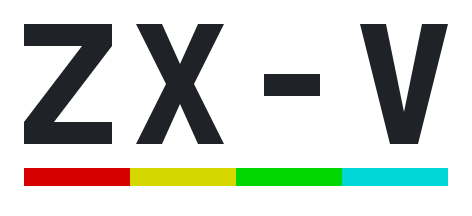

**English** · [Español](README.es.md)

<h1 align="center">
  <picture>
    <source media="(prefers-color-scheme: dark)" srcset="docs/images/logo-dark.svg">
    
  </picture>
</h1>

A 32-bit hobby computer inspired by the ZX Spectrum. It is not a Spectrum
clone or a Spectrum emulator: it is a new machine that keeps the spirit of the
original — switch it on and you are in BASIC, ready to type a program.

- **The Spectrum's 15 colours, without colour clash:** every pixel has its own
  colour.
- **A BASIC compatible with Sinclair BASIC** (as far as is reasonable), with a
  full-screen editor and many extensions: structured loops, procedures,
  sprites, tile maps, scrolling, music and files.
- **Sound** from two AY-3-8912 chips and the beeper.
- **An SD card** instead of the tape: it also loads the Spectrum's `.TAP` and
  `.TZX` files. Examples and games come built in, on the `ROM:` drive.
- **Native programs in C** for its RISC-V CPU — the equivalent of Z80 machine
  code games — with an SDK, and BASIC compiled with
  [ZX Basic](docs/en/zxbasic.md).
- **An emulator** for Windows, Linux and the web browser.
- **Real hardware** built with two Raspberry Pi Pico 2 boards: one is the CPU,
  the other the "ULA" (video and sound).

> **Status:** the emulator and the ROM with BASIC work. The firmware of each
> Pico has been tested on its own, on a protoboard, but the two Picos have not
> yet been tested working together. The printed circuit board is designed but
> has not been manufactured yet.

## Try it

**In your browser:** [cronomantic.github.io/ZX-V](https://cronomantic.github.io/ZX-V/),
nothing to install.

**On your computer:** download the latest version from
[**Releases**](https://github.com/cronomantic/ZX-V/releases):

| Package | What it is |
|---|---|
| `zxv-windows-x64.zip` | The emulator for Windows, with the ROM and the examples |
| `zxv-linux-x86_64.tar.gz` and the `.AppImage` | The emulator for Linux |
| `zxv-web.zip` | The web version: unzip it and open `index.html` (no server needed) |
| `zxv-uf2.zip` | The firmware for the two Picos of the real machine |

Open it and you are in BASIC. Type this, pressing Enter after each line:

```
10 FOR i=1 TO 8: CIRCLE INK i;128,88,i*10: NEXT i
RUN
```

Then try `CAT "ROM:"` to see the built-in examples and games... or start with
the [getting started guide](docs/en/getting-started.md).

## Documentation

| | |
|---|---|
| [Getting started](docs/en/getting-started.md) | From zero to your first program |
| [Learn BASIC](docs/en/basic/README.md) | A course from scratch, step by step |
| [BASIC reference](docs/en/basic/reference.md) · [The editor](docs/en/basic/editor.md) | Every statement and function |
| [Native programs (SDK)](docs/en/sdk/README.md) | Programming the machine in C |
| [Compiling BASIC](docs/en/zxbasic.md) | ZX Basic, with a target for ZX-V |
| [The emulator](docs/en/emulator.md) | The desktop and web versions, options |
| [The machine](docs/en/machine.md) | Screen, colours, sound, memory and files |
| [Build the hardware](docs/en/hardware/README.md) | The board, assembly and firmware |

All of it is also in Spanish: [docs/es](docs/es/README.md).

## How it is made

```
┌────────── Pico 2 "CPU" ──────────┐   8-bit link + clock   ┌────────── Pico 2 "ULA" ──────────┐
│ the ROM: BASIC and the system    │───────────────────────►│ video: HDMI / DVI                │
│ your programs                    │   sound line           │ sound: two AY chips + beeper     │
│ USB keyboard, mouse and gamepads │───────────────────────►│        over HDMI and line out    │
│ SD card, clock                   │◄───────────────────────│                                  │
└──────────────────────────────────┘   frame sync, return   └──────────────────────────────────┘
```

For software there is a single machine; that it is made of two chips is a
detail of the hardware, and the emulator implements the same machine in one
program.

## What is here

| | |
|---|---|
| [`sdk/`](sdk) | The SDK for native programs in C, with its examples and four complete games in C. MIT licence ([`sdk/LICENSE`](sdk/LICENSE)): your programs can have any licence |
| [`examples/`](examples) | Games in BASIC (`basic/`) and one in compiled BASIC with ZX Basic (`zxbasic/stardust`). MIT licence ([`examples/LICENSE`](examples/LICENSE)) |
| [`docs/`](docs) | The documentation, in English and Spanish. CC BY 4.0 licence ([`docs/LICENSE`](docs/LICENSE)), the same as `dev/`; its code examples are public domain |
| [`dev/`](dev) | The technical specification of the machine ([`spec.md`](dev/spec.md)) and of its BASIC ([`basic.md`](dev/basic.md)), in Spanish: memory map, registers, the ROM API, file formats |
| [Releases](https://github.com/cronomantic/ZX-V/releases) | The emulator, the ROM and the firmware, as binaries. Free, and you can pass them on unchanged and free of charge: the terms are in [`TERMS.txt`](TERMS.txt) |

The source code of the emulator, the ROM and the firmware is not public. The
packages say in their `THIRD_PARTY_NOTICES.txt` what they contain that belongs
to others, with the texts of those licences.
