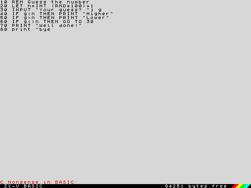
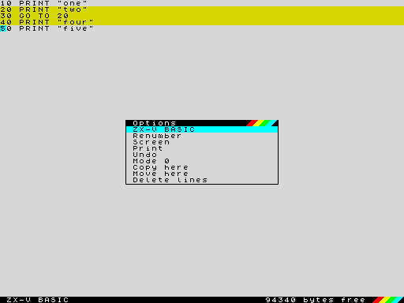
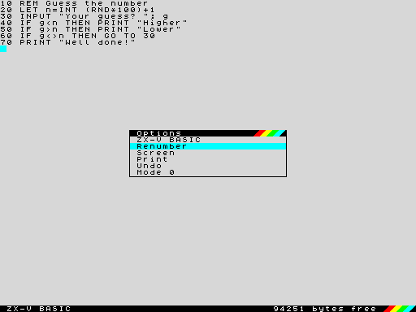
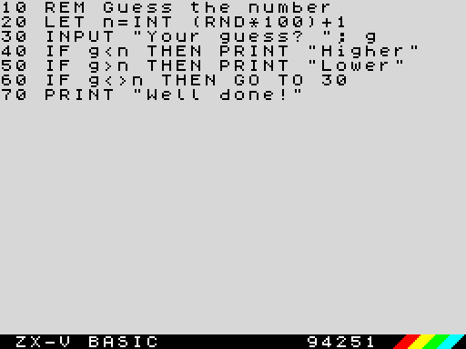

**English** · [Español](../../es/basic/editor.md)

# The editor

When you switch on ZX-V you are in the **editor**, where you type and change
BASIC programs and give commands. This page explains how it works and what
every key does. For the BASIC language itself, see the
[BASIC course](README.md) and the [reference](reference.md).

## The two screens

ZX-V shows two different screens:

- The **editor screen**, the one above: your program listed in 64 columns
  (or 32, in [mode 0](#the-editor-in-mode-0)), with an empty line at the end
  for typing new lines and commands. At the bottom there is a **status line**
  for messages and a black **bar** with `ZX-V BASIC`, the free memory in
  bytes and the coloured stripes.
- The **program screen**, where programs run and commands show their results
  (with `PRINT`, `PLOT` and so on), in the program's own mode and colours.

When you run a command or a program, ZX-V switches to the program screen.
When it ends, the report (for example `0 OK, 0:1`) stays at the bottom of the
program screen until you press a key; then you are back in the editor. The
key you press is not lost: it counts as typed in the editor, so you can
start typing the next line straight away.

## Typing a line

The cursor is a blinking cyan block. Type as on any computer: letters,
digits, symbols (with Shift, as your keyboard shows them) and spaces.

**Keywords are typed letter by letter**, in upper or lower case: `print`,
`Print` and `PRINT` are the same. When the line is stored, ZX-V shows it
again with the keywords in capitals and its own spacing: typing
`10 goto 20` gives `10 GO TO 20`. Variable names keep the case you typed.

A keyword must not run into the letters or digits that follow it:
`GO TO 20` and `PRINT"hi"` are fine, but `GOTO20` is not read as `GO TO 20`.
When in doubt, leave a space.

You can type the characters with codes 32 to 127 (including `£` and `©`, if
your keyboard has them). Letters with an accent, a diaeresis, a tilde or a
cedilla are typed without it (`é` becomes `e`, `ñ` becomes `n`, `ç` becomes
`c`), and `¿` and `¡` become `?` and `!`; other characters do nothing. Block
graphics and user-defined graphics are written with `CHR$` (see the
[character set](reference.md#character-set)). A line can be up to 1024
characters long; long lines continue on the next rows of the screen.

> **If you know the Spectrum:** the editor works like the one of the
> +2/128K: you edit the listing in place, there are no K, L and E modes, and
> the EDIT key opens the options menu. The keys are those of a PC keyboard,
> without CAPS SHIFT and SYMBOL SHIFT.

## Program lines and direct commands

What happens when you press **Enter** depends on how the line starts:

- **With a number** (from 1 to 9999), it is a **program line**: it is
  stored in the program, in its place by number, and nothing runs yet. If a
  line with that number already existed, it is replaced.
- **Without a number**, it is a **direct command**: it runs at once, on the
  program screen. For example `PRINT 2+2`, `RUN`, `SAVE "game"` or `CLS`.

Before storing or running anything, ZX-V checks the line. If there is a
mistake, you hear a short buzz, the cursor jumps to where the problem is and
the status line shows what is wrong in red (usually `C Nonsense in BASIC`).
Nothing is stored or run until you fix it, as in the picture at the top of
this page.

After storing a line, the cursor goes to the start of the next line of the
listing, or to the empty line at the end.

## Moving around and changing lines

The whole listing can be edited in place: move the cursor to a line, change
it, and press Enter.

| Key | What it does |
|---|---|
| ← → | Move one character. At the start or end of a line, go to the line before or after |
| ↑ ↓ | Move up or down one row, through the listing |
| Home, End | Go to the start or the end of the line |
| Ctrl+Home | Go to the first line of the program |
| Ctrl+End | Go to the empty line at the end |
| Page Up, Page Down | Go ten lines up or down |
| Ctrl+← , Ctrl+→ | Go to the previous or next word |
| Backspace | Delete the character to the left of the cursor |
| Delete | Delete the character under the cursor; with the cursor in a [block](#blocks-of-lines), delete the block |
| Enter | Store the line (or run the command) |
| Esc | Undo the changes made to this line (if there are none, unmark the block); while a program runs, it is BREAK |
| Tab | EDIT: open the options menu |
| Shift+↑ ↓ | Mark a [block of lines](#blocks-of-lines) |
| F3 | [Find](#find-and-replace-find-and-replace) the last thing you searched for again |

Some useful things:

- **Leaving a changed line stores it.** If you change a line and move to
  another one with the cursor keys, the line is stored as if you had pressed
  Enter. If it has a mistake, the cursor stays on it until you fix it or
  press Esc.
- **To undo** the changes to the line you are on, press Esc: the line goes
  back to how it was.
- **To delete a line**, type its number alone on the empty line and press
  Enter (`30` deletes line 30). To delete several, use
  [`DELETE`](reference.md#delete).
- **To copy a line**, change its number: the line is stored with the new
  number and the old one stays where it was.
- **To run a line as a command**, delete its number and press Enter: the text
  runs as a direct command, and the program line stays as it was.
- Pressing Enter on a line you have not changed just moves to the next line.

The empty line at the end keeps what you type even if you move up to look at
the listing and come back.

**The listing indents itself:** whatever is inside a `FOR`, `WHILE`,
`REPEAT`, `DEF PROC`, `SELECT CASE` or a [block IF](reference.md#if-then-else)
shows two spaces further right for each level, and `ELSE` and `CASE` one level
less. The spaces are not stored (they take no memory), so there is no need to
type them: when the line is stored, the editor indents it. `LIST` and the
`.bas` files written by `SAVE` look the same.

## Running a program

- `RUN` runs the program from the start (it first deletes the variables);
  `RUN 100` runs it from line 100. `GO TO 100` also runs it from line 100,
  keeping the variables.
- Press **BREAK (the Esc key)** to stop a program. The report is
  `L BREAK into program`, and [`CONTINUE`](reference.md#continue) carries on
  from where it stopped.
- When a program fills the screen, it stops and asks `scroll?`: any key goes
  on, and N, Space or Esc stop it.
- The report at the bottom says how the program ended and where (see
  [Reports](reference.md#reports)): `0 OK, 70:1` means it ended normally,
  at statement 1 of line 70.

## Finding a line: LIST and EDIT

In a long program, Page Up and Page Down go ten lines at a time, and
Ctrl+Home and Ctrl+End take you to the start and the end. To go straight to a
line, type one of these as a command:

- `LIST 200` puts the cursor on line 200 (or the next one that exists), ready
  to edit it. `LIST` alone goes to the start.
- `EDIT 200` does the same; `EDIT` alone goes to the last line you stored.

To see the listing on the program screen instead, as on the Spectrum, use
`LIST #2`. `LLIST` sends it to the printer file.

## Numbering lines: AUTO, RENUM, DELETE

- [`AUTO`](reference.md#auto) gives you line numbers automatically: after
  `AUTO`, the empty line already starts with the next number (the last line
  plus 10), and each time you press Enter the next number appears. `AUTO
  100, 5` starts at 100 and goes up in fives. It ends when you press Enter on
  a line with only the number, press Esc, or move to another line.
- [`RENUM`](reference.md#renum) renumbers the whole program in tens (or
  `RENUM 1000, 5`, from 1000 in fives), and corrects the numbers after
  `GO TO`, `GO SUB`, `RESTORE`, `RUN`, `LIST`, `LLIST` and `LINE`. Line numbers
  worked out by the program, as in `GO TO n*10`, are not corrected; labels
  ([`@name`](reference.md#label)) never need it.
- [`DELETE 100, 190`](reference.md#delete) deletes lines 100 to 190.

These three work only as direct commands.

## Blocks of lines

To copy, move or delete several lines at once, mark them first:

1. Put the cursor on the first line and press **Shift+↓** (or Shift+↑ to go
   upwards). That line and the next are marked, and each time you press it
   again one more line is marked. Marked lines show in yellow.
2. Move the cursor to where you want the block and press **EDIT (Tab)**. With
   a block marked, the menu has three more options:

| Option | What it does |
|---|---|
| Copy here | Copies the lines of the block after the cursor line (on the empty line at the end, to the end of the program) |
| Move here | The same, but removes them from where they were. A `GO TO`, `GO SUB`, `RESTORE`... that pointed to a moved line now points to its new number |
| Delete lines | Deletes the block, like Delete |

The copied or moved lines get numbers between the cursor line and the next
one, in tens if they fit (closer together if not). If there are not enough
free numbers for all of them, the program is first renumbered in tens, as with
`RENUM`. When copying, the line numbers inside the copied lines do not change:
they still point to the same lines as before.

To **delete** the block, put the cursor on one of its lines and press Delete:
the status line asks `Delete 3 lines? (Y/N)`, and only Y deletes them.
**Esc** unmarks the block without doing anything.

## Find and replace: FIND and REPLACE

- [`FIND "text"`](reference.md#find) moves the cursor to the next program line
  where the text appears, starting with the line after the cursor and going
  round to the start at the end. The cursor lands right on the text. Upper and
  lower case are the same: `FIND "print"` finds the `PRINT`s.
- **F3** finds the same text again, from the cursor. So does `FIND` on its
  own.
- [`REPLACE "old", "new"`](reference.md#replace) changes the text in the whole
  program. Each changed line is checked as if you had typed it: if it would
  have a mistake, it is left alone. The status line says how many changes were
  made (`5 changes`), and in red how many lines were left unchanged.

Both search the listing as you see it, keywords, quoted text and `REM`s
included, but not the line numbers.

## Undo

The **Undo** option in the EDIT menu undoes the last change to the program: a
line stored or deleted, a block copied, moved or deleted, and also `REPLACE`,
`RENUM`, `DELETE`, `NEW`, `LOAD` and `MERGE`. Used again, it redoes what it
undid. If the cursor line is half changed, it first just puts it back as it
was, like Esc.

To be able to undo, the editor keeps a copy of the program in free memory,
without taking it from anyone. If a program later needs that memory (with a
large `DIM`, for example), the copy is lost and the status line says
`Nothing to undo`. With a very large program, which leaves no room for the
copy, undo is not possible either.

## The options menu (EDIT)

Press **EDIT (the Tab key)** to open the options menu in the middle of the
screen:

Choose with ↑ and ↓ and press Enter. Esc or Tab close the menu without doing
anything.

| Option | What it does |
|---|---|
| ZX-V BASIC | Closes the menu and goes back to the editor |
| Renumber | Renumbers the program in tens from 10, like `RENUM`. The status line says `Program renumbered`, or `Cannot renumber` if the numbers would go past 9999 or there is not enough memory |
| Screen | Shows the program screen (what the last program or command left there) until you press a key |
| Print | Sends the listing to the printer, the file `printer.txt` on the SD card, like `LLIST`. The status line says `Listing sent to the printer` |
| Undo | Undoes the last change to the program: see [Undo](#undo) |
| Mode 0 / Mode 1 | Switches the editor to the other mode: see [The editor in mode 0](#the-editor-in-mode-0) |
| Copy here, Move here, Delete lines | Only with a block marked: see [Blocks of lines](#blocks-of-lines) |

Renumber and Print work with the stored program: if the line you are on has
been changed, it is stored first (and if it has a mistake, the menu closes so
that you can fix it).

## The editor in mode 0

The editor starts in screen mode 1: 64 columns and 46 rows for the listing,
in small letters. The **Mode 0** option in the EDIT menu switches it to mode
0, like the 128K's: **32 columns and 22 rows**, with letters twice as big,
easier to read on a TV or from a distance. Long lines carry on in the rows
below, as in mode 1, and the bar at the bottom only shows the free memory
(without "bytes free"). In mode 0 the same option is called **Mode 1** and
puts it back as it was.

The editor's mode has nothing to do with your programs' (`MODE`): each one
uses its own screen. It stays after `NEW`, and when the machine is reset the
editor goes back to mode 1.

## The status line

The line just above the bar shows:

| Message | When |
|---|---|
| `© 2026 Cronomantic  ZX-V 0.6.0` | When ZX-V starts, and after `NEW`: the copyright and the ROM version |
| An error in red, such as `C Nonsense in BASIC` | When a line you tried to store or run has a mistake |
| `Program renumbered`, `Cannot renumber` | After the Renumber option |
| `Listing sent to the printer` | After the Print option |
| `3 lines copied`, `3 lines moved`, `3 lines deleted` | After copying, moving or deleting a block |
| `The cursor is in the block`, `No room for the lines` | When the block cannot be copied or moved there |
| `Not found` | After `FIND` or F3, if the text is not in the program |
| `5 changes`, `, 2 lines not changed (error)` | After `REPLACE` |
| `Change undone`, `Nothing to undo` | After the Undo option |

The message disappears with the next key you press. The bar under it always
shows the free memory: the program and its variables share about 96 KB.

## Saving and loading

Programs are kept on the SD card. From the editor:

- `SAVE "game"` saves the program as `game.tap`. `SAVE "game" LINE 10` saves
  it so that it runs by itself from line 10 when loaded.
- `LOAD "game"` loads it, replacing the program in memory.
- `CAT` lists the files of the current folder, and `CAT "ROM:"` the examples
  that come with ZX-V; `LOAD "ROM:hello"` runs one of them.
- `MERGE "game"` adds the lines of a saved program to the one you have.
- `OPEN #4, "game.txt" OUT: LIST #4: CLOSE #4` writes the listing as a text
  file, to read it on a computer.

`NEW` deletes the program, and loading a native program (`.zxv`) also clears
BASIC when it ends: save your work first. All the details are in the
reference, under [Files and the SD card](reference.md#files-and-the-sd-card).

## The language of the editor

The bar, the menu, the messages and the error reports are in English or
Spanish, the language of the machine. Change it with `LANGUAGE "es"` or
`LANGUAGE "en"` (see [LANGUAGE](reference.md#language)); the emulator also
has an option for it (see [the emulator](../emulator.md)).
