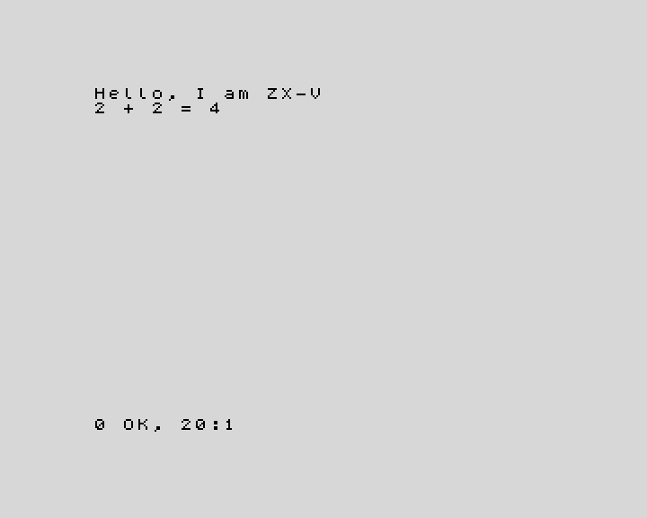

**English** · [Español](../../../es/basic/tutorial/01-first-steps.md)

# 1. First steps

**In this chapter you will learn** what a program is, how to type one, how to
run it and how to change it. You will meet your first keywords: `PRINT`,
`RUN`, `GO TO`, `REM` and `NEW`.

You need ZX-V in front of you: the real machine or the emulator. If you have
not started it yet, [Getting started](../../getting-started.md) explains how.
When it starts, you see a light grey screen with a black bar at the bottom.
That bar belongs to the **editor**, the place where you type.

## Commands: the machine does it now

Type this and press **Enter**:

```
PRINT "Hello"
```

The screen changes and shows the word `Hello`. At the bottom you see a
message like `0 OK, 0:1`: it means "everything went well". Press any key to go
back to the editor.

`PRINT` is a **keyword**: a word the machine understands. It writes on the
screen whatever comes after it. Text goes between double quotes (`"`).
Numbers and sums do not need them:

```
PRINT 2+2
```

This writes `4`. You can type keywords in capitals or in small letters, as you
like; when you press Enter the machine shows them in capitals.

What you just typed are **commands**: lines without a number, which the
machine carries out as soon as you press Enter, and then forgets.

## Programs: the machine remembers

A **program** is a list of lines that the machine keeps, to carry them out
later. Each program line starts with a **line number**. Type these two lines,
pressing **Enter** after each one:

```
10 PRINT "Hello, I am ZX-V"
20 PRINT "2 + 2 = ";2+2
```

This time nothing happens on the screen: the lines go into the **listing**,
the program kept in the editor. To run the program, type the command `RUN`
and press Enter. You see:



The machine has carried out line 10, then line 20, always in the order of
the line numbers. The `;` in line 20 joins two things on the same line of
the screen: the text and the result of the sum.

The message at the bottom, `0 OK, 20:1`, says that the program finished
without problems, and where: at line 20, statement 1. Press a key to go back
to the editor, where your program is still there. (That key is also typed
into the editor; if it was a letter, just delete it with **Backspace**.)

Why go up in tens? So that there is room for new lines in between: if you
later want something between lines 10 and 20, you can number it 15.

## The editor in two minutes

The editor works like a small word processor. These keys are all you need
for now:

| Key | What it does |
|---|---|
| **Enter** | Stores the line (or runs it, if it has no number) |
| Arrow keys | Move the cursor through the listing |
| **Backspace**, **Delete** | Erase to the left of the cursor, or under it |
| **Ctrl+End** | Takes you to the empty line at the end, where new lines are typed |
| **Esc** | Undoes the changes to the line you are on. While a program runs, it stops it: this is the **BREAK** key |
| **Tab** | The **EDIT** key: opens the editor's menu |

To **change** a line, move up to it with the arrow keys, fix it and press
**Enter**. You can also type it again, with the same number: the new one
replaces the old one.

To **add** a line, type it with its number on the empty line at the bottom
of the listing. The editor puts it in its place, ordered by number. After
Enter, the cursor goes to the line that follows the one you typed; press
**Ctrl+End** to go back to the empty line.

To **delete** a line, type just its number and press Enter.

To erase the whole program and start again, type `NEW`.

If a line has a mistake, the machine makes a buzz when you press Enter, leaves
the cursor where the problem is and shows a message in red above the bar,
such as `C Nonsense in BASIC`. Fix it and press Enter again.

The [editor guide](../editor.md) explains everything else: the menu, how to
renumber, and more keys.

## A program that never stops

Type `NEW` to start afresh, then this program:

```
10 PRINT "ZX-V ";
20 GO TO 10
```

`GO TO 10` sends the program back to line 10, so it repeats forever. The `;`
at the end of line 10 means "do not start a new line": the next `PRINT`
goes on the same line. Type `RUN` and the screen fills up.

When the screen is full, the machine asks `scroll?` at the bottom. Press any
key to see one more screenful. To stop the program, press **Esc** (BREAK).
The message `D BREAK - CONT repeats, 10:1` tells you that you stopped it at
line 10.

## Errors

The machine tells you when something goes wrong. Try this program (remember
`NEW` first):

```
10 PRINT "Your score:"
20 PRINT score
```

Run it. Line 10 works, but then you get `2 Variable not found, 20:1`. Every
error message has a code (`2`), a description and the place: line 20,
statement 1. Here, the machine does not know what `score` is. You will learn
to fix that in the next chapter.

Errors do no harm: your program is still there, and you can fix it and run
it again.

## Notes for yourself: `REM`

A line that starts with `REM` (from "remark") is ignored by the machine. Use
it to explain what your program does:

```
10 REM My first program
20 PRINT "Hello"
```

## Try it

1. Write a program that prints your name on one line and your city on the
   next one.
2. Change the program from "A program that never stops" so that it prints
   your name instead of `ZX-V`. Then delete the `;` at the end of line 10
   and run it again. What changes?

<details>
<summary>Hint</summary>

For the first one, use two lines, each with its own `PRINT`. For the second,
move up to line 10 with the arrow keys, change the text between quotes and
press Enter. Without the `;`, each `PRINT` starts a new line.

</details>

---

**Reference:** [`PRINT`](../reference.md#print), [`RUN`](../reference.md#run),
[`GO TO`](../reference.md#go-to), [`REM`](../reference.md#rem),
[`NEW`](../reference.md#new), [Error messages](../reference.md#error-messages).

**Next:** [2. Variables and maths](02-variables-and-maths.md) ·
[Back to the course](../README.md)
