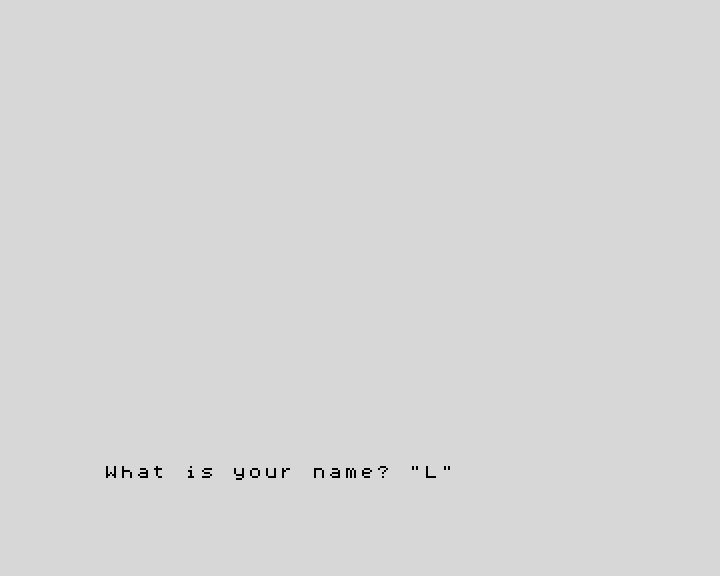

**English** · [Español](../../../es/basic/tutorial/03-text-and-input.md)

# 3. Text and input

**In this chapter you will learn** to keep text in **string variables**, to
join and cut text, and to ask the person at the keyboard with `INPUT`.

## Strings

A piece of text is called a **string**. You already used strings: everything
between double quotes, like `"Hello"`. Strings can be kept in variables too.
Their names are a single letter followed by `$` (say "a-string"): `a$`,
`n$`, `t$`.

```
10 LET a$="ZX"
20 LET b$="Spectrum"
30 LET c$=a$+" "+b$
40 PRINT c$
50 PRINT LEN c$
60 PRINT c$(1 TO 2)
70 PRINT c$(4 TO )
80 PRINT c$(4)
```

This prints:

```
ZX Spectrum
11
ZX
Spectrum
S
```

- `+` **joins** strings: line 30 builds `"ZX Spectrum"`.
- `LEN` gives the **length**, the number of characters (spaces count).
- `c$(1 TO 2)` takes a **slice**: from character 1 to character 2.
  `c$(4 TO )` goes from 4 to the end, and `c$(4)` is just character 4.

There are only 26 string variables, one per letter, so choose letters that
remind you of what they hold: `n$` for a name, `w$` for a word.

## Numbers and text

A number and a string are different things: `"42"` is two characters, `42`
is a number. These functions turn one into the other:

| Function | What it does | Example | Result |
|---|---|---|---|
| `STR$` | number to string | `STR$ 42` | `"42"` |
| `VAL` | string to number | `VAL "2*3+1"` | `7` |
| `CODE` | the code of the first character | `CODE "A"` | `65` |
| `CHR$` | the character with that code | `CHR$ 66` | `"B"` |

```
10 LET n=42
20 LET t$=STR$ n
30 PRINT "The number has ";LEN t$;" digits"
40 PRINT VAL "2*3+1"
50 PRINT CODE "A",CHR$ 66
```

Every character has a code: `A` is 65, `B` is 66, and so on. You will use
`CODE` again when you read the keyboard in chapter 11.

## Asking questions: `INPUT`

`INPUT` stops the program and waits for the person to type something and
press Enter. Whatever they type goes into a variable:

```
10 INPUT "What is your name? ";n$
20 INPUT "How old are you? ";age
30 PRINT "Hello, ";n$
40 PRINT "In ten years you will be ";age+10
```

The question appears at the bottom of the screen, followed by a flashing
cursor:



If the variable is a string (`n$`), the cursor appears between quotes, to
remind you that the answer is text: type it without the quotes, they are
already there. Any text is fine. If it is a number
(`age`), type a number: the machine works out what you type as if it were a
sum, so `30+6` also gives 36. Words are a problem there: typing `ten`, for
example, stops the program with `2 Variable not found`, because the machine
thinks `ten` is the name of a variable.

## Try it

1. Ask for a first name and a surname, and print the initials: with "Grace"
   and "Hopper" the program prints `Your initials: GH`.
2. Ask for a word and print how many letters it has.

<details>
<summary>Hint</summary>

Character 1 of `f$` is `f$(1)`. For the second exercise, `LEN` does the
counting.

</details>

<details>
<summary>A solution for the first one</summary>

```
10 INPUT "First name? ";f$
20 INPUT "Surname? ";s$
30 PRINT "Your initials: ";f$(1);s$(1)
```

</details>

---

**Reference:** [Strings](../reference.md#strings),
[`LEN`](../reference.md#len), [`STR$`, `VAL`](../reference.md#str-val-val),
[`CHR$`, `CODE`](../reference.md#chr-code),
[`INPUT`](../reference.md#input).

**Next:** [4. Decisions](04-decisions.md) ·
**Previous:** [2. Variables and maths](02-variables-and-maths.md)
