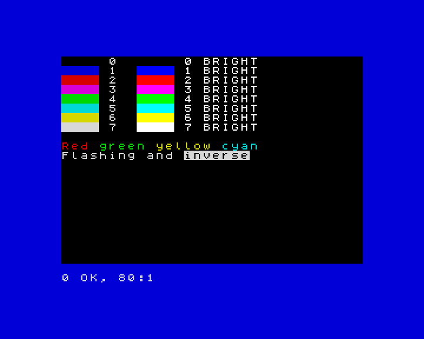

**English** · [Español](../../../es/basic/tutorial/08-colours-and-the-screen.md)

# 8. Colours and the screen

**In this chapter you will learn** to use the machine's colours with `INK`,
`PAPER`, `BORDER` and `BRIGHT`, to make text flash, to write anywhere on the
screen with `PRINT AT` and `TAB`, and to switch to the high-resolution mode
with `MODE`.

## The colours

ZX-V has the colours of the ZX Spectrum. There are eight, numbered 0 to 7,
and each one has a brighter version:

| Number | Colour | Number | Colour |
|---|---|---|---|
| 0 | black | 4 | green |
| 1 | blue | 5 | cyan |
| 2 | red | 6 | yellow |
| 3 | magenta | 7 | white |

Every character on the screen has two colours: the **ink** (the colour of
the letter) and the **paper** (the background behind it). Around the screen
there is a frame, the **border**.

- `INK n` chooses the colour of what you write and draw.
- `PAPER n` chooses the background colour.
- `BORDER n` paints the frame at once.
- `CLS` clears the screen and fills it with the paper colour.
- `BRIGHT 1` makes the colours brighter (`BRIGHT 0` goes back to normal).

```
10 BORDER 1: PAPER 0: INK 7: CLS
20 FOR c=0 TO 7
30 PRINT PAPER c;"    ";PAPER 0;" ";c;"  ";
40 PRINT BRIGHT 1;PAPER c;"    ";PAPER 0;" ";c;" BRIGHT"
50 NEXT c
60 PRINT
70 PRINT INK 2;"Red ";INK 4;"green ";INK 6;"yellow ";INK 5;"cyan"
80 PRINT FLASH 1;"Flashing";FLASH 0;" and ";INVERSE 1;"inverse"
```



On its own line, `INK 2` changes the colour for everything that comes after.
Inside a `PRINT`, like in lines 30 to 80, it only changes the colour of that
`PRINT`: the next one goes back to the colours you had.

Two more effects:

- `FLASH 1` makes the text swap its ink and paper about three times a
  second.
- `INVERSE 1` swaps ink and paper: the text appears as a hole in a block of
  colour.

A useful trick for messages that stand out:

```
10 PAPER 7: INK 0: CLS
20 PRINT AT 10,8; PAPER 2; INK 7;" GAME OVER "
30 PRINT AT 12,8; INK 1;"Score: "; INK 2;1250
```

**If you know the Spectrum:** on ZX-V every pixel has its own colour, so
there is no *colour clash*: drawing in one colour never changes the colour
of the pixels next to it.

## Writing anywhere: `PRINT AT`

The screen is a grid of 32 columns and 24 rows of characters. The program
can write on the top 22 rows, numbered 0 to 21; the bottom two belong to
`INPUT` and to the messages. `PRINT AT row,column;` moves to that place
before writing:

```
10 PAPER 1: INK 6: CLS
20 PRINT AT 0,0;"Top left"
30 PRINT AT 10,12;"Middle"
40 PRINT AT 21,20;"Bottom right"
50 PRINT AT 5,0;"Name";TAB 16;"Score"
60 PRINT AT 6,0;"Ada";TAB 16;"120"
```

Rows go down from 0 at the top; columns go right from 0 at the left. A row
or column outside the screen gives `5 Out of screen`.

`TAB n` jumps to column `n` of the current line: it is handy for tables.

With `PRINT AT` and random numbers you can fill the night sky with stars:

```
10 BORDER 0: PAPER 0: CLS
20 FOR i=1 TO 300
30 PRINT AT INT (RND*22),INT (RND*32); INK INT (RND*7)+1;"*";
40 NEXT i
```

## High resolution: `MODE 1`

So far you have used **mode 0**: 256 × 192 pixels, like the Spectrum. ZX-V
has a second mode with twice as many pixels across and down: **mode 1**, 512
× 384 pixels, with 64 columns and 48 rows of smaller characters.

```
10 MODE 1
20 PRINT "Mode 1 has 64 columns and 48 rows of text."
30 PRINT AT 45,50;"Bottom corner"
40 PLOT 0,0: DRAW 511,367
```

`MODE` clears the screen. In mode 1 the program can use rows 0 to 45. Line
40 draws a line across the whole screen (you will learn `PLOT` and `DRAW` in
the next chapter). To go back to the normal mode, type `MODE 0`.

## Try it

1. Write your name in the middle of the screen in yellow on blue, with a
   red border.
2. Draw a chessboard of 8 × 8 squares, each square two characters wide and
   one row high, alternating black and white paper.

<details>
<summary>Hint</summary>

For the chessboard, use two `FOR` loops, one for rows and one for columns.
The square in row `r` and column `c` is white when `r+c` is even:
`INT ((r+c)/2)=(r+c)/2`. Print two spaces with `PAPER 7` or `PAPER 0` at
`AT r,c*2`.

</details>

<details>
<summary>A solution for the second one</summary>

```
10 BORDER 1: PAPER 1: CLS
20 FOR r=0 TO 7
30 FOR c=0 TO 7
40 LET p=7*(INT ((r+c)/2)=(r+c)/2)
50 PRINT AT r+7,c*2+8; PAPER p;"  "
60 NEXT c
70 NEXT r
```

Line 40 uses the fact that a true condition is 1 and a false one is 0, so `p`
is 7 (white) or 0 (black).

</details>

---

**Reference:** [Colours](../reference.md#colours),
[`INK`, `PAPER`](../reference.md#ink-paper), [`BORDER`](../reference.md#border),
[`BRIGHT`, `FLASH`](../reference.md#bright-flash),
[`INVERSE`, `OVER`](../reference.md#inverse-over),
[`PRINT`](../reference.md#print), [`CLS`](../reference.md#cls),
[`MODE`](../reference.md#mode).

**Next:** [9. Drawing](09-drawing.md) ·
**Previous:** [7. Procedures](07-procedures.md)
