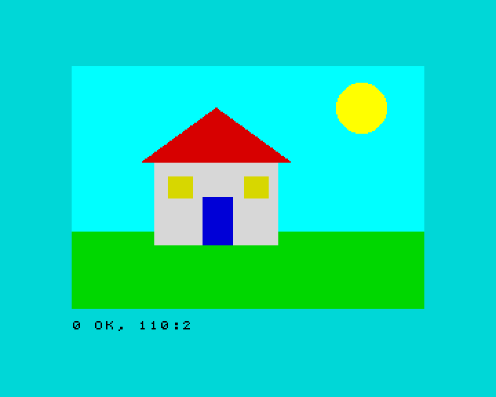

**English** · [Español](../../../es/basic/tutorial/09-drawing.md)

# 9. Drawing

**In this chapter you will learn** to draw points, lines, circles and arcs
with `PLOT`, `DRAW` and `CIRCLE`, and filled shapes with `BOX`, `DISC` and
`POLY`.

## Pixels and coordinates

The screen is made of tiny dots called **pixels**: 256 across and 192 down
in mode 0. To draw, you say which pixel with two numbers, its
**coordinates**: `x` (how far to the right) and `y`.

For `PLOT`, `DRAW` and `CIRCLE`, the point (0,0) is the **bottom left**
corner, and `y` grows upwards, as in maths class. `x` goes from 0 to 255 and
`y` from 0 to 175 (the bottom two rows of characters are kept for messages).

## `PLOT`, `DRAW` and `CIRCLE`

- `PLOT x,y` lights the pixel at (x,y).
- `DRAW dx,dy` draws a line from the last point to a point `dx` pixels to
  the right and `dy` pixels up. The numbers are **relative**: they say how
  far to move, not where to go. Negative numbers go left or down.
- `CIRCLE x,y,r` draws a circle with its centre at (x,y) and radius `r`.

```
10 PLOT 0,0
20 PLOT 255,175
30 PLOT 128,88
40 PLOT 20,150: DRAW 100,0: DRAW 0,-50: DRAW -100,50
50 CIRCLE 200,60,30
```

Lines 10 to 30 light three pixels: two corners and the middle. Line 40 draws
a triangle: from (20,150), 100 to the right, 50 down, and back to the
start.

You can give a colour to each drawing, as with `PRINT`:

```
10 BORDER 0: PAPER 0: CLS
20 FOR i=1 TO 7
30 CIRCLE INK i;128,88,i*12
40 NEXT i
```

```
10 PAPER 0: CLS
20 FOR x=0 TO 255 STEP 8
30 PLOT INK 6;x,0: DRAW INK 4;255-x,175
40 NEXT x
```

## Arcs

`DRAW` with a third number draws an **arc** instead of a straight line. The
number is how much it turns, in radians: `PI` is half a turn. Positive
numbers bend one way and negative ones the other:

```
10 PLOT 50,100: DRAW 150,0,PI
20 PLOT 50,120: DRAW 150,0,-PI/2
```

## Curves with maths

`SIN` gives the height of a wave. Plot one point for each `x` and you get a
curve:

```
10 FOR x=0 TO 255
20 PLOT x,88+60*SIN (x/128*2*PI)
30 NEXT x
```

## Filled shapes: `BOX`, `DISC` and `POLY`

ZX-V adds commands that draw **filled** shapes, very fast. They are part of
the graphics for games that you will use in chapter 12, and they work a bit
differently:

- The colour comes first, as a number from 0 to 15: 0 to 7 are the normal
  colours and 8 to 15 their bright versions (10 is bright red, 14 bright
  yellow).
- The coordinates start at the **top left** corner and `y` grows
  **downwards**, like the rows of `PRINT AT`. `y` goes from 0 to 191.

| Command | Draws |
|---|---|
| `BOX c,x,y,w,h` | A filled rectangle with its top left corner at (x,y), `w` wide and `h` high |
| `DISC c,x,y,r` | A filled circle with its centre at (x,y) and radius `r` |
| `POLY c,x1,y1,x2,y2,x3,y3...` | A filled polygon with those corners (up to 64) |

This program shows the difference between the two ways of counting `y`:

```
10 PAPER 0: CLS
20 PLOT INK 7;10,10: DRAW INK 7;235,0
30 BOX 2,10,10,40,30
40 PRINT AT 21,0; INK 7;"BOX at 10,10"
```

The line from `PLOT 10,10` is near the bottom; the red box at 10,10 is at the
top.

With a few filled shapes you can paint a whole picture:

```
10 BORDER 5: PAPER 5: CLS
20 REM sky and grass
30 BOX 13,0,0,256,120
40 BOX 4,0,120,256,56
50 REM the sun
60 DISC 14,210,30,18
70 REM the house
80 BOX 7,60,70,90,60
90 POLY 2,50,70,105,30,160,70
100 BOX 1,95,95,22,35
110 BOX 6,70,80,18,16: BOX 6,125,80,18,16
```



The roof is a `POLY` with three corners: the two ends of the eaves and the
top. Shapes drawn later go on top of earlier ones, so the windows and the
door are drawn after the wall.

## Try it

1. Draw a target: five filled circles, one inside the other, alternating red
   and white.
2. Add a tree to the house picture: a brown trunk is not possible (there is
   no brown), so use a yellow `BOX` for the trunk and a green `DISC` for the
   leaves.

<details>
<summary>Hint</summary>

For the target, draw the biggest circle first, with a `FOR` loop that goes
down in size: `FOR i=5 TO 1 STEP -1`. The colour can be worked out from `i`:
red (2) when `i` is odd and white (7) when it is even.

</details>

<details>
<summary>A solution for the first one</summary>

```
10 PAPER 0: CLS
20 FOR i=5 TO 1 STEP -1
30 LET c=2: IF INT (i/2)=i/2 THEN LET c=7
40 DISC c,128,88,i*15
50 NEXT i
```

</details>

---

**Reference:** [`PLOT`](../reference.md#plot), [`DRAW`](../reference.md#draw),
[`CIRCLE`](../reference.md#circle), [`BOX`](../reference.md#box),
[`DISC`](../reference.md#disc), [`POLY`](../reference.md#poly),
[Colours](../reference.md#colours).

**Next:** [10. Sound and music](10-sound-and-music.md) ·
**Previous:** [8. Colours and the screen](08-colours-and-the-screen.md)
