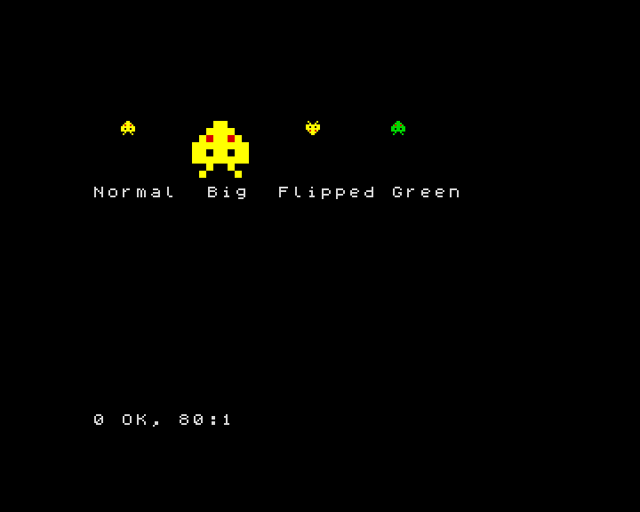
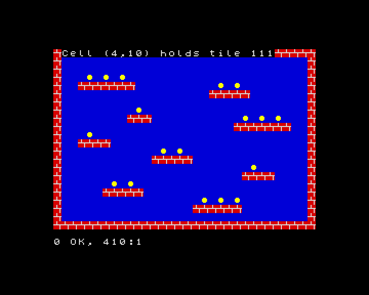

**English** · [Español](../../../es/basic/tutorial/12-sprites-and-tile-maps.md)

# 12. Sprites and tile maps

**In this chapter you will learn** to create **sprites** (small pictures
that move over the background) with `GRAB` and draw them with `SPRITE`, to
animate without flicker using the two screen pages, to detect collisions
with `HIT`, and to build levels with **tiles** and **maps**: `TILE`,
`MAP DIM`, `MAP POKE`, `MAP` and `CELL`.

These commands are ZX-V's graphics for games. They are fast: a BASIC loop can
draw a few hundred small sprites in each frame.

Like `BOX` in chapter 9, they count coordinates in pixels from the **top
left** corner, with `y` growing downwards, and they use the colour numbers
0 to 15.

## Making a sprite from a string

The easiest way to create a sprite is to draw it with characters. Each
character is one pixel: a digit from `0` to `9` or a letter from `a` to `f`
is a colour (`a` is 10, `b` 11... `f` 15), and any other character, like
`.`, is transparent: the background shows through.

```
10 BORDER 0: PAPER 0: INK 7: CLS
20 LET s$="...ee..."+"..eeee.."+".e2ee2e."+"eeeeeeee"+"ee.ee.ee"+"eeeeeeee"+"..e..e.."+".e....e."
30 GRAB 0,8,s$
40 SPRITE 0,16,20
50 SPRITE 0,56,20,0,"",32,32
60 SPRITE 0,120,20,2
70 SPRITE 0,168,20,0,"0123456789abcd4f"
80 PRINT AT 7,0;"Normal  Big  Flipped Green"
```



- `GRAB 0,8,s$` creates sprite number 0, 8 pixels wide, from the string. The
  string has 64 characters: 8 rows of 8, one after the other. Here `e` is
  bright yellow (14) and `2` is red.
- `SPRITE n,x,y` draws sprite `n` with its top left corner at (x,y).
- A fourth number flips it: 1 left to right, 2 upside down, 3 both.
- A string in fifth place changes its colours: the colour `i` is drawn as the
  character in position `i` of the string (counting from 0). In line 70, the
  `4` in position 14 turns bright yellow into green.
- Two more numbers stretch it to that width and height (line 50).

You can have up to 256 sprites, numbered 0 to 255.

## Moving without flicker

To move a sprite you draw it again in its new place, after rubbing out the
old picture. If you do it on the screen you are looking at, you will see the
moment when it is rubbed out: the picture flickers. The trick is to draw on a
hidden screen and show it when it is ready.

ZX-V has two screen **pages**, 0 and 1. `SCREEN n` chooses the page where
things are drawn; `PAGE n` chooses the page you see. So:

```
10 BORDER 0: PAPER 0: INK 7: CLS
20 LET s$="...ee..."+"..eeee.."+".e2ee2e."+"eeeeeeee"+"ee.ee.ee"+"eeeeeeee"+"..e..e.."+".e....e."
30 GRAB 0,8,s$
40 LET x=0: LET s=1
50 REPEAT
60 SCREEN s
70 BOX 1,0,0,256,192
80 SPRITE 0,x,88
90 PAGE s: LET s=1-s
100 WAIT 1
110 LET x=x+2
120 UNTIL x>248
130 SCREEN 0: PAGE 0
```

`s` is the hidden page. Each turn draws the whole picture there (a blue
background and the sprite), shows it with `PAGE s`, and swaps: `LET s=1-s`
turns 1 into 0 and 0 into 1, so the next picture is drawn on the other page.
`WAIT 1` keeps the speed steady at 50 pictures a second. At the end, line
130 leaves everything on page 0, the normal one.

## Sprites from a drawing, and collisions

`GRAB` can also copy a sprite from something drawn on the screen: `GRAB
n,x,y,w,h,t` takes the rectangle of `w` × `h` pixels at (x,y), and colour
`t` becomes transparent.

`HIT(a,ax,ay,b,bx,by)` gives 1 if sprite `a` drawn at (ax,ay) and sprite `b`
at (bx,by) touch each other: if any of their visible pixels overlap.

```
10 BORDER 0: PAPER 0: INK 7: CLS
20 GRAB 0,8,"...ee..."+"..eeee.."+".e2ee2e."+"eeeeeeee"+"ee.ee.ee"+"eeeeeeee"+"..e..e.."+".e....e."
30 DISC 3,8,8,7: GRAB 1,0,0,16,16,0
40 LET x=0: LET s=1
50 REPEAT
60 SCREEN s: BOX 0,0,0,256,192
70 SPRITE 1,200,84
80 SPRITE 0,x,88
90 PAGE s: LET s=1-s: WAIT 1
100 LET x=x+2
110 UNTIL HIT(0,x,88,1,200,84)
120 SCREEN 0: PAGE 0
130 BEEP 0.2,-10
140 PRINT AT 0,0;"Crash at x=";x
```

Line 30 draws a magenta disc in the corner and grabs it as sprite 1, with
black (0) as transparent, so only the disc is kept. The loop moves sprite 0
until it touches the disc.

## Tiles and maps

Platform and maze games are built from small square pictures repeated many
times: bricks, grass, coins. Each little picture is a **tile**, and a **map**
says which tile goes in each square of the level.

- `TILE 8,n,x,y` copies the 8 × 8 pixels at (x,y) of the screen as tile
  number `n`. (Tiles can also be 16 × 16: `TILE 16,...`.)
- `MAP DIM m,w,h` creates map number `m` (0 to 15), `w` squares wide and `h`
  high.
- `MAP POKE m,x,y,a$` fills squares of the map from (x,y) to the right, one
  per character: each character puts the tile whose number is its code. So
  if tile 35 is a brick, `#` (code 35) means a brick.
- `MAP m` draws the map on the screen.
- `CELL(m,x,y)` tells you which tile is in square (x,y): this is how a game
  knows whether there is a wall or a coin.

```
10 BORDER 0: PAPER 0: INK 7: CLS
20 REM Tile 32 (a space): sky
30 BOX 1,0,0,8,8: TILE 8,32,0,0
40 REM Tile 35 (#): brick
50 BOX 2,0,0,8,8: BOX 7,0,3,8,1: BOX 7,3,0,1,3: BOX 7,6,4,1,4: TILE 8,35,0,0
60 REM Tile 111 (o): coin
70 BOX 1,0,0,8,8: DISC 14,3,3,2: TILE 8,111,0,0
80 MAP DIM 0,32,22
90 FOR y=0 TO 21: READ r$: MAP POKE 0,0,y,r$: NEXT y
100 MAP 0
110 PRINT AT 0,1;"Cell (4,10) holds tile ";CELL(0,4,10)
200 DATA "################################"
210 DATA "#                              #"
220 DATA "#                              #"
230 DATA "#   o o o                      #"
240 DATA "#  #######          o o        #"
250 DATA "#                  #####       #"
260 DATA "#                              #"
270 DATA "#         o                    #"
280 DATA "#        ###           o o o   #"
290 DATA "#                     #######  #"
300 DATA "#   o                          #"
310 DATA "#  ####                        #"
320 DATA "#            o o               #"
330 DATA "#           #####              #"
340 DATA "#                       o      #"
350 DATA "#                      ####    #"
360 DATA "#      o o                     #"
370 DATA "#     #####                    #"
380 DATA "#                 o o o        #"
390 DATA "#                ######        #"
400 DATA "#                              #"
410 DATA "################################"
```



The level is drawn in the `DATA` lines, almost as you see it. Square (4,10)
has an `o`, so `CELL` gives 111, the coin. To pick up a coin, a game puts a
space in its square with `MAP POKE 0,x,y," "` and draws the map again.

## Scrolling

A map can be bigger than the screen. `MAP m,mx,my,x,y,w,h` draws the part of
the map that starts at pixel (mx,my) of the map, in the rectangle (x,y,w,h)
of the screen. Change `mx` little by little and the level scrolls:

```
10 BORDER 0: PAPER 0: INK 7: CLS
20 BOX 1,0,0,8,8: TILE 8,32,0,0
30 BOX 2,0,0,8,8: BOX 7,0,3,8,1: BOX 7,3,0,1,3: BOX 7,6,4,1,4: TILE 8,35,0,0
40 CLS
50 MAP DIM 0,64,2,8,1
60 MAP POKE 0,0,0,"   ##      ###          #####        ##   ###         ####      "
70 MAP POKE 0,0,1,"################################################################"
80 LET cx=0: LET s=1
90 REPEAT
100 SCREEN s: MAP 0,cx,0,0,100,256,16
110 PAGE s: LET s=1-s: WAIT 1
120 LET cx=cx+2: IF cx=512 THEN LET cx=0
130 UNTIL INKEY$<>""
140 SCREEN 0: PAGE 0
```

In `MAP DIM 0,64,2,8,1`, the 8 is the size of the tiles and the final 1 makes
the map **repeat** in both directions: after the last column comes the first
one again, so the scroll never ends. Press a key to stop it.
Line 120 takes `cx` back to 0 when it reaches 512, the width of the map
(64 tiles of 8 pixels): since the map repeats, nothing changes on the
screen, and the number never grows too big.

## Keeping your graphics

Sprites, tiles and maps stay in memory after the program ends, and also
after `RUN`; `NEW` deletes them. To save them all in a file on the SD card,
use `SAVE "name" GRAPHICS`, and `LOAD "name" GRAPHICS` brings them back.

Drawing big sprites with strings is slow work. You can draw them on your PC
with any paint program and convert the pictures with the `png2gfx` tool:
the [SDK guide](../../sdk/README.md) explains how.

## Try it

1. Make a sprite of your own, 8 × 8, and move it diagonally across the
   screen.
2. In the tile map program, add a sprite that you move with the keys (as in
   chapter 11), and print the number of the tile under it with `CELL`.

<details>
<summary>Hint</summary>

For the second, the square under the point (x,y) of the screen is
`(INT (x/8),INT (y/8))`, because the tiles are 8 pixels wide. Remember to
draw the map again (`MAP 0`) each time before the sprite, so that the old
sprite disappears, and use the two pages to avoid flicker.

</details>

---

**Reference:** [Sprites, tile maps and fast graphics](../reference.md#sprites-tile-maps-and-fast-graphics),
[`GRAB`](../reference.md#grab), [`SPRITE`](../reference.md#sprite),
[`HIT`](../reference.md#hit), [`TILE`](../reference.md#tile),
[`MAP DIM`, `MAP POKE`](../reference.md#map-dim-map-poke),
[`MAP`](../reference.md#map), [`CELL`](../reference.md#cell),
[`PAGE`, `SCREEN`](../reference.md#page-screen).

**Next:** [13. Files and the SD card](13-files-and-the-sd-card.md) ·
**Previous:** [11. Keyboard and joystick](11-keyboard-and-joystick.md)
