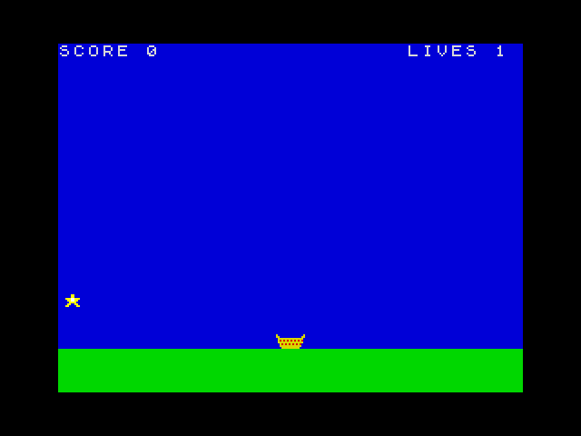

**English** · [Español](../../../es/basic/tutorial/14-a-complete-game.md)

# 14. A complete game

**In this chapter you will** put together everything you have learnt and
write a whole game, step by step: *Star Catcher*. Stars fall from the sky
and you catch them with a basket. Each star is worth 10 points, and they
fall faster as your score grows. Miss three and the game is over. The best
score is kept on the SD card.



You will build it in five steps. After each step the program runs, so you
can see how it grows and find mistakes early. Each step shows only the lines
that are new or that change: type them, and keep the ones you already have.

## The plan

Before typing, it helps to think about the pieces:

- **The graphics**: two sprites, the basket (16 × 8 pixels) and the star
  (8 × 8).
- **The state of the game**, in variables: the basket's position `px`; the
  star's position `sx`, `sy` and speed `sp`; `score` and `lives`.
- **The game loop**, repeated 30 times a second: read the controls and move
  the basket, move the star, check whether it has been caught or has reached
  the ground, and draw everything.
- **Around the loop**: a title screen, the end of the game, and the best
  score.

Each piece will be a procedure, so the main program will be short.

## Step 1: the graphics and the scene

```
10 REM Star Catcher
20 BORDER 0: PAPER 0: INK 7: CLS
50 PROC graphics
80 LET px=120: LET sx=124: LET sy=8: LET score=0: LET lives=3: LET s=1: PROC drawall
1000 REM --- Graphics ---
1010 DEF PROC graphics
1020 LET b$="6..............6"+"66............66"+".66666666666666."
1030 LET b$=b$+".62626262626262."+".66666666666666."+"..626262626262.."
1040 LET b$=b$+"..666666666666.."+"...6666666666..."
1050 GRAB 0,16,b$
1060 LET t$="...ee..."+"...ee..."+"eeeffeee"+".eeffee."
1070 LET t$=t$+"..eeee.."+".ee..ee."+"ee....ee"+"........"
1080 GRAB 1,8,t$
1090 END PROC
4400 DEF PROC drawall
4410 SCREEN s
4420 BOX 1,0,0,256,168: BOX 4,0,168,256,24
4430 SPRITE 1,sx,sy
4440 SPRITE 0,px,160
4450 PRINT AT 0,0; PAPER 1;"SCORE ";score;AT 0,24;"LIVES ";lives
4460 PAGE s: LET s=1-s: WAIT 2
4470 END PROC
```

- `graphics` creates the sprites from strings, as in chapter 12. In the
  basket, `6` is yellow and `2` red; the star is bright yellow (`e`) with a
  white centre (`f`).
- `drawall` draws a complete picture on the hidden page `s`: the blue sky,
  the green ground, the star, the basket and the score line, then shows it
  and waits two frames with `WAIT 2`. That gives 30 pictures a second.
- Line 80 gives the variables some values just to try `drawall`. Run it: you
  see the scene, still.

## Step 2: moving the basket

Now the game loop. Replace line 80 and add these lines:

```
40 DEF FN b(j,n)=INT (j/2^n)-2*INT (j/2^(n+1))
80 PROC game
3000 REM --- One game ---
3010 DEF PROC game
3020 LET score=0: LET lives=3: LET px=120: LET s=1: LET vol=0
3040 PROC newstar
3050 REPEAT
3060 PROC moveplayer
3100 PROC drawall
3120 UNTIL lives=0
3140 END PROC
4000 REM --- Pieces of the game ---
4010 DEF PROC moveplayer
4020 LET j=JOY 0
4030 IF KEY CODE "o" OR KEY 8 OR FN b(j,1) THEN LET px=px-4
4040 IF KEY CODE "p" OR KEY 9 OR FN b(j,0) THEN LET px=px+4
4050 IF px<0 THEN LET px=0
4060 IF px>240 THEN LET px=240
4070 END PROC
4100 DEF PROC newstar
4110 LET sx=INT (RND*248): LET sy=8
4120 LET sp=2+INT (score/50): IF sp>8 THEN LET sp=8
4130 END PROC
```

- The procedure `game` sets everything up and repeats the loop until there
  are no lives left. For now nothing takes lives away, so it never ends:
  press **Esc** to stop it. (`vol` will be used for the sound in step 4.)
- `moveplayer` reads the keys **O** and **P**, the cursor keys and the
  joystick (with the function `FN b` from chapter 11, defined in line 40),
  and keeps the basket inside the screen: the screen is 256 pixels wide and
  the basket 16, so `px` goes from 0 to 240.
- `newstar` puts a star at a random place at the top. Its speed `sp` grows
  with the score: 2 pixels per picture at the start, one more every 50
  points, up to 8.

Run it and move the basket from side to side.

## Step 3: falling stars

```
30 RANDOMIZE
3070 LET sy=sy+sp
3080 IF HIT(0,px,160,1,sx,sy) THEN PROC caught
3090 IF sy>168 THEN PROC missed
4200 DEF PROC caught
4210 LET score=score+10
4230 PROC newstar
4240 END PROC
4300 DEF PROC missed
4310 LET lives=lives-1
4330 PROC newstar
4340 END PROC
```

- Line 3070 makes the star fall.
- Line 3080 uses `HIT` to see whether the star touches the basket: if it
  does, `caught` adds 10 points and throws a new star.
- If the star reaches the ground (`sy>168`), `missed` takes a life away and
  throws a new star.
- `RANDOMIZE`, in line 30, makes the stars fall in a different place each
  game.

Now it is a game: after three misses the loop ends, and the program with it.

## Step 4: sound and the end of the game

```
3030 SOUND 7,62
3110 IF vol>0 THEN LET vol=vol-1: SOUND 8,vol
3130 PROC gameover
4220 SOUND 0,60;1,0;8,15: LET vol=15
4320 SOUND 0,0;1,3;8,15: LET vol=15
5000 REM --- Game over ---
5010 DEF PROC gameover
5020 SOUND 8,0: SCREEN 1-s
5030 PRINT AT 10,11; PAPER 2; INK 7;" GAME OVER "
5050 PLAY "T160O4 3gfedc5c"
5060 PAUSE 100
5070 END PROC
```

- The sounds use voice A of the sound chip, as in chapter 10. Line 3030
  turns on its tone. A catch plays a high note and a miss a low one, both at
  full volume (`8,15`), and `vol` remembers the volume.
- Line 3110 lowers the volume a little in every turn of the loop, so each
  sound fades out by itself in a fraction of a second, without stopping the
  game. `BEEP` would have frozen the game while it played.
- `gameover` turns the sound off, writes *GAME OVER* on the page that is
  being shown (the one that is not `s`), plays a sad tune and waits two
  seconds, or until a key is pressed.

## Step 5: title screen and best score

The last step adds a title screen and keeps the best score in a file, as in
chapter 13:

```
60 LET best=0: PROC loadbest
70 @title: PROC title
90 GO TO @title
2000 REM --- Title screen ---
2010 DEF PROC title
2020 SCREEN 0: PAGE 0: CLS
2030 PRINT AT 4,9; INK 6; BRIGHT 1;"STAR CATCHER"
2040 SPRITE 1,124,56
2050 PRINT AT 10,4;"Catch the falling stars!"
2060 PRINT AT 13,3;"O and P, or the cursor keys"
2070 PRINT AT 15,8; INK 5;"Best score: ";best
2080 PRINT AT 19,5; FLASH 1;" Press any key to play "
2090 PLAY "T180O5 3ceg5C"
2100 PAUSE 0
2110 END PROC
5040 IF score>best THEN LET best=score: PROC savebest: PRINT AT 12,10; PAPER 1; INK 6;" New record! "
6000 REM --- The best score, in a file ---
6010 DEF PROC loadbest
6020 ON ERROR GO TO 6040
6030 OPEN #4,"stars.txt" IN: INPUT #4;best
6040 ON ERROR GO TO 0: CLOSE #4
6050 END PROC
6100 DEF PROC savebest
6110 ON ERROR GO TO 6130
6120 OPEN #4,"stars.txt" OUT: PRINT #4;best
6130 ON ERROR GO TO 0: CLOSE #4
6140 END PROC
```

- The main program now goes round and round: title, game, title...
- `title` uses page 0 and waits for a key with `PAUSE 0`, which also forgets
  any key pressed during the last game.
- `loadbest` and `savebest` read and write the best score in the file
  `stars.txt`. Thanks to `ON ERROR`, if the file does not exist, or there is
  no card, the game just starts with a best score of 0.

To stop the game, press **Esc**. Save it with `SAVE "stars" LINE 10`, so that
`LOAD "stars"` starts it by itself.

## The whole program

Here is the complete listing, to check yours against it:

```
10 REM Star Catcher
20 BORDER 0: PAPER 0: INK 7: CLS
30 RANDOMIZE
40 DEF FN b(j,n)=INT (j/2^n)-2*INT (j/2^(n+1))
50 PROC graphics
60 LET best=0: PROC loadbest
70 @title: PROC title
80 PROC game
90 GO TO @title
1000 REM --- Graphics ---
1010 DEF PROC graphics
1020 LET b$="6..............6"+"66............66"+".66666666666666."
1030 LET b$=b$+".62626262626262."+".66666666666666."+"..626262626262.."
1040 LET b$=b$+"..666666666666.."+"...6666666666..."
1050 GRAB 0,16,b$
1060 LET t$="...ee..."+"...ee..."+"eeeffeee"+".eeffee."
1070 LET t$=t$+"..eeee.."+".ee..ee."+"ee....ee"+"........"
1080 GRAB 1,8,t$
1090 END PROC
2000 REM --- Title screen ---
2010 DEF PROC title
2020 SCREEN 0: PAGE 0: CLS
2030 PRINT AT 4,9; INK 6; BRIGHT 1;"STAR CATCHER"
2040 SPRITE 1,124,56
2050 PRINT AT 10,4;"Catch the falling stars!"
2060 PRINT AT 13,3;"O and P, or the cursor keys"
2070 PRINT AT 15,8; INK 5;"Best score: ";best
2080 PRINT AT 19,5; FLASH 1;" Press any key to play "
2090 PLAY "T180O5 3ceg5C"
2100 PAUSE 0
2110 END PROC
3000 REM --- One game ---
3010 DEF PROC game
3020 LET score=0: LET lives=3: LET px=120: LET s=1: LET vol=0
3030 SOUND 7,62
3040 PROC newstar
3050 REPEAT
3060 PROC moveplayer
3070 LET sy=sy+sp
3080 IF HIT(0,px,160,1,sx,sy) THEN PROC caught
3090 IF sy>168 THEN PROC missed
3100 PROC drawall
3110 IF vol>0 THEN LET vol=vol-1: SOUND 8,vol
3120 UNTIL lives=0
3130 PROC gameover
3140 END PROC
4000 REM --- Pieces of the game ---
4010 DEF PROC moveplayer
4020 LET j=JOY 0
4030 IF KEY CODE "o" OR KEY 8 OR FN b(j,1) THEN LET px=px-4
4040 IF KEY CODE "p" OR KEY 9 OR FN b(j,0) THEN LET px=px+4
4050 IF px<0 THEN LET px=0
4060 IF px>240 THEN LET px=240
4070 END PROC
4100 DEF PROC newstar
4110 LET sx=INT (RND*248): LET sy=8
4120 LET sp=2+INT (score/50): IF sp>8 THEN LET sp=8
4130 END PROC
4200 DEF PROC caught
4210 LET score=score+10
4220 SOUND 0,60;1,0;8,15: LET vol=15
4230 PROC newstar
4240 END PROC
4300 DEF PROC missed
4310 LET lives=lives-1
4320 SOUND 0,0;1,3;8,15: LET vol=15
4330 PROC newstar
4340 END PROC
4400 DEF PROC drawall
4410 SCREEN s
4420 BOX 1,0,0,256,168: BOX 4,0,168,256,24
4430 SPRITE 1,sx,sy
4440 SPRITE 0,px,160
4450 PRINT AT 0,0; PAPER 1;"SCORE ";score;AT 0,24;"LIVES ";lives
4460 PAGE s: LET s=1-s: WAIT 2
4470 END PROC
5000 REM --- Game over ---
5010 DEF PROC gameover
5020 SOUND 8,0: SCREEN 1-s
5030 PRINT AT 10,11; PAPER 2; INK 7;" GAME OVER "
5040 IF score>best THEN LET best=score: PROC savebest: PRINT AT 12,10; PAPER 1; INK 6;" New record! "
5050 PLAY "T160O4 3gfedc5c"
5060 PAUSE 100
5070 END PROC
6000 REM --- The best score, in a file ---
6010 DEF PROC loadbest
6020 ON ERROR GO TO 6040
6030 OPEN #4,"stars.txt" IN: INPUT #4;best
6040 ON ERROR GO TO 0: CLOSE #4
6050 END PROC
6100 DEF PROC savebest
6110 ON ERROR GO TO 6130
6120 OPEN #4,"stars.txt" OUT: PRINT #4;best
6130 ON ERROR GO TO 0: CLOSE #4
6140 END PROC
```

## Make it yours

Some ideas to go further:

- Add a second kind of star, in another colour, worth 50 points.
- Add a bomb that you must **not** catch: it takes a life away.
- Give an extra life every 500 points.
- Make the basket faster or slower, or let the player choose the difficulty
  on the title screen.
- Draw a background with tiles: a few clouds, or a city at night.

## Where to go now

You have finished the course. To see how far ZX-V BASIC can go, look at the
platform game in `examples/basic/platformer`: a robot runs through a level
of five screens with scrolling, collects coins, jumps over spikes and stomps
on the creatures. Its [guide](../../../../examples/basic/platformer/README.md)
explains how it is made, and it uses everything you have seen here. You can
play it from the `ROM:` drive: `CD "ROM:"` and `LOAD "platformer"`.

From now on, the [BASIC reference](../reference.md) has every keyword with
all its details, and the [editor guide](../editor.md) all the tricks of the
editor. When BASIC is not fast enough, the [SDK](../../sdk/README.md) lets
you write native programs in C.

---

**Reference:** [Sprites, tile maps and fast graphics](../reference.md#sprites-tile-maps-and-fast-graphics),
[`SOUND`](../reference.md#sound), [`KEY`](../reference.md#key),
[`JOY`](../reference.md#joy), [`ON ERROR`](../reference.md#on-error).

**Previous:** [13. Files and the SD card](13-files-and-the-sd-card.md) ·
[Back to the course](../README.md)
