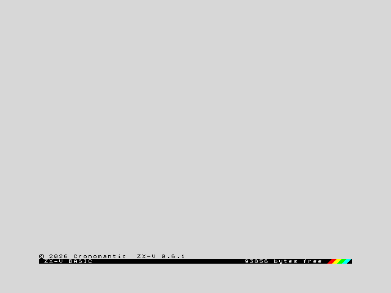
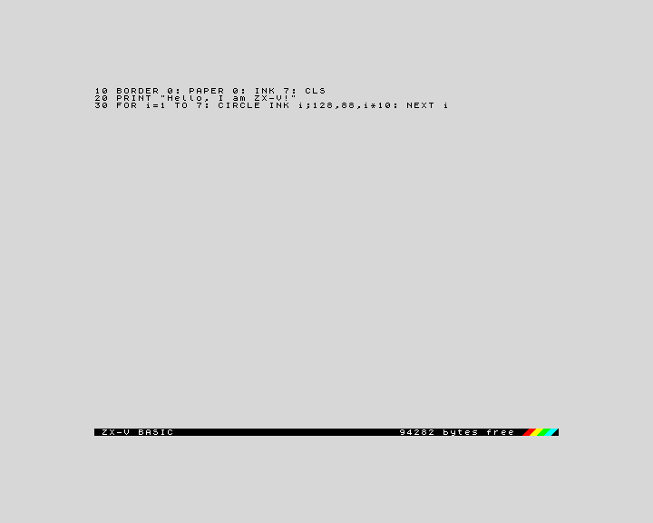
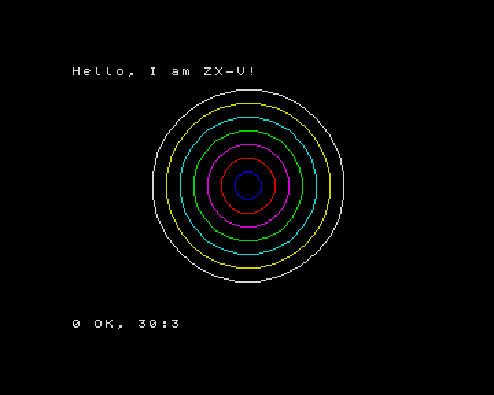

**English** · [Español](../es/getting-started.md)

# Getting started

This page takes you from nothing to typing and running your first program in
about five minutes. You do not need to know anything about the ZX Spectrum or
about programming.

## What is ZX-V?

ZX-V is a small 32-bit home computer, new but in the spirit of the 1980s
ZX Spectrum. Like the computers of that time, you switch it on and it is ready
for you to type: it starts straight into **BASIC**, a simple programming
language. It has 15 bright colours, two music chips, an SD card for your files,
and it can also run fast programs written in C.

ZX-V is both a real machine, built from two Raspberry Pi Pico 2 boards, and an
emulator that runs the very same software on your PC or in your browser.
Everything on this page works the same in all of them.

## Choose how to use it

| Option | What you need | Best for |
|---|---|---|
| **Desktop emulator** (`zxv`) | A PC with Windows (64-bit) or Linux (x86-64) | Most people: programming, playing, developing |
| **Web version** | A modern browser (Chrome, Edge, Firefox...) | Trying it without installing anything, or putting it on a website |
| **Real hardware** | The ZX-V board (or a protoboard), two Pico 2, a USB keyboard and an HDMI screen | The full experience; see [Build the hardware](hardware/README.md) |

## Download

Everything is on the project's GitHub page, under
[**Releases**](https://github.com/cronomantic/ZX-V/releases). The latest
release has these packages:

| File | What it is |
|---|---|
| `zxv-windows-x64.zip` | The emulator for Windows |
| `ZX-V-…-x86_64.AppImage` | The emulator for Linux (x86-64) in a single file, with everything inside |
| `zxv-linux-x86_64.tar.gz` | The emulator for Linux (x86-64), using your system's Qt and SDL |
| `zxv-web.zip` | The web version |
| `zxv-uf2.zip` | The firmware for the two Picos of the real machine (see [The firmware](hardware/firmware.md)) |

**Windows:** unzip `zxv-windows-x64.zip` anywhere (for example on your
desktop) and double-click `zxv.exe`. Nothing else needs installing.

**Linux:** the easiest is the AppImage: make it executable and open it
(`chmod +x ZX-V-*.AppImage`, then double-click it or run
`./ZX-V-*.AppImage`). It brings Qt and SDL inside and works on most
distributions from 2022 onwards (Ubuntu 22.04, Debian 12, Fedora 36...). The
other programs of the package run through it too:
`./ZX-V-*.AppImage zxv-cli --help`. If it complains about FUSE (in a container,
for example), add `--appimage-extract-and-run`.

Or unpack the archive (`tar xzf zxv-linux-x86_64.tar.gz`) and run
`zxv-linux/zxv`. It needs Qt 6 and SDL 2, which most desktops already have; on
Debian or Ubuntu:

```sh
sudo apt install libqt6widgets6 libsdl2-2.0-0
```

**Web version:** unzip `zxv-web.zip` and double-click `index.html`. It works
straight from your disk, without a web server.

The Windows and Linux packages also bring this documentation, to read offline:
open `docs/index.html`, or **Help > Documentation** in the emulator.


## The first boot

Open the emulator. After a moment you see this:



That is all: a light grey screen, a copyright line, and a black bar at the
bottom. The bar is the BASIC **editor**: *ZX-V BASIC* on the left, and on the
right how much memory is free for your program (about 96,000 bytes). The
coloured stripes are a tribute to the Spectrum 128.

The first time you open `zxv`, it also creates a folder called **ZX-V** in your
*Documents* folder and copies the example programs into it. That folder is the
machine's **SD card**: everything you save goes there. More about it
[below](#saving-and-loading-your-programs).

The emulator's own menus and the machine's messages can be in English or in
Spanish: choose in **Options > Language**. In the web version, it is
**View > Options...**.

## Your first program

A program is a list of numbered lines. Type this line exactly as it is and
press **Enter**:

```
10 BORDER 0: PAPER 0: INK 7: CLS
```

The line moves up into the listing, and the keywords (`BORDER`, `PAPER`...) are
shown in capital letters. You can type them in capitals or in small letters,
as you prefer: just type every word letter by letter, as on any computer.

Now type the other two lines, pressing **Enter** after each one:

```
20 PRINT "Hello, I am ZX-V!"
30 FOR i=1 TO 7: CIRCLE INK i;128,88,i*10: NEXT i
```

Your screen should look like this:



If you make a mistake, move the cursor with the arrow keys and fix it as in a
text editor: **Backspace** and **Delete** erase, **Enter** stores the line
again. If a line has an error, the machine makes a buzzing sound and leaves the
cursor where the problem is.

Now type `RUN` and press **Enter**. The program runs:



Line 10 paints the border and the background black and chooses white for the
text, line 20 writes a message, and line 30 draws seven circles, one in each
colour. The message at the bottom, `0 OK, 30:3`, means the program ended
without errors, at line 30, statement 3. Press a key to go back to the
editor, where your program is still waiting. (That key is also typed into the
editor, so if it was a letter, just delete it.)

Some keys worth knowing from the start:

| Key | What it does |
|---|---|
| **Enter** | Store the line, or run a command typed without a line number |
| **Esc** | Stop a running program (this is the **BREAK** key); in the editor, undo the changes to the current line |
| **Tab** | The **EDIT** key: opens the editor's options menu (renumber, show the program's screen, print) |
| Arrow keys, Home, End, Page Up, Page Down | Move around the listing |

To try something different, type `NEW` and press **Enter**: it erases the
program so you can start again.

The [BASIC course](basic/README.md) starts from here and teaches you the
language step by step.

## The built-in examples: the `ROM:` drive

ZX-V comes with a read-only disk full of examples, the **`ROM:` drive** (on the
real machine it is stored inside the CPU Pico, so it is always there). To see
what is on it, type:

```
CAT "ROM:"
```

| File | What it is |
|---|---|
| `platformer.tap` and `platformer.gfx` | A platform game written in BASIC, and its graphics |
| `rps.bas` | Rock, Paper, Scissors in BASIC, as text: `LOAD "rps"` loads it and `LIST` shows it |
| `sentry.bas` | *Sentry*, defend the cities from the missiles with the mouse, the keyboard or a joystick, in BASIC |
| `estela.zxv` | *Estela*, a three-level space shooter |
| `route128.zxv` | *Route 128*, a race against the clock along a road with bends and blind crests |
| `muncher.bas` | *Muncher*, eat the dots in the maze without being caught by its four chasers, in BASIC |
| `cascade.bas` | *Cascade*, line up three gems of a colour before the well fills up, in BASIC (with `cascade.gfx`, `cascade.pt3` and `cascade.afb`) |
| `mine.zxv` | *The Mine*, dig and gather diamonds among falling boulders |
| `street.zxv` | *Street Justice*, brawling through the streets against the neighbourhood gangs |
| `umbra.zxv` | *Umbra*, a 3D maze in the dark |
| `keep.zxv` | *The Keep*, a four-floor dungeon adventure |
| `graphics.zxv` | A graphics demo: scrolling scenery, bouncing balls, a spinning star and a 3D floor |
| `scroll.zxv` | Smooth scrolling over a landscape four screens wide, with parallax |
| `digital.zxv` | Digitised sound played through the music chip |
| `hello.zxv` | The smallest example of a native program |
| `boardtest.zxv` | The board test: screen, clock, SD card, keyboard, gamepads, mouse and sound, one by one |
| `files.zxv` | A native program that creates, reads and lists files on the SD card |

The files ending in `.zxv` are **native programs**, written in C. Load one with
`LOAD`:

```
LOAD "ROM:graphics"
```


Press any key to go back to BASIC. Try `LOAD "ROM:estela"` too: it is a
complete game (arrow keys or O, P, Q, A to move, Space or M to fire, Esc to
quit).

BASIC games that load more files, like the platform game, find them on the
`ROM:` drive by themselves: `LOAD "ROM:platformer"`. You can also go into the
drive and load them from there:

```
CD "ROM:"
LOAD "platformer"
```

`CD "SD:"` takes you back to your SD card.

> When a native program ends, you are back in BASIC with the report `0 OK`
> (or a `W` report if the program ended with an error), but any BASIC program
> you had in memory is gone: the native program used that memory. Save your
> work first.

## Saving and loading your programs

Your programs are saved on the **SD card**. In the desktop emulator this is the
**ZX-V** folder in your *Documents* (you can choose another one in
**File > SD card**). To save the program in memory, give it a name:

```
SAVE "circles"
```

This creates the file `circles.tap` on the card. To see what is on the card,
type `CAT`. To load the program again later:

```
LOAD "circles"
```

You do not need to type the extension: `LOAD` looks for `circles.tap`, then for
`circles.zxv`, then for a file called just `circles`. The examples copied to the
card the first time can be loaded the same way, without `ROM:`:
`LOAD "estela"`.

File names can only use unaccented letters, digits and some symbols, up to 63
characters; capitals and small letters count as the same name.

In the desktop emulator, **File > Save program...** (Alt+G) does the same as
`SAVE` with a file dialog.

If you see `U No SD card`, the emulator is running without a card: choose one
in **File > SD card**.

## Opening files from your PC

You can open files from anywhere on your computer with **File > Open...**
(Alt+O), by dragging them onto the emulator window, or by naming them when you
start it (`zxv game.tap`):

| File | What happens |
|---|---|
| `.zxv` | A native program for ZX-V: it is loaded and run |
| `.tap`, `.tzx` | A tape file: it is loaded with `LOAD`, as on the machine. This is the format ZX-V uses for BASIC programs, and it also loads BASIC programs made for the ZX Spectrum |
| `.bas`, `.txt` | A BASIC listing as plain text: it is typed into the editor for you |
| `.zxvs` | A snapshot: the whole machine, exactly as it was when the snapshot was saved |
| `.img`, a folder | It becomes the SD card |

If the program is not on the SD card, the emulator asks whether to copy it to
the card or to use its folder as the card. See [The emulator](emulator.md) for
the details.

> **If you know the Spectrum:** Spectrum `.tap` and `.tzx` files with BASIC
> programs load and run, including multi-part tapes (a loader followed by
> `LOAD ""`). Z80 machine code, however, cannot run on ZX-V, so most commercial
> Spectrum games will not work.

## Where to go next

- **[Learn BASIC](basic/README.md)**: a course from scratch, ending with a
  complete game.
- **[The editor](basic/editor.md)** and the **[BASIC reference](basic/reference.md)**.
- **[The emulator](emulator.md)**: menus, keys, snapshots, the web version and
  all the options.
- **[The machine](machine.md)**: what ZX-V can do: screen, colours, sound,
  memory and files.
- **[Native programs (SDK)](sdk/README.md)**: write fast programs and games in C.
- **[Build the hardware](hardware/README.md)**: make your own real ZX-V.
