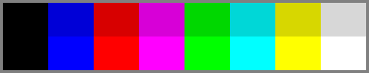
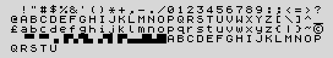

**English** · [Español](../es/machine.md)

# The machine

This page describes what ZX-V is like: what you see on the screen, what you
hear, how you control it, and how much room your programs have. It is the same
machine in the emulator and in the real hardware.

## At a glance

| | ZX-V |
|---|---|
| Processor | 32-bit RISC-V at 144 MHz |
| Memory | 520 KB of RAM in total; about 94 KB free for a BASIC program, and up to 248 KB for a native program |
| Screen | 256 × 192 or 512 × 384 pixels, with a border |
| Colours | 15, any colour on any pixel |
| Video pages | Two, to draw one while you show the other |
| Sound | Two AY-3-8912 music chips (6 voices) and a beeper, in stereo |
| Storage | SD card, plus the built-in `ROM:` drive with the examples |
| Input | USB keyboard, mouse and up to two gamepads |
| Clock | Date and time, kept while the machine is off |
| Languages | English and Spanish |
| Rhythm | 50 frames per second |
| Picture output | HDMI or DVI, 720 × 576 at 50 Hz or 640 × 480 at 60 Hz |

It starts straight into BASIC, and it also runs **native programs** written in
C for its processor (see the [SDK](sdk/README.md)).

## The screen

### Two resolutions

The screen has two **modes**. Each shows a rectangle of pixels (the *paper*)
surrounded by a coloured **border**:

| Mode | Pixels | Text (8 × 8 characters) | Used for |
|---|---|---|---|
| 0 | 256 × 192 | 32 columns × 24 rows | Programs and games: the classic resolution, with big pixels |
| 1 | 512 × 384 | 64 columns × 48 rows | Detailed graphics and lots of text. The BASIC editor uses it |

Both fill the same area of your TV: a mode 1 pixel is half the width and half
the height of a mode 0 pixel. In BASIC, `MODE 0` and `MODE 1` switch between
them. Your programs start in mode 0.

On a screen running at 640 × 480 a little of the border is cut off; the paper
is always seen whole.

### Colours

ZX-V has **15 colours**: eight colours at normal brightness and the same ones
bright (black is the same in both).

| Number | Colour | Number | Colour |
|---|---|---|---|
| 0 | Black | 8 | Black (bright) |
| 1 | Blue | 9 | Bright blue |
| 2 | Red | 10 | Bright red |
| 3 | Magenta | 11 | Bright magenta |
| 4 | Green | 12 | Bright green |
| 5 | Cyan | 13 | Bright cyan |
| 6 | Yellow | 14 | Bright yellow |
| 7 | White | 15 | Bright white |

Every pixel can have any of these colours, independently of its neighbours.

In BASIC, `INK` (the colour of text and drawings) and `PAPER` (the
background) take the colours 0 to 7 (8 and 9 have special meanings, explained
in the [reference](basic/reference.md)), and `BRIGHT 1` makes them bright; the
graphics commands for games (`BOX`, `DISC`, `SPRITE`...) use the numbers 0 to
15 directly. In those graphics, colour 8 means **transparent**: the pixels of a
sprite drawn in colour 8 let the background show through.

**Colour tables.** The machine can also *change how colours look* without
redrawing anything: a table says, for each of the 16 numbers, which colour is
shown. Programs use this for fades, flashing and colour-cycling effects (in
BASIC, `REMAP`). There are four such tables, and different parts of the screen
can use different ones.

### Two pages

The machine has **two video pages**, two complete screens in memory. One is
shown while the other can be drawn on, and switching between them is instant.
Games use this to draw each frame on the hidden page and then show it all at
once, without flicker (in BASIC, `SCREEN` chooses the page to draw on and
`PAGE` the one shown).

BASIC uses the two pages in its own way: page 0, in mode 0, is your program's
screen, and page 1, in mode 1, is the editor. That is why a program's output
and your listing do not mix: when you run a program you see its screen, and
when it ends a key takes you back to the editor.

### Sprites, tile maps and layers

There are no hardware sprites: a **graphics engine** built into the ROM draws
everything into the page, very quickly. It can draw:

- **sprites** of any size, with transparent parts, mirrored, recoloured or
  scaled up and down;
- **tile maps**: screens or whole levels built from small square tiles (8 × 8
  or 16 × 16 pixels);
- **mode 7 floors**: a flat picture seen in perspective, for racing games or
  3D landscapes;
- lines, filled rectangles, circles, triangles and polygons.

Layers come from the order of drawing: a typical game draws the background of
the map, then the sprites, then the parts of the map marked as *in front*,
which can cover the sprites (a tree the player walks behind, for example).

All this is available from BASIC ([the BASIC reference](basic/reference.md))
and from C ([the SDK](sdk/README.md)).

### The virtual playfield and scrolling

In mode 0 a page can be **larger than the screen**. The screen is then a
window that moves over a bigger picture:

| Page size | Screens | Good for |
|---|---|---|
| 256 × 192 | 1 | Normal use |
| 512 × 384 | 2 × 2 | Scrolling in all directions |
| 1024 × 192 | 4 wide | Side-scrolling games |
| 256 × 768 | 4 tall | Vertical scrolling games |

In BASIC, `MODE 0, 1024, 192` chooses the size, and `SCROLL x, y` moves the
window. **Scrolling is done by the video hardware**, without redrawing: the
picture moves for free, and a game only draws the column or row of scenery
that is about to come into view. The page wraps round at its edges, so a game
can scroll for ever.

The machine can also change some settings **line by line** down the screen:
the border colour, the colour table, and which part of the page each line
shows. This gives split screens (a scoreboard that stays still while the game
scrolls), parallax (distant scenery moving slower), border stripes like those
of old tape loaders, and water or road effects. In BASIC this is `RASTER`.

## Text and characters

Text is written in characters of 8 × 8 pixels: 32 × 24 in mode 0 and 64 × 48 in
mode 1. In mode 0, BASIC keeps the bottom two rows for typing answers to
`INPUT` and for its messages, so a program has 22 rows for its text.

The character set has the letters, digits and symbols of a computer keyboard
(including `£` and `©`), sixteen **block graphics** for simple drawings made of
quarter-squares (codes 128 to 143: an empty cell, then ▝ ▘ ▀ ▗ ▐ ▚ ▜ ▖ ▞ ▌ ▛ ▄ ▟ ▙ █, the same
as on the Spectrum; the [character set](basic/reference.md#character-set)
explains how they are numbered), and 21 **user-defined graphics** (UDGs),
characters whose shape your program can change. They start out as the letters
A to U.

The machine's own messages also have the Spanish letters (`á é í ó ú ü ñ ¿ ¡`
and their capitals), but they are not part of BASIC's character set. In your
programs you type the standard characters only: a letter with an accent, a
diaeresis, a tilde or a cedilla typed on the keyboard comes out without it
(`é` as `e`, `ñ` as `n`), `¿` and `¡` come out as `?` and `!`, and other
characters are ignored.

## Sound

ZX-V has three sound sources, mixed in **stereo**:

- **The beeper**: a simple speaker that is either on or off, like the one in
  the first home computers. With clever programming it can play surprisingly
  rich music. In BASIC, `BEEP`.
- **Two AY-3-8912 music chips**, the chip of the Spectrum 128 and many other
  computers and arcade machines of the 1980s. Each one has **three voices**
  (called A, B and C) that play notes, plus a **noise** generator for drums and
  explosions and an **envelope** that shapes the volume of a note. With two
  chips there are six voices at once: music on one chip and sound effects on
  the other, for example. The second chip starts silent, so music written for
  one chip plays exactly as on the original.

The voices are spread across the stereo picture (A on the left, B in the
centre, C on the right). In BASIC, `PLAY` plays music written as notes, with
up to six voices, and `SOUND` controls the chips directly. Native programs can
also play digitised samples (see the `digital` example).

The sound comes out through HDMI with the picture and, on the real machine,
also through an analogue line output.

## Input devices

- **Keyboard.** Any USB keyboard. You type as on a PC, with the keys of its
  layout. On the real machine, **Ctrl+Alt+F1**, **F2** and **F3** choose the
  Spanish, UK and US layouts (the choice is remembered); the emulator uses the
  layout of your PC.
- **Mouse.** A USB mouse with three buttons and a wheel. BASIC and C programs
  get a pointer position in screen pixels (in BASIC, `MOUSE`).
- **Gamepads.** Up to two USB gamepads: generic ones and PlayStation
  DualShock 4 and DualSense (in the emulator, any gamepad your PC
  recognises). Each has the directions, three fire buttons,
  Start and Select. The first gamepad also works as a *Kempston joystick* for
  programs written for the Spectrum, and BASIC can present a gamepad as keys
  (`JOY`).

On the real machine, the keyboard, mouse and gamepads plug into a USB hub.

**Ctrl+Alt+Del** is the emergency reset: whatever is running, even a program
that has hung, the machine goes back to BASIC. A BASIC program is kept; a
native program is not.

## Memory

The processor has 520 KB of RAM. Most of it is shared like this:

| Area | Size | Contents |
|---|---|---|
| Video pages | 2 × 96 KB | The two screens |
| User memory | 248 KB | Your program and its data |
| System | 80 KB | The machine's own variables and buffers |

**From BASIC**, about 94 KB are free for your program, its variables and its
graphics (sprites, tiles and maps): the editor shows the exact number,
94,400 bytes when the machine starts. The rest of the user memory is BASIC's
own working space.

**A native program** takes over the user memory: it can use nearly all of the
248 KB. In mode 0 each video page only needs 24 KB for the screen, so a
program that does not use a large virtual playfield can also use the other
72 KB of each page.

The ROM, with the BASIC, takes 512 KB, and the `ROM:` drive up to 3.25 MB;
both are read-only and are not part of the RAM.

## Storage and files

### The SD card and the `ROM:` drive

The machine has two **drives**:

- **`SD:`**, the **SD card**, where you load and save. It can be formatted as
  FAT, FAT32 or exFAT, so you can also use it in your PC. In the emulator, a
  folder of your PC plays the card.
- **`ROM:`**, a read-only disk built into the machine, with the examples. It
  cannot be written to: trying it gives `V Disk error (not allowed)`.

You use them with the usual BASIC commands: `CAT` lists a folder, `CD` changes
folder, `MKDIR` and `RMDIR` create and remove folders, and `COPY`, `MOVE` and
`ERASE` copy, move and delete files (also with wildcards like `*.tap`). A path
can start with the drive: `LOAD "ROM:graphics"`, `CAT "SD:/games"`. `CD "ROM:"`
enters the `ROM:` drive and `CD "SD:"` goes back to the card.

File names can be up to 63 characters long, with unaccented letters, digits
and symbols; capitals and small letters count as the same name. Folders are
separated with `/`.

### File types

| Extension | What it holds | How to use it |
|---|---|---|
| `.tap` | Tape file: BASIC programs, blocks of memory (`CODE`), screens and arrays. It is ZX-V's normal format for BASIC programs, and the same format as the Spectrum's | `SAVE "name"`, `LOAD "name"` |
| `.tzx` | Spectrum tape file (another format); its BASIC programs, code, screens and arrays load | `LOAD "name.tzx"` |
| `.bas` | A BASIC listing as plain text, to write or share programs with a text editor | Open it in the emulator, which types it in |
| `.zxv` | A native program, compiled from C or assembler | `LOAD "name"` |
| `.zxvs` | A snapshot: the whole state of the machine, to continue later (emulator only) | File > Open in the emulator |
| `.gfx` | Graphics for BASIC: sprites, tiles, maps and textures | `SAVE "name" GRAPHICS`, `LOAD "name" GRAPHICS`. They can also be made from PNG images on your PC (see the [SDK](sdk/README.md)) |
| `.scr` | A Spectrum screen (6,912 bytes), shown as it was, colour limitations included | `LOAD "name.scr" SCREEN$`, `SAVE "name.scr" SCREEN$` (without an extension, `SAVE` puts the screen in a `.tap`) |
| any | Raw data and text files | `LOAD "name" CODE address`; text files with `OPEN #`, `PRINT #` and `INPUT #` |

`LPRINT`, `LLIST` and `COPY` (the printer commands) write to the text file
`printer.txt` at the root of the card.

**Tapes.** A `.tap` or `.tzx` that you load stays "in the tape recorder": later
`LOAD ""` commands read the next blocks from it, as on a real tape. That is how
programs in several parts (a loader, a title screen, the game) load as they
did on the Spectrum.

## The clock

ZX-V knows the **date and time**. On the real machine a clock chip with a
battery keeps it while the machine is off; the emulator uses your PC's clock.
Files are dated when they are saved, and programs can read the time (in BASIC,
`PRINT CLOCK 3;":";CLOCK 4` shows the hour and minutes). `CLOCK` with a date
sets it.

If the clock has never been set, the machine works normally and files are
dated 1 January 2026.

For measuring time inside a program, the machine counts **frames**: 50 per
second, always, even when the screen runs at 60 Hz (in BASIC, `TIME`).

## Languages

The machine speaks **English** and **Spanish**: BASIC's messages (`0 OK`,
`2 Variable not found` / `2 Variable no encontrada`), the editor's bar and
its menu. `LANGUAGE "en"` or `LANGUAGE "es"` changes it, and it is remembered
(on the real machine, in the clock chip). Keywords are the same in both
languages: `PRINT` is always `PRINT`.

Programs can read the language and choose their own texts; the *Estela* game
does.

## Compared with the ZX Spectrum

This section is optional reading, for those who know the Spectrum or are
curious about it.

| | ZX Spectrum 48K / 128K | ZX-V |
|---|---|---|
| Processor | Z80, 8 bits, 3.5 MHz | RISC-V, 32 bits, 144 MHz |
| RAM | 48 KB / 128 KB | 520 KB |
| Free for BASIC | About 41 KB | About 94 KB |
| Screen | 256 × 192 | 256 × 192 or 512 × 384 |
| Colour | 2 colours per 8 × 8 cell (*colour clash*) | Any of the 15 colours on any pixel |
| Video pages | 1 (2 on the 128K) | 2, plus hardware scrolling and a virtual playfield |
| Sound | Beeper / beeper and one AY | Beeper and two AY chips, stereo |
| Storage | Cassette tape | SD card and the `ROM:` drive; `.tap` and `.tzx` files |
| BASIC | Sinclair BASIC, keywords with one key | Compatible Sinclair BASIC, typed letter by letter, with a full-screen editor like the 128's and many extensions |
| Machine code | Z80 | RISC-V (native programs in C or assembler) |

What carries over from the Spectrum:

- **BASIC programs.** The BASIC follows Sinclair BASIC closely: the same
  numbers, random sequences, error messages and drawing algorithms. Spectrum
  BASIC programs in `.tap` or `.tzx` files load and run, and programs saved by
  ZX-V load on a real Spectrum. `PEEK` and `POKE` on the Spectrum's screen,
  attributes and system variables work, and `SPEED 0` makes BASIC run at the
  speed of a 48K for programs that depend on it.
- **Screens** (`.scr` and `SCREEN$` blocks) load and look as they did, colour
  clash included.
- **Keyboard and joysticks.** Programs that read the keyboard with `IN` see the
  Spectrum's keys, and the gamepad works as a Kempston joystick or as the
  Sinclair and Cursor joysticks.
- **Sound.** `BEEP`, and `PLAY` with the 128's syntax, work as on the
  original; `OUT` to the AY ports works as on the 128.

What does not: **Z80 machine code** cannot run, so most commercial games, and
BASIC programs that rely on machine-code routines, will not work. ZX-V's own
native programs take that role, and they are much more powerful.

The full list of differences, statement by statement, is in the
[BASIC reference](basic/reference.md).
