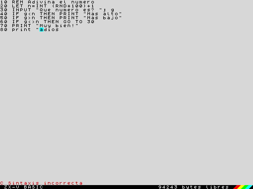
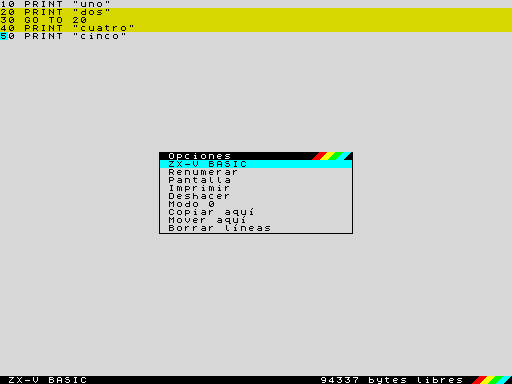
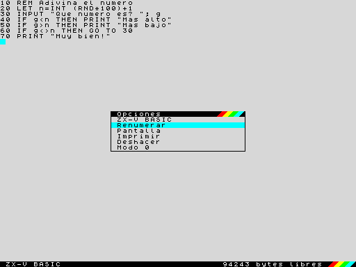
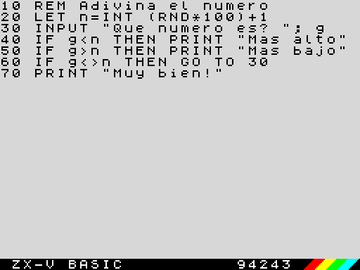

[English](../../en/basic/editor.md) · **Español**

# El editor

Al encender ZX-V estás en el **editor**, donde se teclean y se cambian los
programas en BASIC y se dan las órdenes. Esta página explica cómo funciona y
qué hace cada tecla. Para el lenguaje BASIC en sí, mira el [curso de
BASIC](README.md) y la [referencia](reference.md).

## Las dos pantallas

ZX-V enseña dos pantallas distintas:

- La **pantalla del editor**, la de arriba: tu programa listado en 64
  columnas (o en 32, en [modo 0](#el-editor-en-modo-0)), con una línea vacía
  al final para teclear líneas nuevas y órdenes. Abajo hay una **línea de estado** para los mensajes y una
  **barra** negra con `ZX-V BASIC`, la memoria libre en bytes y las franjas
  de colores.
- La **pantalla del programa**, donde se ejecutan los programas y las órdenes
  enseñan sus resultados (con `PRINT`, `PLOT` y demás), en el modo y con los
  colores del propio programa.

Cuando ejecutas una orden o un programa, ZX-V pasa a la pantalla del
programa. Al acabar, el informe (por ejemplo `0 OK, 0:1`) se queda abajo, en
la pantalla del programa, hasta que pulsas una tecla; entonces vuelves al
editor. La tecla que pulsas no se pierde: cuenta como tecleada en el editor,
así que puedes empezar a escribir la línea siguiente sin más.

## Teclear una línea

El cursor es un recuadro cian que parpadea. Se teclea como en cualquier
ordenador: letras, cifras, signos (con Mayúsculas, como vienen en tu teclado)
y espacios.

**Las palabras clave se teclean letra a letra**, en mayúsculas o en
minúsculas: `print`, `Print` y `PRINT` son lo mismo. Al guardar la línea, ZX-V
la vuelve a enseñar con las palabras clave en mayúsculas y con sus propios
espacios: si tecleas `10 goto 20`, sale `10 GO TO 20`. Los nombres de las
variables se quedan como los tecleaste.

Una palabra clave no puede ir pegada a las letras o cifras que la siguen:
`GO TO 20` y `PRINT"hola"` están bien, pero `GOTO20` no se lee como
`GO TO 20`. Si dudas, deja un espacio.

Se pueden teclear los caracteres de código 32 a 127 (también `£` y `©`, si
tu teclado los tiene). **Las letras con tilde, la ñ, `¿` y `¡` no son
caracteres del BASIC**: al teclearlas se escriben sin la tilde, la diéresis o
la cedilla (`é` sale `e`, `ñ` sale `n`, `ç` sale `c`), y `¿` y `¡` salen `?` y
`!`; los demás caracteres no hacen nada. En los textos de tus programas, por
tanto, hay que pasarse sin ellas. Los gráficos de bloques y los definidos por el
usuario se escriben con `CHR$` (ver el [juego de
caracteres](reference.md#juego-de-caracteres)). Una línea puede tener hasta
1024 caracteres; las largas siguen en las filas siguientes de la pantalla.

> **Si conoces el Spectrum:** el editor funciona como el del +2/128K: el
> listado se edita en su sitio, no hay modos K, L y E, y la tecla EDIT abre el
> menú de opciones. Las teclas son las de un teclado de PC, sin CAPS SHIFT ni
> SYMBOL SHIFT.

## Líneas de programa y órdenes directas

Lo que pasa al pulsar **Enter** depende de cómo empiece la línea:

- **Con un número** (del 1 al 9999), es una **línea de programa**: se guarda
  en el programa, en su sitio según el número, y todavía no se ejecuta nada.
  Si ya había una línea con ese número, se sustituye.
- **Sin número**, es una **orden directa**: se ejecuta en el momento, en la
  pantalla del programa. Por ejemplo `PRINT 2+2`, `RUN`, `SAVE "juego"` o
  `CLS`.

Antes de guardar o de ejecutar nada, ZX-V comprueba la línea. Si hay un
error, suena un zumbido corto, el cursor salta al sitio del problema y la
línea de estado dice en rojo qué pasa (casi siempre `C Sintaxis
incorrecta`). No se guarda ni se ejecuta nada hasta que lo arreglas, como en
la imagen del principio de esta página.

Después de guardar una línea, el cursor pasa al principio de la línea
siguiente del listado, o a la línea vacía del final.

## Moverse y cambiar líneas

Todo el listado se puede editar en su sitio: lleva el cursor a una línea,
cámbiala y pulsa Enter.

| Tecla | Qué hace |
|---|---|
| ← → | Un carácter a la izquierda o a la derecha. Al principio o al final de una línea, pasa a la anterior o a la siguiente |
| ↑ ↓ | Una fila arriba o abajo, por el listado |
| Inicio, Fin | Al principio o al final de la línea |
| Ctrl+Inicio | A la primera línea del programa |
| Ctrl+Fin | A la línea vacía del final |
| RePág, AvPág | Diez líneas arriba o abajo |
| Ctrl+← , Ctrl+→ | A la palabra anterior o a la siguiente |
| Retroceso | Borra el carácter de la izquierda del cursor |
| Supr | Borra el carácter que hay bajo el cursor; con el cursor en un [bloque](#bloques-de-líneas), borra el bloque |
| Enter | Guarda la línea (o ejecuta la orden) |
| Esc | Deshace los cambios de esta línea (si no los hay, quita la marca del bloque); mientras se ejecuta un programa, es BREAK |
| Tab | EDIT: abre el menú de opciones |
| Mayúsculas+↑ ↓ | Marcan un [bloque de líneas](#bloques-de-líneas) |
| F3 | [Busca](#buscar-y-sustituir-find-y-replace) otra vez lo último que buscaste |

Algunas cosas útiles:

- **Al salir de una línea cambiada, se guarda.** Si cambias una línea y te
  vas a otra con los cursores, se guarda como si hubieras pulsado Enter. Si
  tiene un error, el cursor se queda en ella hasta que lo arreglas o pulsas
  Esc.
- **Para deshacer** los cambios de la línea en la que estás, pulsa Esc: la
  línea vuelve a estar como antes.
- **Para borrar una línea**, teclea solo su número en la línea vacía y pulsa
  Enter (`30` borra la línea 30). Para borrar varias, usa
  [`DELETE`](reference.md#delete).
- **Para copiar una línea**, cámbiale el número: se guarda con el número
  nuevo y la antigua se queda donde estaba.
- **Para ejecutar una línea como orden**, bórrale el número y pulsa Enter:
  el texto se ejecuta como una orden directa, y la línea del programa se queda
  como estaba.
- Pulsar Enter en una línea que no has cambiado solo pasa a la siguiente.

La línea vacía del final conserva lo que tecleas aunque subas a mirar el
listado y vuelvas.

**El listado se sangra solo:** lo que va dentro de un `FOR`, `WHILE`,
`REPEAT`, `DEF PROC`, `SELECT CASE` o un [IF de bloque](reference.md#if-then-else)
sale dos espacios más a la derecha por cada nivel, y `ELSE` y `CASE`, uno
menos. Los espacios no se guardan (no ocupan memoria), así que no hace falta
teclearlos: al guardar la línea, el editor la sangra. `LIST` y los `.bas` que
graba `SAVE` salen igual.

## Ejecutar un programa

- `RUN` ejecuta el programa desde el principio (antes borra las variables);
  `RUN 100`, desde la línea 100. `GO TO 100` también lo ejecuta desde la
  línea 100, pero conserva las variables.
- Pulsa **BREAK (la tecla Esc)** para parar un programa. El informe es
  `L BREAK en el programa`, y [`CONTINUE`](reference.md#continue) sigue desde
  donde se paró.
- Cuando un programa llena la pantalla, se para y pregunta `scroll?`:
  cualquier tecla sigue, y N, Espacio o Esc lo paran.
- El informe de abajo dice cómo acabó el programa y dónde (ver
  [Informes](reference.md#informes)): `0 OK, 70:1` quiere decir que acabó
  bien, en la orden 1 de la línea 70.

## Buscar una línea: LIST y EDIT

En un programa largo, RePág y AvPág avanzan de diez en diez líneas, y
Ctrl+Inicio y Ctrl+Fin te llevan al principio y al final. Para ir directo a
una línea, teclea una de estas órdenes:

- `LIST 200` pone el cursor en la línea 200 (o en la siguiente que haya),
  lista para editarla. `LIST` sin número va al principio.
- `EDIT 200` hace lo mismo; `EDIT` sin número va a la última línea que
  guardaste.

Para ver el listado en la pantalla del programa, como en el Spectrum, usa
`LIST #2`. `LLIST` lo manda al fichero de la impresora.

## Numerar líneas: AUTO, RENUM, DELETE

- [`AUTO`](reference.md#auto) pone los números de línea solo: tras `AUTO`, la
  línea vacía ya empieza con el número siguiente (la última línea más 10), y
  cada vez que pulsas Enter sale el siguiente. `AUTO 100, 5` empieza en el 100
  y va de cinco en cinco. Se acaba al pulsar Enter en una línea que solo tiene
  el número, al pulsar Esc o al pasar a otra línea.
- [`RENUM`](reference.md#renum) renumera todo el programa de diez en diez (o
  `RENUM 1000, 5`, desde el 1000 de cinco en cinco), y corrige los números que
  van detrás de `GO TO`, `GO SUB`, `RESTORE`, `RUN`, `LIST`, `LLIST` y `LINE`.
  Los números de línea que calcula el programa, como en `GO TO n*10`, no se
  corrigen; las etiquetas ([`@nombre`](reference.md#etiqueta)) nunca lo
  necesitan.
- [`DELETE 100, 190`](reference.md#delete) borra las líneas de la 100 a la 190.

Las tres funcionan solo como órdenes directas.

## Bloques de líneas

Para copiar, mover o borrar varias líneas de una vez, márcalas primero:

1. Lleva el cursor a la primera línea y pulsa **Mayúsculas+↓** (o
   Mayúsculas+↑ para ir hacia arriba). Se marcan esa línea y la siguiente, y
   cada vez que vuelves a pulsarlo se marca una más. Las líneas marcadas se
   ven en amarillo.
2. Lleva el cursor a donde quieras el bloque y pulsa **EDIT (Tab)**. Con un
   bloque marcado, el menú tiene tres opciones más:

| Opción | Qué hace |
|---|---|
| Copiar aquí | Copia las líneas del bloque detrás de la línea del cursor (en la línea vacía del final, al final del programa) |
| Mover aquí | Igual, pero quita las del sitio de antes. Los `GO TO`, `GO SUB`, `RESTORE`... que iban a una línea movida pasan a su número nuevo |
| Borrar líneas | Borra el bloque, como Supr |

Las líneas copiadas o movidas toman números entre el de la línea del cursor y
el de la siguiente, de diez en diez si caben (si no, más juntos). Si no hay
números libres para todas, primero se renumera el programa de diez en diez,
como con `RENUM`. Al copiar, los números de línea que hay dentro de las
líneas copiadas no cambian: siguen yendo a las mismas líneas de antes.

Para **borrar** el bloque, pon el cursor en una de sus líneas y pulsa Supr: la
línea de estado pregunta `¿Borrar 3 líneas? (S/N)`, y solo S las borra.
**Esc** quita la marca sin hacer nada.

## Buscar y sustituir: FIND y REPLACE

- [`FIND "texto"`](reference.md#find) lleva el cursor a la siguiente línea
  del programa donde aparece el texto, empezando por la que va detrás de la
  del cursor y dando la vuelta al llegar al final. El cursor se queda justo
  sobre el texto. No distingue mayúsculas de minúsculas: `FIND "print"`
  encuentra los `PRINT`.
- **F3** busca otra vez lo mismo, desde el cursor. `FIND` sin texto también.
- [`REPLACE "viejo", "nuevo"`](reference.md#replace) cambia el texto en todo
  el programa. Cada línea cambiada se comprueba como si la hubieras tecleado:
  si quedara con un error, no se toca. La línea de estado dice cuántos cambios
  ha hecho (`5 cambios`), y en rojo cuántas líneas se quedaron sin cambiar.

Las dos buscan en el listado tal como lo ves, palabras clave, textos entre
comillas y `REM` incluidos, pero no en los números de línea.

## Deshacer

La opción **Deshacer** del menú EDIT deshace el último cambio del programa:
una línea guardada o borrada, un bloque copiado, movido o borrado, y también
`REPLACE`, `RENUM`, `DELETE`, `NEW`, `LOAD` y `MERGE`. Si la usas otra vez,
rehace lo que deshizo. Si la línea del cursor está a medio cambiar, primero
solo la deja como estaba, como Esc.

Para poder deshacer, el editor guarda una copia del programa en la memoria
libre, sin quitársela a nadie. Si después un programa necesita esa memoria
(por ejemplo con un `DIM` grande), la copia se pierde y la línea de estado
dice `No se puede deshacer`. Con un programa muy grande, que no deja sitio
para la copia, tampoco se puede.

## El menú de opciones (EDIT)

Pulsa **EDIT (la tecla Tab)** para abrir el menú de opciones en el centro de
la pantalla:

Elige con ↑ y ↓ y pulsa Enter. Esc o Tab cierran el menú sin hacer nada.

| Opción | Qué hace |
|---|---|
| ZX-V BASIC | Cierra el menú y vuelve al editor |
| Renumerar | Renumera el programa de diez en diez desde el 10, como `RENUM`. La línea de estado dice `Programa renumerado`, o `No se puede renumerar` si los números pasarían de 9999 o no hay memoria suficiente |
| Pantalla | Enseña la pantalla del programa (lo que dejó allí el último programa u orden) hasta que pulsas una tecla |
| Imprimir | Manda el listado a la impresora, el fichero `printer.txt` de la tarjeta SD, como `LLIST`. La línea de estado dice `Listado enviado a la impresora` |
| Deshacer | Deshace el último cambio del programa: ver [Deshacer](#deshacer) |
| Modo 0 / Modo 1 | Pasa el editor al otro modo: ver [El editor en modo 0](#el-editor-en-modo-0) |
| Copiar aquí, Mover aquí, Borrar líneas | Solo con un bloque marcado: ver [Bloques de líneas](#bloques-de-líneas) |

Renumerar e Imprimir trabajan con el programa guardado: si la línea en la que
estás ha cambiado, primero se guarda (y si tiene un error, el menú se cierra
para que lo arregles).

## El editor en modo 0

El editor empieza en el modo 1 de la pantalla: 64 columnas y 46 filas para
el listado, con letra pequeña. La opción **Modo 0** del menú EDIT lo pasa al
modo 0, como el del 128K: **32 columnas y 22 filas**, con letra del doble de
grande, más fácil de leer en una tele o desde lejos. Las líneas largas
siguen en las filas siguientes, igual que en el modo 1, y la barra de abajo
solo lleva la memoria libre (sin «bytes libres»). En modo 0, la misma opción
se llama **Modo 1** y lo devuelve a como estaba.

El modo del editor no tiene que ver con el de tus programas (`MODE`): cada
uno usa su pantalla. Se mantiene con `NEW`, y al reiniciar la máquina el
editor vuelve al modo 1.

## La línea de estado

La línea que hay justo encima de la barra enseña:

| Mensaje | Cuándo |
|---|---|
| `© 2026 Cronomantic  ZX-V 0.6.0` | Al arrancar ZX-V, y después de `NEW`: el copyright y la versión de la ROM |
| Un error en rojo, como `C Sintaxis incorrecta` | Cuando una línea que querías guardar o ejecutar tiene un error |
| `Programa renumerado`, `No se puede renumerar` | Tras la opción Renumerar |
| `Listado enviado a la impresora` | Tras la opción Imprimir |
| `3 líneas copiadas`, `3 líneas movidas`, `3 líneas borradas` | Tras copiar, mover o borrar un bloque |
| `El cursor está en el bloque`, `No caben las líneas` | Cuando el bloque no se puede copiar o mover ahí |
| `No encontrado` | Tras `FIND` o F3, si el texto no está en el programa |
| `5 cambios`, `, 2 líneas sin cambiar (error)` | Tras `REPLACE` |
| `Cambio deshecho`, `No se puede deshacer` | Tras la opción Deshacer |

El mensaje desaparece con la siguiente tecla que pulses. La barra de debajo
enseña siempre la memoria libre: el programa y sus variables comparten unos
96 KB.

## Grabar y cargar

Los programas se guardan en la tarjeta SD. Desde el editor:

- `SAVE "juego"` graba el programa como `juego.tap`. `SAVE "juego" LINE 10`
  lo graba para que, al cargarlo, se ejecute solo desde la línea 10.
- `LOAD "juego"` lo carga, y sustituye al programa que haya en la memoria.
- `CAT` lista los ficheros de la carpeta actual, y `CAT "ROM:"`, los ejemplos
  que trae ZX-V; `LOAD "ROM:hello"` ejecuta uno de ellos.
- `MERGE "juego"` añade las líneas de un programa grabado al que tienes.
- `OPEN #4, "juego.txt" OUT: LIST #4: CLOSE #4` escribe el listado en un
  fichero de texto, para leerlo en un ordenador.

`NEW` borra el programa, y cargar un programa nativo (`.zxv`) también deja el
BASIC vacío cuando acaba: graba antes tu trabajo. Todos los detalles están en
la referencia, en [Ficheros y la tarjeta SD](reference.md#ficheros-y-la-tarjeta-sd).

## El idioma del editor

La barra, el menú, los mensajes y los informes de error están en inglés o en
español, el idioma de la máquina. Se cambia con `LANGUAGE "es"` o
`LANGUAGE "en"` (ver [LANGUAGE](reference.md#language)); el emulador también
tiene una opción para elegirlo (ver [el emulador](../emulator.md)).
