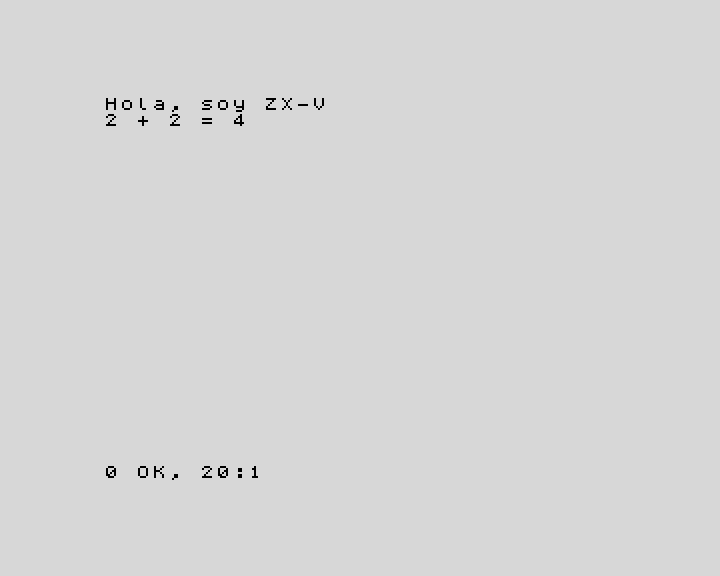

[English](../../../en/basic/tutorial/01-first-steps.md) · **Español**

# 1. Primeros pasos en BASIC

**En este capítulo aprenderás** qué es un programa, cómo se teclea, cómo se
ejecuta y cómo se cambia. Conocerás tus primeras palabras clave: `PRINT`,
`RUN`, `GO TO`, `REM` y `NEW`.

Necesitas tener ZX-V delante: la máquina de verdad o el emulador. Si todavía
no lo has puesto en marcha, [Primeros pasos](../../getting-started.md)
explica cómo. Al arrancar verás una pantalla gris claro con una barra negra
abajo. Esa barra es del **editor**, el sitio donde se escribe.

## Órdenes: la máquina lo hace ya

Teclea esto y pulsa **Enter**:

```
PRINT "Hola"
```

La pantalla cambia y aparece la palabra `Hola`. Abajo verás un mensaje como
`0 OK, 0:1`, que quiere decir "todo ha ido bien". Pulsa cualquier tecla para
volver al editor.

`PRINT` es una **palabra clave**: una palabra que la máquina entiende.
Escribe en la pantalla lo que va detrás. El texto va entre comillas dobles
(`"`). Los números y las cuentas no las necesitan:

```
PRINT 2+2
```

Esto escribe `4`. Las palabras clave se pueden teclear en mayúsculas o en
minúsculas, como prefieras; al pulsar Enter, la máquina las enseña en
mayúsculas.

Lo que acabas de teclear son **órdenes directas**: líneas sin número, que la
máquina ejecuta en cuanto pulsas Enter y después olvida.

## Programas: la máquina se acuerda

Un **programa** es una lista de líneas que la máquina guarda para
ejecutarlas más tarde. Cada **línea de programa** empieza por un **número de
línea**. Teclea estas dos, pulsando **Enter** después de cada una:

```
10 PRINT "Hola, soy ZX-V"
20 PRINT "2 + 2 = ";2+2
```

Esta vez no pasa nada en la pantalla: las líneas van al **listado**, el
programa que guarda el editor. Para ejecutarlo, teclea la orden `RUN` y pulsa
Enter. Verás esto:



La máquina ha ejecutado la línea 10 y después la 20: siempre en el orden de
los números de línea. El `;` de la línea 20 junta dos cosas en la misma línea
de la pantalla: el texto y el resultado de la suma.

El mensaje de abajo, `0 OK, 20:1`, dice que el programa ha terminado sin
problemas, y dónde: en la línea 20, sentencia 1. Pulsa una tecla para volver
al editor, donde sigue tu programa. (Esa tecla también se escribe en el
editor; si era una letra, bórrala con **Retroceso**).

¿Por qué de diez en diez? Para que quede sitio para líneas nuevas en medio:
si más tarde quieres algo entre la 10 y la 20, le pones el 15.

## El editor en dos minutos

El editor funciona como un pequeño procesador de textos. De momento basta con
estas teclas:

| Tecla | Qué hace |
|---|---|
| **Enter** | Guarda la línea (o la ejecuta, si no tiene número) |
| Cursores | Mueven el cursor por el listado |
| **Retroceso**, **Supr** | Borran a la izquierda del cursor o debajo de él |
| **Ctrl+Fin** | Lleva a la línea vacía del final, donde se escriben las líneas nuevas |
| **Esc** | Deshace los cambios de la línea en la que estás. Con un programa en marcha, lo para: es la tecla **BREAK** |
| **Tab** | La tecla **EDIT**: abre el menú del editor |

Para **cambiar** una línea, sube hasta ella con los cursores, corrígela y
pulsa **Enter**. También puedes teclearla otra vez con el mismo número: la
nueva sustituye a la vieja.

Para **añadir** una línea, tecléala con su número en la línea vacía del final
del listado. El editor la coloca en su sitio, por orden de número. Después
de Enter, el cursor va a la línea que sigue a la que has tecleado; pulsa
**Ctrl+Fin** para volver a la línea vacía.

Para **borrar** una línea, teclea solo su número y pulsa Enter.

Para borrar el programa entero y empezar de nuevo, teclea `NEW`.

Si una línea tiene un error, al pulsar Enter la máquina hace un zumbido, deja
el cursor donde está el problema y muestra un mensaje en rojo encima de la
barra, como `C Sintaxis incorrecta`. Corrígelo y pulsa Enter otra vez.

La [guía del editor](../editor.md) explica todo lo demás: el menú, cómo
renumerar y más teclas.

## Un programa que no se para

Teclea `NEW` para empezar de cero y luego este programa:

```
10 PRINT "ZX-V ";
20 GO TO 10
```

`GO TO 10` manda el programa otra vez a la línea 10, así que se repite sin
fin. El `;` al final de la línea 10 quiere decir "no cambies de línea": el
siguiente `PRINT` sigue en la misma. Teclea `RUN` y la pantalla se llena.

Cuando la pantalla está llena, la máquina pregunta `scroll?` abajo. Pulsa
cualquier tecla para ver otra pantalla más. Para parar el programa, pulsa
**Esc** (BREAK). El mensaje `D BREAK - CONT repite, 10:1` te dice que lo has
parado en la línea 10.

## Errores

La máquina avisa cuando algo va mal. Prueba este programa (acuérdate antes de
`NEW`):

```
10 PRINT "Tus puntos:"
20 PRINT puntos
```

Ejecútalo. La línea 10 funciona, pero luego sale
`2 Variable no encontrada, 20:1`. Todos los mensajes de error tienen un
código (`2`), una descripción y el sitio: línea 20, sentencia 1. Aquí la
máquina no sabe qué es `puntos`. En el capítulo siguiente aprenderás a
arreglarlo.

Los errores no hacen ningún daño: el programa sigue ahí, y puedes
corregirlo y ejecutarlo otra vez.

## Notas para ti: `REM`

La máquina no hace caso de las líneas que empiezan por `REM` (de *remark*,
"comentario"). Úsalas para explicar lo que hace tu programa:

```
10 REM Mi primer programa
20 PRINT "Hola"
```

En los textos de los programas no uses tildes, eñes ni los signos `¿` y `¡`:
el BASIC usa el juego de caracteres del Spectrum, que no los tiene. Si los
tecleas, el editor los escribe sin la tilde: `ñ` sale `n`, `ó` sale `o`, y
`¿` y `¡` salen `?` y `!`. Escribe `"Como te llamas?"` en vez de
`"¿Cómo te llamas?"`, que quedaría `"?Como te llamas?"`.

## Pruébalo

1. Escribe un programa que ponga tu nombre en una línea y tu ciudad en la
   siguiente.
2. Cambia el programa de "Un programa que no se para" para que escriba tu
   nombre en vez de `ZX-V`. Luego quita el `;` del final de la línea 10 y
   vuelve a ejecutarlo. ¿Qué cambia?

<details>
<summary>Pista</summary>

Para el primero, usa dos líneas, cada una con su `PRINT`. Para el segundo,
sube a la línea 10 con los cursores, cambia el texto entre comillas y pulsa
Enter. Sin el `;`, cada `PRINT` empieza una línea nueva.

</details>

---

**Referencia:** [`PRINT`](../reference.md#print), [`RUN`](../reference.md#run),
[`GO TO`](../reference.md#go-to), [`REM`](../reference.md#rem),
[`NEW`](../reference.md#new), [Mensajes de error](../reference.md#mensajes-de-error).

**Siguiente:** [2. Variables y cuentas](02-variables-and-maths.md) ·
[Volver al curso](../README.md)
