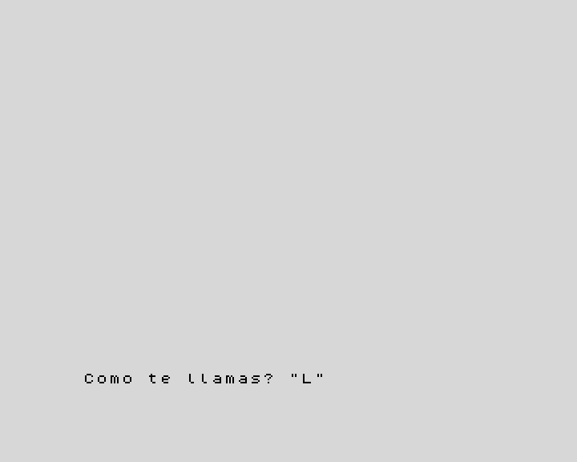

[English](../../../en/basic/tutorial/03-text-and-input.md) · **Español**

# 3. Texto y preguntas

**En este capítulo aprenderás** a guardar texto en **variables de cadena**,
a juntar y cortar textos, y a preguntar a quien está al teclado con `INPUT`.

## Cadenas

A un trozo de texto se le llama **cadena**. Ya has usado cadenas: todo lo que
va entre comillas dobles, como `"Hola"`. Las cadenas también se pueden
guardar en variables, cuyo nombre es una sola letra seguida de `$` (se lee
"a dólar"): `a$`, `n$`, `t$`.

```
10 LET a$="ZX"
20 LET b$="Spectrum"
30 LET c$=a$+" "+b$
40 PRINT c$
50 PRINT LEN c$
60 PRINT c$(1 TO 2)
70 PRINT c$(4 TO )
80 PRINT c$(4)
```

Esto escribe:

```
ZX Spectrum
11
ZX
Spectrum
S
```

- `+` **junta** cadenas: la línea 30 forma `"ZX Spectrum"`.
- `LEN` da la **longitud**, el número de caracteres (los espacios cuentan).
- `c$(1 TO 2)` saca un **trozo**: del carácter 1 al 2. `c$(4 TO )` va del 4
  al final, y `c$(4)` es solo el carácter 4.

Solo hay 26 variables de cadena, una por letra, así que elige letras que te
recuerden lo que guardan: `n$` para un nombre, `p$` para una palabra.

## Números y textos

Un número y una cadena son cosas distintas: `"42"` son dos caracteres y `42`
es un número. Estas funciones pasan de uno a otro:

| Función | Qué hace | Ejemplo | Resultado |
|---|---|---|---|
| `STR$` | de número a cadena | `STR$ 42` | `"42"` |
| `VAL` | de cadena a número | `VAL "2*3+1"` | `7` |
| `CODE` | el código del primer carácter | `CODE "A"` | `65` |
| `CHR$` | el carácter con ese código | `CHR$ 66` | `"B"` |

```
10 LET n=42
20 LET t$=STR$ n
30 PRINT "El numero tiene ";LEN t$;" cifras"
40 PRINT VAL "2*3+1"
50 PRINT CODE "A",CHR$ 66
```

Cada carácter tiene un código: la `A` es el 65, la `B` el 66, y así
sucesivamente. Volverás a usar `CODE` para leer el teclado en el capítulo 11.

## Hacer preguntas: `INPUT`

`INPUT` para el programa y espera a que la persona teclee algo y pulse Enter.
Lo que teclee va a una variable:

```
10 INPUT "Como te llamas? ";n$
20 INPUT "Que edad tienes? ";e
30 PRINT "Hola, ";n$
40 PRINT "Dentro de una decada tendras ";e+10
```

La pregunta sale abajo de la pantalla, seguida de un cursor que parpadea:



Si la variable es una cadena (`n$`), el cursor sale entre comillas, para
recordarte que la respuesta es texto: escríbela sin comillas, que ya están
puestas. Vale cualquier texto. Si es un número
(`e`), teclea un número: la máquina calcula lo que escribes como si fuera una
cuenta, así que `30+6` también da 36. Las palabras son un problema: si
tecleas `diez`, por ejemplo, el programa se para con
`2 Variable no encontrada`, porque la máquina cree que `diez` es el nombre de
una variable.

## Pruébalo

1. Pide un nombre y un apellido y escribe las iniciales: con "Grace" y
   "Hopper", el programa escribe `Tus iniciales: GH`.
2. Pide una palabra y escribe cuántas letras tiene.

<details>
<summary>Pista</summary>

El carácter 1 de `f$` es `f$(1)`. Para el segundo ejercicio, `LEN` hace la
cuenta.

</details>

<details>
<summary>Una solución para el primero</summary>

```
10 INPUT "Nombre? ";f$
20 INPUT "Apellido? ";s$
30 PRINT "Tus iniciales: ";f$(1);s$(1)
```

</details>

---

**Referencia:** [Cadenas](../reference.md#cadenas),
[`LEN`](../reference.md#len), [`STR$`, `VAL`](../reference.md#str-val-val),
[`CHR$`, `CODE`](../reference.md#chr-code),
[`INPUT`](../reference.md#input).

**Siguiente:** [4. Decisiones](04-decisions.md) ·
**Anterior:** [2. Variables y cuentas](02-variables-and-maths.md)
