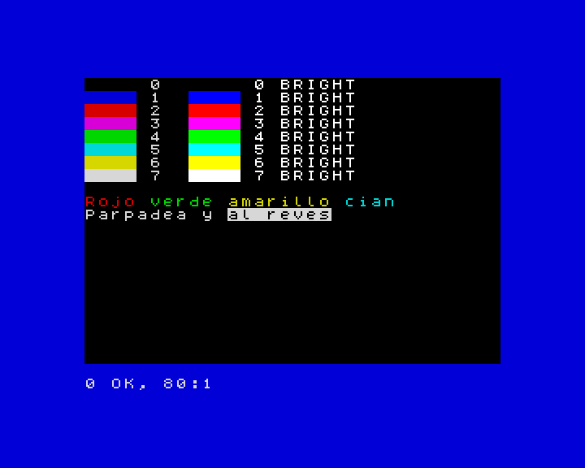

[English](../../../en/basic/tutorial/08-colours-and-the-screen.md) · **Español**

# 8. Los colores y la pantalla

**En este capítulo aprenderás** a usar los colores de la máquina con `INK`,
`PAPER`, `BORDER` y `BRIGHT`, a hacer que un texto parpadee, a escribir en
cualquier sitio de la pantalla con `PRINT AT` y `TAB`, y a pasar al modo de
alta resolución con `MODE`.

## Los colores

ZX-V tiene los colores del ZX Spectrum. Son ocho, numerados del 0 al 7, y
cada uno tiene una versión más brillante:

| Número | Color | Número | Color |
|---|---|---|---|
| 0 | negro | 4 | verde |
| 1 | azul | 5 | cian |
| 2 | rojo | 6 | amarillo |
| 3 | magenta | 7 | blanco |

Cada carácter de la pantalla tiene dos colores: la **tinta** (el color de la
letra) y el **papel** (el fondo que hay detrás). Alrededor de la pantalla hay
un marco, el **borde**.

- `INK n` elige el color de lo que escribes y dibujas.
- `PAPER n` elige el color del fondo.
- `BORDER n` pinta el marco en el momento.
- `CLS` borra la pantalla y la llena del color del papel.
- `BRIGHT 1` hace los colores más brillantes (`BRIGHT 0` los devuelve a la
  normalidad).

```
10 BORDER 1: PAPER 0: INK 7: CLS
20 FOR c=0 TO 7
30 PRINT PAPER c;"    ";PAPER 0;" ";c;"  ";
40 PRINT BRIGHT 1;PAPER c;"    ";PAPER 0;" ";c;" BRIGHT"
50 NEXT c
60 PRINT
70 PRINT INK 2;"Rojo ";INK 4;"verde ";INK 6;"amarillo ";INK 5;"cian"
80 PRINT FLASH 1;"Parpadea";FLASH 0;" y ";INVERSE 1;"al reves"
```



En una línea suelta, `INK 2` cambia el color de todo lo que viene después.
Dentro de un `PRINT`, como en las líneas 30 a 80, solo cambia el color de
ese `PRINT`: el siguiente vuelve a los colores que tenías.

Dos efectos más:

- `FLASH 1` hace que el texto intercambie la tinta y el papel unas tres
  veces por segundo.
- `INVERSE 1` intercambia la tinta y el papel: el texto sale como un hueco en
  un bloque de color.

Un truco útil para los mensajes que tienen que destacar:

```
10 PAPER 7: INK 0: CLS
20 PRINT AT 10,6; PAPER 2; INK 7;" FIN DE LA PARTIDA "
30 PRINT AT 12,6; INK 1;"Puntos: "; INK 2;1250
```

**Si conoces el Spectrum:** en ZX-V cada píxel tiene su propio color, así que
no hay *color clash*: dibujar en un color nunca cambia el color de los
píxeles de al lado.

## Escribir en cualquier sitio: `PRINT AT`

La pantalla es una cuadrícula de 32 columnas y 24 filas de caracteres. El
programa puede escribir en las 22 de arriba, numeradas del 0 al 21; las dos
de abajo son para `INPUT` y los mensajes. `PRINT AT fila,columna;` se va a
ese sitio antes de escribir:

```
10 PAPER 1: INK 6: CLS
20 PRINT AT 0,0;"Arriba a la izquierda"
30 PRINT AT 10,13;"Centro"
40 PRINT AT 21,14;"Abajo a la derecha"
50 PRINT AT 5,0;"Nombre";TAB 16;"Puntos"
60 PRINT AT 6,0;"Ada";TAB 16;"120"
```

Las filas bajan desde el 0 de arriba; las columnas van hacia la derecha desde
el 0 de la izquierda. Una fila o columna fuera de la pantalla da
`5 Fuera de la pantalla`.

`TAB n` salta a la columna `n` de la línea en la que estás: viene muy bien
para las tablas.

Con `PRINT AT` y números al azar puedes llenar de estrellas el cielo de la
noche:

```
10 BORDER 0: PAPER 0: CLS
20 FOR i=1 TO 300
30 PRINT AT INT (RND*22),INT (RND*32); INK INT (RND*7)+1;"*";
40 NEXT i
```

## Alta resolución: `MODE 1`

Hasta ahora has usado el **modo 0**: 256 × 192 píxeles, como el Spectrum.
ZX-V tiene un segundo modo con el doble de píxeles a lo ancho y a lo alto: el
**modo 1**, de 512 × 384 píxeles, con 64 columnas y 48 filas de caracteres
más pequeños.

```
10 MODE 1
20 PRINT "El modo 1 tiene 64 columnas y 48 filas de texto."
30 PRINT AT 45,50;"La esquina"
40 PLOT 0,0: DRAW 511,367
```

`MODE` borra la pantalla. En el modo 1, el programa puede usar las filas de
la 0 a la 45. La línea 40 dibuja una línea que cruza toda la pantalla
(`PLOT` y `DRAW` llegan en el capítulo siguiente). Para volver al modo
normal, teclea `MODE 0`.

## Pruébalo

1. Escribe tu nombre en el centro de la pantalla, en amarillo sobre azul, con
   el borde rojo.
2. Dibuja un tablero de ajedrez de 8 × 8 casillas, cada una de dos
   caracteres de ancho y una fila de alto, alternando el papel negro y el
   blanco.

<details>
<summary>Pista</summary>

Para el tablero, usa dos bucles `FOR`, uno para las filas y otro para las
columnas. La casilla de la fila `f` y la columna `c` es blanca cuando `f+c`
es par: `INT ((f+c)/2)=(f+c)/2`. Escribe dos espacios con `PAPER 7` o
`PAPER 0` en `AT f,c*2`.

</details>

<details>
<summary>Una solución para el segundo</summary>

```
10 BORDER 1: PAPER 1: CLS
20 FOR f=0 TO 7
30 FOR c=0 TO 7
40 LET p=7*(INT ((f+c)/2)=(f+c)/2)
50 PRINT AT f+7,c*2+8; PAPER p;"  "
60 NEXT c
70 NEXT f
```

La línea 40 aprovecha que una condición que se cumple vale 1 y una que no, 0,
así que `p` vale 7 (blanco) o 0 (negro).

</details>

---

**Referencia:** [Colores](../reference.md#colores),
[`INK`, `PAPER`](../reference.md#ink-paper), [`BORDER`](../reference.md#border),
[`BRIGHT`, `FLASH`](../reference.md#bright-flash),
[`INVERSE`, `OVER`](../reference.md#inverse-over),
[`PRINT`](../reference.md#print), [`CLS`](../reference.md#cls),
[`MODE`](../reference.md#mode).

**Siguiente:** [9. Dibujar](09-drawing.md) ·
**Anterior:** [7. Procedimientos](07-procedures.md)
