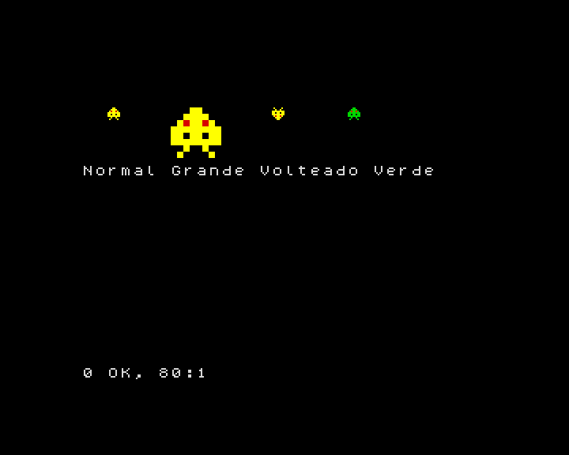
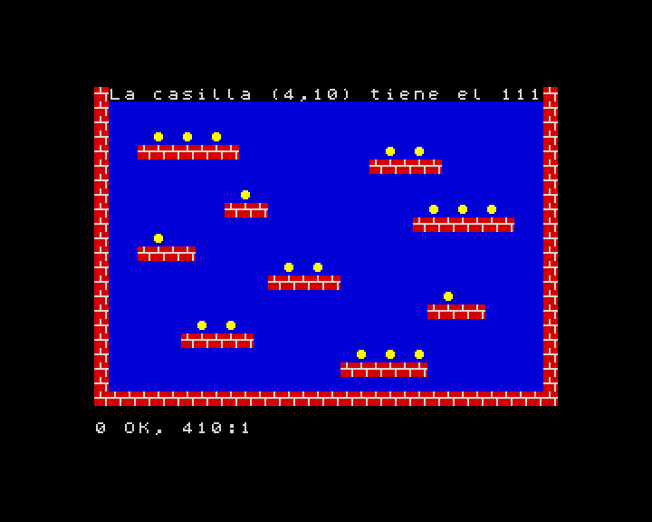

[English](../../../en/basic/tutorial/12-sprites-and-tile-maps.md) · **Español**

# 12. Sprites y mapas de tiles

**En este capítulo aprenderás** a crear **sprites** (dibujitos que se mueven
por encima del fondo) con `GRAB` y a dibujarlos con `SPRITE`, a animar sin
parpadeos usando las dos páginas de la pantalla, a detectar choques con
`HIT`, y a construir niveles con **tiles** (las piezas del mosaico) y
**mapas**: `TILE`, `MAP DIM`, `MAP POKE`, `MAP` y `CELL`.

Estas órdenes son los gráficos para juegos de ZX-V. Son rápidas: un bucle en
BASIC puede dibujar unos cientos de sprites pequeños en cada frame.

Como `BOX` en el capítulo 9, cuentan las coordenadas en píxeles desde la
esquina de **arriba a la izquierda**, con la `y` creciendo hacia abajo, y
usan los números de color del 0 al 15.

## Un sprite a partir de una cadena

La forma más fácil de crear un sprite es dibujarlo con caracteres. Cada
carácter es un píxel: una cifra del `0` al `9` o una letra de la `a` a la `f`
es un color (`a` es el 10, `b` el 11... `f` el 15), y cualquier otro
carácter, como `.`, es transparente: deja ver el fondo.

```
10 BORDER 0: PAPER 0: INK 7: CLS
20 LET s$="...ee..."+"..eeee.."+".e2ee2e."+"eeeeeeee"+"ee.ee.ee"+"eeeeeeee"+"..e..e.."+".e....e."
30 GRAB 0,8,s$
40 SPRITE 0,16,20
50 SPRITE 0,56,20,0,"",32,32
60 SPRITE 0,120,20,2
70 SPRITE 0,168,20,0,"0123456789abcd4f"
80 PRINT AT 7,0;"Normal Grande Volteado Verde"
```



- `GRAB 0,8,s$` crea el sprite número 0, de 8 píxeles de ancho, a partir de
  la cadena. La cadena tiene 64 caracteres: 8 filas de 8, una detrás de
  otra. Aquí la `e` es el amarillo brillante (14) y el `2` el rojo.
- `SPRITE n,x,y` dibuja el sprite `n` con su esquina de arriba a la izquierda
  en (x,y).
- Un cuarto número lo voltea: 1 de izquierda a derecha, 2 de arriba abajo, 3
  las dos cosas.
- Una cadena en quinto lugar cambia sus colores: el color `i` se dibuja como
  el carácter de la posición `i` de la cadena (contando desde 0). En la línea
  70, el `4` de la posición 14 convierte el amarillo brillante en verde.
- Dos números más lo estiran a ese ancho y ese alto (línea 50).

Puedes tener hasta 256 sprites, numerados del 0 al 255.

## Moverse sin parpadeos

Para mover un sprite lo vuelves a dibujar en su sitio nuevo, después de
borrar el dibujo anterior. Si lo haces en la pantalla que estás viendo, se
nota el momento en que se borra: el dibujo parpadea. El truco es dibujar en
una pantalla escondida y enseñarla cuando está terminada.

ZX-V tiene dos **páginas** de pantalla, la 0 y la 1. `SCREEN n` elige la
página en la que se dibuja; `PAGE n` elige la que se ve. Así:

```
10 BORDER 0: PAPER 0: INK 7: CLS
20 LET s$="...ee..."+"..eeee.."+".e2ee2e."+"eeeeeeee"+"ee.ee.ee"+"eeeeeeee"+"..e..e.."+".e....e."
30 GRAB 0,8,s$
40 LET x=0: LET s=1
50 REPEAT
60 SCREEN s
70 BOX 1,0,0,256,192
80 SPRITE 0,x,88
90 PAGE s: LET s=1-s
100 WAIT 1
110 LET x=x+2
120 UNTIL x>248
130 SCREEN 0: PAGE 0
```

`s` es la página escondida. En cada vuelta se dibuja ahí el cuadro entero
(un fondo azul y el sprite), se enseña con `PAGE s` y se cambia: `LET s=1-s`
convierte el 1 en 0 y el 0 en 1, así que el siguiente cuadro se dibuja en la
otra página. `WAIT 1` mantiene la velocidad fija, a 50 cuadros por segundo.
Al final, la línea 130 lo deja todo en la página 0, la normal.

## Sprites a partir de un dibujo, y choques

`GRAB` también puede copiar un sprite de algo dibujado en la pantalla:
`GRAB n,x,y,an,al,t` coge el rectángulo de `an` × `al` píxeles que hay en
(x,y), y el color `t` pasa a ser transparente.

`HIT(a,ax,ay,b,bx,by)` da 1 si el sprite `a` dibujado en (ax,ay) y el sprite
`b` en (bx,by) se tocan: si alguno de sus píxeles visibles coincide.

```
10 BORDER 0: PAPER 0: INK 7: CLS
20 GRAB 0,8,"...ee..."+"..eeee.."+".e2ee2e."+"eeeeeeee"+"ee.ee.ee"+"eeeeeeee"+"..e..e.."+".e....e."
30 DISC 3,8,8,7: GRAB 1,0,0,16,16,0
40 LET x=0: LET s=1
50 REPEAT
60 SCREEN s: BOX 0,0,0,256,192
70 SPRITE 1,200,84
80 SPRITE 0,x,88
90 PAGE s: LET s=1-s: WAIT 1
100 LET x=x+2
110 UNTIL HIT(0,x,88,1,200,84)
120 SCREEN 0: PAGE 0
130 BEEP 0.2,-10
140 PRINT AT 0,0;"Choque en x=";x
```

La línea 30 dibuja un círculo magenta en la esquina y lo coge como sprite 1,
con el negro (0) como transparente, así que solo queda el círculo. El bucle
mueve el sprite 0 hasta que toca el círculo.

## Tiles y mapas

Los juegos de plataformas y de laberintos se construyen con dibujitos
cuadrados que se repiten muchas veces: ladrillos, hierba, monedas. Cada
dibujito es un **tile**, y un **mapa** dice qué tile va en cada casilla del
nivel.

- `TILE 8,n,x,y` copia los 8 × 8 píxeles que hay en (x,y) de la pantalla como
  el tile número `n`. (Los tiles también pueden ser de 16 × 16:
  `TILE 16,...`).
- `MAP DIM m,an,al` crea el mapa número `m` (del 0 al 15), de `an` casillas de
  ancho y `al` de alto.
- `MAP POKE m,x,y,a$` llena casillas del mapa desde (x,y) hacia la derecha,
  una por carácter: cada carácter pone el tile cuyo número es su código. Así,
  si el tile 35 es un ladrillo, `#` (código 35) quiere decir ladrillo.
- `MAP m` dibuja el mapa en la pantalla.
- `CELL(m,x,y)` dice qué tile hay en la casilla (x,y): así sabe un juego si
  hay una pared o una moneda.

```
10 BORDER 0: PAPER 0: INK 7: CLS
20 REM Tile 32 (un espacio): cielo
30 BOX 1,0,0,8,8: TILE 8,32,0,0
40 REM Tile 35 (#): ladrillo
50 BOX 2,0,0,8,8: BOX 7,0,3,8,1: BOX 7,3,0,1,3: BOX 7,6,4,1,4: TILE 8,35,0,0
60 REM Tile 111 (o): moneda
70 BOX 1,0,0,8,8: DISC 14,3,3,2: TILE 8,111,0,0
80 MAP DIM 0,32,22
90 FOR y=0 TO 21: READ r$: MAP POKE 0,0,y,r$: NEXT y
100 MAP 0
110 PRINT AT 0,1;"La casilla (4,10) tiene el ";CELL(0,4,10)
200 DATA "################################"
210 DATA "#                              #"
220 DATA "#                              #"
230 DATA "#   o o o                      #"
240 DATA "#  #######          o o        #"
250 DATA "#                  #####       #"
260 DATA "#                              #"
270 DATA "#         o                    #"
280 DATA "#        ###           o o o   #"
290 DATA "#                     #######  #"
300 DATA "#   o                          #"
310 DATA "#  ####                        #"
320 DATA "#            o o               #"
330 DATA "#           #####              #"
340 DATA "#                       o      #"
350 DATA "#                      ####    #"
360 DATA "#      o o                     #"
370 DATA "#     #####                    #"
380 DATA "#                 o o o        #"
390 DATA "#                ######        #"
400 DATA "#                              #"
410 DATA "################################"
```



El nivel está dibujado en las líneas `DATA`, casi como se ve. En la casilla
(4,10) hay una `o`, así que `CELL` da 111, la moneda. Para coger una moneda,
un juego pone un espacio en su casilla con `MAP POKE 0,x,y," "` y vuelve a
dibujar el mapa.

## Scroll

Un mapa puede ser más grande que la pantalla. `MAP m,mx,my,x,y,an,al` dibuja
la parte del mapa que empieza en su píxel (mx,my), en el rectángulo
(x,y,an,al) de la pantalla. Si cambias `mx` poco a poco, el nivel se
desplaza:

```
10 BORDER 0: PAPER 0: INK 7: CLS
20 BOX 1,0,0,8,8: TILE 8,32,0,0
30 BOX 2,0,0,8,8: BOX 7,0,3,8,1: BOX 7,3,0,1,3: BOX 7,6,4,1,4: TILE 8,35,0,0
40 CLS
50 MAP DIM 0,64,2,8,1
60 MAP POKE 0,0,0,"   ##      ###          #####        ##   ###         ####      "
70 MAP POKE 0,0,1,"################################################################"
80 LET cx=0: LET s=1
90 REPEAT
100 SCREEN s: MAP 0,cx,0,0,100,256,16
110 PAGE s: LET s=1-s: WAIT 1
120 LET cx=cx+2: IF cx=512 THEN LET cx=0
130 UNTIL INKEY$<>""
140 SCREEN 0: PAGE 0
```

En `MAP DIM 0,64,2,8,1`, el 8 es el tamaño de los tiles y el 1 del final hace
que el mapa se **repita** en las dos direcciones: detrás de la última columna
vuelve a venir la primera, así que el scroll no se acaba nunca. Pulsa una
tecla para pararlo.
La línea 120 vuelve a poner `cx` a 0 cuando llega a 512, el ancho del mapa
(64 tiles de 8 píxeles): como el mapa se repite, en la pantalla no cambia
nada, y el número nunca crece demasiado.

## Guardar tus gráficos

Los sprites, los tiles y los mapas se quedan en la memoria cuando el
programa acaba, y también tras `RUN`; `NEW` los borra. Para guardarlos todos
en un fichero de la tarjeta SD, usa `SAVE "nombre" GRAPHICS`, y
`LOAD "nombre" GRAPHICS` los recupera.

Dibujar sprites grandes con cadenas es un trabajo lento. Puedes dibujarlos en
el PC con cualquier programa de dibujo y convertir las imágenes con la
herramienta `png2gfx`: la [guía del SDK](../../sdk/README.md) explica cómo.

## Pruébalo

1. Haz un sprite tuyo de 8 × 8 y muévelo en diagonal por la pantalla.
2. En el programa del mapa de tiles, añade un sprite que se mueva con las
   teclas (como en el capítulo 11) y escribe el número del tile que tiene
   debajo con `CELL`.

<details>
<summary>Pista</summary>

Para el segundo, la casilla que hay debajo del punto (x,y) de la pantalla es
`(INT (x/8),INT (y/8))`, porque los tiles miden 8 píxeles. Acuérdate de
volver a dibujar el mapa (`MAP 0`) cada vez, antes que el sprite, para que
el sprite anterior desaparezca, y usa las dos páginas para que no parpadee.

</details>

---

**Referencia:** [Sprites, mapas de tiles y gráficos rápidos](../reference.md#sprites-mapas-de-tiles-y-gráficos-rápidos),
[`GRAB`](../reference.md#grab), [`SPRITE`](../reference.md#sprite),
[`HIT`](../reference.md#hit), [`TILE`](../reference.md#tile),
[`MAP DIM`, `MAP POKE`](../reference.md#map-dim-map-poke),
[`MAP`](../reference.md#map), [`CELL`](../reference.md#cell),
[`PAGE`, `SCREEN`](../reference.md#page-screen).

**Siguiente:** [13. Ficheros y la tarjeta SD](13-files-and-the-sd-card.md) ·
**Anterior:** [11. Teclado y mando](11-keyboard-and-joystick.md)
