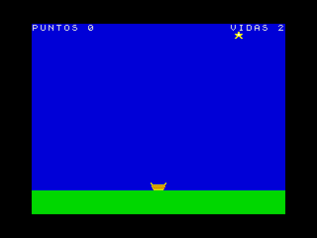

[English](../../../en/basic/tutorial/14-a-complete-game.md) · **Español**

# 14. Un juego completo

**En este capítulo** juntarás todo lo que has aprendido para escribir un
juego entero, paso a paso: *Atrapa estrellas*. Caen estrellas del cielo y
las recoges con una cesta. Cada estrella vale 10 puntos, y caen más deprisa
cuantos más puntos tienes. Si se te escapan tres, se acaba la partida. El
récord se guarda en la tarjeta SD.



Lo construirás en cinco pasos. Después de cada paso el programa funciona,
así que puedes ver cómo crece y encontrar los errores pronto. Cada paso
enseña solo las líneas nuevas o las que cambian: tecléalas y deja las que ya
tienes.

## El plan

Antes de teclear, conviene pensar en las piezas:

- **Los gráficos**: dos sprites, la cesta (16 × 8 píxeles) y la estrella
  (8 × 8).
- **El estado del juego**, en variables: la posición de la cesta, `px`; la
  posición de la estrella, `sx` y `sy`, y su velocidad, `sp`; `puntos` y
  `vidas`.
- **El bucle del juego**, que se repite 30 veces por segundo: leer los
  controles y mover la cesta, mover la estrella, comprobar si se ha atrapado
  o si ha llegado al suelo, y dibujarlo todo.
- **Alrededor del bucle**: una pantalla de título, el final de la partida y
  el récord.

Cada pieza será un procedimiento, así que el programa principal será corto.

## Paso 1: los gráficos y la escena

```
10 REM Atrapa estrellas
20 BORDER 0: PAPER 0: INK 7: CLS
50 PROC graficos
80 LET px=120: LET sx=124: LET sy=8: LET puntos=0: LET vidas=3: LET s=1: PROC dibujar
1000 REM --- Graficos ---
1010 DEF PROC graficos
1020 LET b$="6..............6"+"66............66"+".66666666666666."
1030 LET b$=b$+".62626262626262."+".66666666666666."+"..626262626262.."
1040 LET b$=b$+"..666666666666.."+"...6666666666..."
1050 GRAB 0,16,b$
1060 LET t$="...ee..."+"...ee..."+"eeeffeee"+".eeffee."
1070 LET t$=t$+"..eeee.."+".ee..ee."+"ee....ee"+"........"
1080 GRAB 1,8,t$
1090 END PROC
4400 DEF PROC dibujar
4410 SCREEN s
4420 BOX 1,0,0,256,168: BOX 4,0,168,256,24
4430 SPRITE 1,sx,sy
4440 SPRITE 0,px,160
4450 PRINT AT 0,0; PAPER 1;"PUNTOS ";puntos;AT 0,25;"VIDAS ";vidas
4460 PAGE s: LET s=1-s: WAIT 2
4470 END PROC
```

- `graficos` crea los sprites a partir de cadenas, como en el capítulo 12.
  En la cesta, el `6` es amarillo y el `2` rojo; la estrella es amarilla
  brillante (`e`) con el centro blanco (`f`).
- `dibujar` dibuja un cuadro completo en la página escondida `s`: el cielo
  azul, el suelo verde, la estrella, la cesta y la línea de los puntos; luego
  lo enseña y espera dos frames con `WAIT 2`. Eso da 30 cuadros por segundo.
- La línea 80 da unos valores a las variables solo para probar `dibujar`.
  Ejecútalo: verás la escena, quieta.

## Paso 2: mover la cesta

Ahora, el bucle del juego. Cambia la línea 80 y añade estas:

```
40 DEF FN b(j,n)=INT (j/2^n)-2*INT (j/2^(n+1))
80 PROC partida
3000 REM --- Una partida ---
3010 DEF PROC partida
3020 LET puntos=0: LET vidas=3: LET px=120: LET s=1: LET vol=0
3040 PROC estrella
3050 REPEAT
3060 PROC mover
3100 PROC dibujar
3120 UNTIL vidas=0
3140 END PROC
4000 REM --- Las piezas del juego ---
4010 DEF PROC mover
4020 LET j=JOY 0
4030 IF KEY CODE "o" OR KEY 8 OR FN b(j,1) THEN LET px=px-4
4040 IF KEY CODE "p" OR KEY 9 OR FN b(j,0) THEN LET px=px+4
4050 IF px<0 THEN LET px=0
4060 IF px>240 THEN LET px=240
4070 END PROC
4100 DEF PROC estrella
4110 LET sx=INT (RND*248): LET sy=8
4120 LET sp=2+INT (puntos/50): IF sp>8 THEN LET sp=8
4130 END PROC
```

- El procedimiento `partida` lo prepara todo y repite el bucle hasta que no
  quedan vidas. De momento nada quita vidas, así que no acaba nunca: pulsa
  **Esc** para pararlo. (`vol` servirá para el sonido en el paso 4).
- `mover` lee las teclas **O** y **P**, los cursores y el mando (con la
  función `FN b` del capítulo 11, definida en la línea 40), y mantiene la
  cesta dentro de la pantalla: la pantalla mide 256 píxeles de ancho y la
  cesta 16, así que `px` va de 0 a 240.
- `estrella` pone una estrella en un sitio al azar de arriba. Su velocidad
  `sp` crece con los puntos: 2 píxeles por cuadro al principio, uno más cada
  50 puntos, hasta 8.

Ejecútalo y mueve la cesta de un lado a otro.

## Paso 3: estrellas que caen

```
30 RANDOMIZE
3070 LET sy=sy+sp
3080 IF HIT(0,px,160,1,sx,sy) THEN PROC atrapada
3090 IF sy>168 THEN PROC perdida
4200 DEF PROC atrapada
4210 LET puntos=puntos+10
4230 PROC estrella
4240 END PROC
4300 DEF PROC perdida
4310 LET vidas=vidas-1
4330 PROC estrella
4340 END PROC
```

- La línea 3070 hace caer la estrella.
- La línea 3080 usa `HIT` para ver si la estrella toca la cesta: si la toca,
  `atrapada` suma 10 puntos y lanza una estrella nueva.
- Si la estrella llega al suelo (`sy>168`), `perdida` quita una vida y lanza
  otra estrella.
- `RANDOMIZE`, en la línea 30, hace que las estrellas caigan en un sitio
  distinto en cada partida.

Ya es un juego: después de tres fallos se acaba el bucle, y con él el
programa.

## Paso 4: el sonido y el final de la partida

```
3030 SOUND 7,62
3110 IF vol>0 THEN LET vol=vol-1: SOUND 8,vol
3130 PROC finpartida
4220 SOUND 0,60;1,0;8,15: LET vol=15
4320 SOUND 0,0;1,3;8,15: LET vol=15
5000 REM --- Fin de la partida ---
5010 DEF PROC finpartida
5020 SOUND 8,0: SCREEN 1-s
5030 PRINT AT 10,6; PAPER 2; INK 7;" FIN DE LA PARTIDA "
5050 PLAY "T160O4 3gfedc5c"
5060 PAUSE 100
5070 END PROC
```

- Los sonidos usan la voz A del chip de sonido, como en el capítulo 10. La
  línea 3030 enciende su tono. Atrapar una estrella toca una nota aguda y
  perderla una grave, las dos a todo volumen (`8,15`), y `vol` se acuerda del
  volumen.
- La línea 3110 baja un poco el volumen en cada vuelta del bucle, así que
  cada sonido se apaga solo en una fracción de segundo, sin parar el juego.
  `BEEP` habría congelado el juego mientras sonaba.
- `finpartida` apaga el sonido, escribe *FIN DE LA PARTIDA* en la página que
  se está viendo (la que no es `s`), toca una melodía triste y espera dos
  segundos, o hasta que se pulse una tecla.

## Paso 5: la pantalla de título y el récord

El último paso añade una pantalla de título y guarda el récord en un
fichero, como en el capítulo 13:

```
60 LET record=0: PROC leerrecord
70 @titulo: PROC titulo
90 GO TO @titulo
2000 REM --- Pantalla de titulo ---
2010 DEF PROC titulo
2020 SCREEN 0: PAGE 0: CLS
2030 PRINT AT 4,8; INK 6; BRIGHT 1;"ATRAPA ESTRELLAS"
2040 SPRITE 1,124,56
2050 PRINT AT 10,1;"Atrapa las estrellas que caen"
2060 PRINT AT 13,6;"O y P, o los cursores"
2070 PRINT AT 15,11; INK 5;"Record: ";record
2080 PRINT AT 19,2; FLASH 1;" Pulsa una tecla para jugar "
2090 PLAY "T180O5 3ceg5C"
2100 PAUSE 0
2110 END PROC
5040 IF puntos>record THEN LET record=puntos: PROC grabarrecord: PRINT AT 12,8; PAPER 1; INK 6;" Nuevo record! "
6000 REM --- El record, en un fichero ---
6010 DEF PROC leerrecord
6020 ON ERROR GO TO 6040
6030 OPEN #4,"estrellas.txt" IN: INPUT #4;record
6040 ON ERROR GO TO 0: CLOSE #4
6050 END PROC
6100 DEF PROC grabarrecord
6110 ON ERROR GO TO 6130
6120 OPEN #4,"estrellas.txt" OUT: PRINT #4;record
6130 ON ERROR GO TO 0: CLOSE #4
6140 END PROC
```

- El programa principal da vueltas: título, partida, título...
- `titulo` usa la página 0 y espera una tecla con `PAUSE 0`, que además se
  olvida de las teclas pulsadas durante la partida anterior.
- `leerrecord` y `grabarrecord` leen y escriben el récord en el fichero
  `estrellas.txt`. Gracias a `ON ERROR`, si el fichero no existe, o no hay
  tarjeta, el juego simplemente empieza con un récord de 0.

Para parar el juego, pulsa **Esc**. Grábalo con `SAVE "estrellas" LINE 10`,
así `LOAD "estrellas"` lo pondrá en marcha solo.

## El programa entero

Aquí tienes el listado completo, para comparar el tuyo:

```
10 REM Atrapa estrellas
20 BORDER 0: PAPER 0: INK 7: CLS
30 RANDOMIZE
40 DEF FN b(j,n)=INT (j/2^n)-2*INT (j/2^(n+1))
50 PROC graficos
60 LET record=0: PROC leerrecord
70 @titulo: PROC titulo
80 PROC partida
90 GO TO @titulo
1000 REM --- Graficos ---
1010 DEF PROC graficos
1020 LET b$="6..............6"+"66............66"+".66666666666666."
1030 LET b$=b$+".62626262626262."+".66666666666666."+"..626262626262.."
1040 LET b$=b$+"..666666666666.."+"...6666666666..."
1050 GRAB 0,16,b$
1060 LET t$="...ee..."+"...ee..."+"eeeffeee"+".eeffee."
1070 LET t$=t$+"..eeee.."+".ee..ee."+"ee....ee"+"........"
1080 GRAB 1,8,t$
1090 END PROC
2000 REM --- Pantalla de titulo ---
2010 DEF PROC titulo
2020 SCREEN 0: PAGE 0: CLS
2030 PRINT AT 4,8; INK 6; BRIGHT 1;"ATRAPA ESTRELLAS"
2040 SPRITE 1,124,56
2050 PRINT AT 10,1;"Atrapa las estrellas que caen"
2060 PRINT AT 13,6;"O y P, o los cursores"
2070 PRINT AT 15,11; INK 5;"Record: ";record
2080 PRINT AT 19,2; FLASH 1;" Pulsa una tecla para jugar "
2090 PLAY "T180O5 3ceg5C"
2100 PAUSE 0
2110 END PROC
3000 REM --- Una partida ---
3010 DEF PROC partida
3020 LET puntos=0: LET vidas=3: LET px=120: LET s=1: LET vol=0
3030 SOUND 7,62
3040 PROC estrella
3050 REPEAT
3060 PROC mover
3070 LET sy=sy+sp
3080 IF HIT(0,px,160,1,sx,sy) THEN PROC atrapada
3090 IF sy>168 THEN PROC perdida
3100 PROC dibujar
3110 IF vol>0 THEN LET vol=vol-1: SOUND 8,vol
3120 UNTIL vidas=0
3130 PROC finpartida
3140 END PROC
4000 REM --- Las piezas del juego ---
4010 DEF PROC mover
4020 LET j=JOY 0
4030 IF KEY CODE "o" OR KEY 8 OR FN b(j,1) THEN LET px=px-4
4040 IF KEY CODE "p" OR KEY 9 OR FN b(j,0) THEN LET px=px+4
4050 IF px<0 THEN LET px=0
4060 IF px>240 THEN LET px=240
4070 END PROC
4100 DEF PROC estrella
4110 LET sx=INT (RND*248): LET sy=8
4120 LET sp=2+INT (puntos/50): IF sp>8 THEN LET sp=8
4130 END PROC
4200 DEF PROC atrapada
4210 LET puntos=puntos+10
4220 SOUND 0,60;1,0;8,15: LET vol=15
4230 PROC estrella
4240 END PROC
4300 DEF PROC perdida
4310 LET vidas=vidas-1
4320 SOUND 0,0;1,3;8,15: LET vol=15
4330 PROC estrella
4340 END PROC
4400 DEF PROC dibujar
4410 SCREEN s
4420 BOX 1,0,0,256,168: BOX 4,0,168,256,24
4430 SPRITE 1,sx,sy
4440 SPRITE 0,px,160
4450 PRINT AT 0,0; PAPER 1;"PUNTOS ";puntos;AT 0,25;"VIDAS ";vidas
4460 PAGE s: LET s=1-s: WAIT 2
4470 END PROC
5000 REM --- Fin de la partida ---
5010 DEF PROC finpartida
5020 SOUND 8,0: SCREEN 1-s
5030 PRINT AT 10,6; PAPER 2; INK 7;" FIN DE LA PARTIDA "
5040 IF puntos>record THEN LET record=puntos: PROC grabarrecord: PRINT AT 12,8; PAPER 1; INK 6;" Nuevo record! "
5050 PLAY "T160O4 3gfedc5c"
5060 PAUSE 100
5070 END PROC
6000 REM --- El record, en un fichero ---
6010 DEF PROC leerrecord
6020 ON ERROR GO TO 6040
6030 OPEN #4,"estrellas.txt" IN: INPUT #4;record
6040 ON ERROR GO TO 0: CLOSE #4
6050 END PROC
6100 DEF PROC grabarrecord
6110 ON ERROR GO TO 6130
6120 OPEN #4,"estrellas.txt" OUT: PRINT #4;record
6130 ON ERROR GO TO 0: CLOSE #4
6140 END PROC
```

## Hazlo tuyo

Algunas ideas para ir más allá:

- Añade otra clase de estrella, de otro color, que valga 50 puntos.
- Añade una bomba que **no** hay que atrapar: quita una vida.
- Da una vida extra cada 500 puntos.
- Haz la cesta más rápida o más lenta, o deja que el jugador elija la
  dificultad en la pantalla de título.
- Dibuja un fondo con tiles: unas nubes, o una ciudad de noche.

## Y ahora, ¿qué?

Has terminado el curso. Para ver hasta dónde llega el BASIC de ZX-V, mira el
juego de plataformas de `examples/basic/platformer`: un robot recorre un
nivel de cinco pantallas con scroll, recoge monedas, salta pinchos y pisa a
los bichos. Su [guía](../../../../examples/basic/platformer/README.es.md)
explica cómo está hecho, y usa todo lo que has visto aquí. Puedes jugarlo
desde la unidad `ROM:`: `CD "ROM:"` y `LOAD "platformer"`.

A partir de ahora, la [referencia del BASIC](../reference.md) tiene todas las
palabras clave con todos sus detalles, y la [guía del editor](../editor.md)
todos los trucos del editor. Cuando el BASIC no sea lo bastante rápido, el
[SDK](../../sdk/README.md) te permite escribir programas nativos en C.

---

**Referencia:** [Sprites, mapas de tiles y gráficos rápidos](../reference.md#sprites-mapas-de-tiles-y-gráficos-rápidos),
[`SOUND`](../reference.md#sound), [`KEY`](../reference.md#key),
[`JOY`](../reference.md#joy), [`ON ERROR`](../reference.md#on-error).

**Anterior:** [13. Ficheros y la tarjeta SD](13-files-and-the-sd-card.md) ·
[Volver al curso](../README.md)
