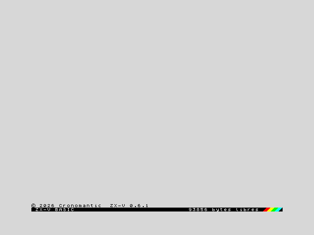
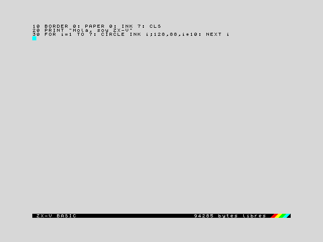
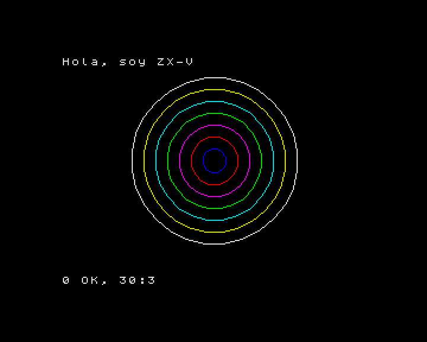
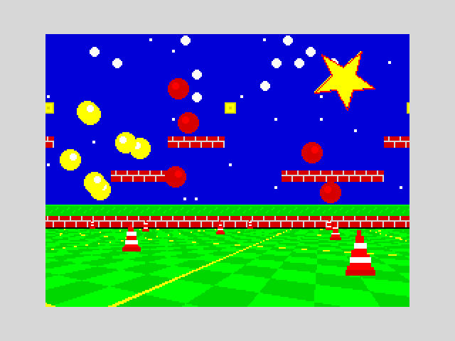

[English](../en/getting-started.md) · **Español**

# Primeros pasos

Esta página te lleva desde cero hasta escribir y ejecutar tu primer programa en
unos cinco minutos. No hace falta saber nada del ZX Spectrum ni de
programación.

## ¿Qué es ZX-V?

ZX-V es un pequeño ordenador doméstico de 32 bits, nuevo pero con el espíritu
del ZX Spectrum de los años 80. Como los ordenadores de entonces, lo enciendes
y está listo para que escribas: arranca directamente en el **BASIC**, un
lenguaje de programación sencillo. Tiene 15 colores vivos, dos chips de música,
una tarjeta SD para tus ficheros, y también ejecuta programas rápidos escritos
en C.

ZX-V es a la vez una máquina real, hecha con dos placas Raspberry Pi Pico 2, y
un emulador que ejecuta exactamente el mismo software en tu PC o en el
navegador. Todo lo de esta página funciona igual en todos ellos.

## Elige cómo usarlo

| Opción | Qué necesitas | Ideal para |
|---|---|---|
| **Emulador de escritorio** (`zxv`) | Un PC con Windows (64 bits) o Linux (x86-64) | Casi todo el mundo: programar, jugar, desarrollar |
| **Versión web** | Un navegador moderno (Chrome, Edge, Firefox...) | Probarlo sin instalar nada, o ponerlo en una web |
| **Hardware real** | La placa de ZX-V (o una protoboard), dos Pico 2, un teclado USB y una pantalla HDMI | La experiencia completa; ver [Construir el hardware](hardware/README.md) |

## Descarga

Todo está en la página del proyecto en GitHub, en
[**Releases**](https://github.com/cronomantic/ZX-V/releases). La última versión
trae estos paquetes:

| Fichero | Qué es |
|---|---|
| `zxv-windows-x64.zip` | El emulador para Windows |
| `ZX-V-…-x86_64.AppImage` | El emulador para Linux (x86-64) en un solo fichero, con todo dentro |
| `zxv-linux-x86_64.tar.gz` | El emulador para Linux (x86-64), con el Qt y el SDL del sistema |
| `zxv-web.zip` | La versión web |
| `zxv-uf2.zip` | El firmware de las dos Pico de la máquina real (ver [El firmware](hardware/firmware.md)) |

**Windows:** descomprime `zxv-windows-x64.zip` donde quieras (en el escritorio,
por ejemplo) y haz doble clic en `zxv.exe`. No hay que instalar nada más.

**Linux:** lo más sencillo es la AppImage: hazla ejecutable y ábrela
(`chmod +x ZX-V-*.AppImage` y luego doble clic, o `./ZX-V-*.AppImage`). Lleva
Qt y SDL dentro y funciona en casi todas las distribuciones desde 2022
(Ubuntu 22.04, Debian 12, Fedora 36...). Los otros programas del paquete
también van a través de ella: `./ZX-V-*.AppImage zxv-cli --help`. Si se queja
de FUSE (en un contenedor, por ejemplo), añade `--appimage-extract-and-run`.

O descomprime el paquete (`tar xzf zxv-linux-x86_64.tar.gz`) y ejecuta
`zxv-linux/zxv`. Necesita Qt 6 y SDL 2, que casi todos los escritorios ya
tienen; en Debian o Ubuntu:

```sh
sudo apt install libqt6widgets6 libsdl2-2.0-0
```

**Versión web:** descomprime `zxv-web.zip` y haz doble clic en `index.html`.
Funciona directamente desde el disco, sin servidor web.

Los paquetes de Windows y Linux traen también esta documentación, para leerla
sin conexión: abre `docs/index.html`, o **Ayuda > Documentación** en
el emulador.


## El primer arranque

Abre el emulador. Al momento verás esto:



Eso es todo: una pantalla gris clara, una línea de copyright y una barra negra
abajo. La barra es el **editor** del BASIC: *ZX-V BASIC* a la izquierda y, a la
derecha, cuánta memoria queda libre para tu programa (unos 96.000 bytes). Las
franjas de colores son un homenaje al Spectrum 128.

La primera vez que abres `zxv`, además, crea una carpeta llamada **ZX-V** en tu
carpeta *Documentos* y copia en ella los programas de ejemplo. Esa carpeta es
la **tarjeta SD** de la máquina: todo lo que grabes irá ahí. Más sobre ella
[abajo](#grabar-y-cargar-tus-programas).

Los menús del emulador y los mensajes de la máquina pueden ir en español o en
inglés: se elige en **Opciones > Idioma**. En la versión web, en
**Ver > Opciones...**.

## Tu primer programa

Un programa es una lista de líneas numeradas. Escribe esta línea tal cual y
pulsa **Intro**:

```
10 BORDER 0: PAPER 0: INK 7: CLS
```

La línea sube al listado, y las palabras clave (`BORDER`, `PAPER`...) se
muestran en mayúsculas. Puedes escribirlas en mayúsculas o en minúsculas, como
prefieras: basta con escribir cada palabra letra a letra, como en cualquier
ordenador.

Ahora escribe las otras dos líneas, pulsando **Intro** después de cada una:

```
20 PRINT "Hola, soy ZX-V"
30 FOR i=1 TO 7: CIRCLE INK i;128,88,i*10: NEXT i
```

La pantalla quedará así:



Si te equivocas, mueve el cursor con las flechas y corrígelo como en un editor
de textos: **Retroceso** y **Supr** borran, e **Intro** vuelve a guardar la
línea. Si una línea tiene un error, la máquina suelta un zumbido y deja el
cursor donde está el problema.

Ahora escribe `RUN` y pulsa **Intro**. El programa se ejecuta:



La línea 10 pinta de negro el borde y el fondo y elige el blanco para el texto,
la 20 escribe un mensaje y la 30 dibuja siete círculos, uno de cada color. El
mensaje de abajo, `0 OK, 30:3`, quiere decir que el programa terminó sin
errores, en la línea 30, sentencia 3. Pulsa una tecla para volver al editor,
donde te espera tu programa. (Esa tecla también se escribe en el editor; si era
una letra, bórrala sin más.)

Algunas teclas que conviene conocer desde el principio:

| Tecla | Qué hace |
|---|---|
| **Intro** | Guarda la línea, o ejecuta una orden escrita sin número de línea |
| **Esc** | Para un programa en marcha (es la tecla **BREAK**); en el editor, deshace los cambios de la línea |
| **Tab** | La tecla **EDIT**: abre el menú de opciones del editor (renumerar, ver la pantalla del programa, imprimir) |
| Flechas, Inicio, Fin, RePág, AvPág | Se mueven por el listado |

Para probar otra cosa, escribe `NEW` y pulsa **Intro**: borra el programa para
empezar de nuevo.

El [curso de BASIC](basic/README.md) empieza aquí y te enseña el lenguaje paso
a paso.

## Los ejemplos de serie: la unidad `ROM:`

ZX-V trae un disco de solo lectura lleno de ejemplos, la **unidad `ROM:`** (en
la máquina real va dentro de la Pico CPU, así que siempre está ahí). Para ver
lo que tiene, escribe:

```
CAT "ROM:"
```

| Fichero | Qué es |
|---|---|
| `platformer.tap` y `platformer.gfx` | Un juego de plataformas escrito en BASIC, y sus gráficos |
| `rps.bas` | Rock, Paper, Scissors en BASIC, en texto: `LOAD "rps"` lo carga y `LIST` lo enseña |
| `sentry.bas` | *Sentry*, defiende las ciudades de los misiles con el ratón, el teclado o un mando, en BASIC |
| `estela.zxv` | *Estela*, un matamarcianos de tres fases |
| `route128.zxv` | *Route 128*, carreras contra el reloj por una carretera con curvas y cambios de rasante |
| `muncher.bas` | *Muncher*, cómete los puntos del laberinto sin que te pillen sus cuatro perseguidores, en BASIC |
| `cascade.bas` | *Cascade*, junta tres gemas del mismo color en línea antes de que se llene el pozo, en BASIC (con `cascade.gfx`, `cascade.pt3` y `cascade.afb`) |
| `mine.zxv` | *The Mine*, cava y junta diamantes entre piedras que caen |
| `street.zxv` | *Street Justice*, peleas por las calles contra las bandas del barrio |
| `umbra.zxv` | *Umbra*, un laberinto en 3D a oscuras |
| `keep.zxv` | *The Keep*, una aventura de mazmorras de cuatro plantas |
| `graphics.zxv` | Una demostración gráfica: escenario que se desplaza, pelotas que rebotan, una estrella que gira y un suelo en 3D |
| `scroll.zxv` | Desplazamiento suave por un paisaje de cuatro pantallas de ancho, con parallax |
| `digital.zxv` | Sonido digitalizado por el chip de música |
| `hello.zxv` | El ejemplo más pequeño de programa nativo |
| `boardtest.zxv` | La prueba de la placa: monitor, reloj, tarjeta, teclado, mandos, ratón y sonido, uno a uno |
| `files.zxv` | Un programa nativo que crea, lee y lista ficheros en la tarjeta SD |

Los ficheros que acaban en `.zxv` son **programas nativos**, escritos en C. Se
cargan con `LOAD`:

```
LOAD "ROM:graphics"
```



Pulsa una tecla para volver al BASIC. Prueba también `LOAD "ROM:estela"`: es un
juego completo (flechas o O, P, Q, A para moverte, espacio o M para disparar y
Esc para salir).

Los juegos en BASIC que cargan más ficheros, como el de plataformas, los
encuentran en la unidad `ROM:` solos: `LOAD "ROM:platformer"`. También puedes
entrar en la unidad y cargarlos desde ahí:

```
CD "ROM:"
LOAD "platformer"
```

`CD "SD:"` te devuelve a la tarjeta SD.

> Cuando termina un programa nativo, vuelves al BASIC con el informe `0 OK`
> (o con un informe `W` si el programa ha acabado con un error), pero el
> programa BASIC que tuvieras en memoria ha desaparecido: el programa nativo
> ha usado esa memoria. Grábalo antes.

## Grabar y cargar tus programas

Tus programas se graban en la **tarjeta SD**. En el emulador de escritorio es
la carpeta **ZX-V** de tus *Documentos* (puedes elegir otra en
**Archivo > Tarjeta SD**). Para grabar el programa que tienes en memoria, ponle
un nombre:

```
SAVE "circulos"
```

Esto crea el fichero `circulos.tap` en la tarjeta. Para ver lo que hay en la
tarjeta, escribe `CAT`. Para volver a cargar el programa más tarde:

```
LOAD "circulos"
```

No hace falta escribir la extensión: `LOAD` busca `circulos.tap`, después
`circulos.zxv` y por último un fichero llamado solo `circulos`. Los ejemplos
que se copiaron a la tarjeta la primera vez se cargan igual, sin `ROM:`:
`LOAD "estela"`.

Los nombres de fichero solo pueden llevar letras sin tildes, cifras y algunos
signos, hasta 63 caracteres: `circulos`, no `círculos`. Las mayúsculas y las
minúsculas cuentan como el mismo nombre.

En el emulador de escritorio, **Archivo > Grabar el programa...** (Alt+G) hace
lo mismo que `SAVE`, con un diálogo.

Si ves `U No hay tarjeta SD`, el emulador está funcionando sin tarjeta: elige
una en **Archivo > Tarjeta SD**.

## Abrir ficheros de tu PC

Puedes abrir ficheros de cualquier sitio de tu ordenador con
**Archivo > Abrir...** (Alt+O), arrastrándolos a la ventana del emulador o
dándolos al arrancarlo (`zxv juego.tap`):

| Fichero | Qué pasa |
|---|---|
| `.zxv` | Un programa nativo de ZX-V: se carga y se ejecuta |
| `.tap`, `.tzx` | Un fichero de cinta: se carga con `LOAD`, como en la máquina. Es el formato en el que ZX-V graba los programas BASIC, y también carga los programas BASIC hechos para el ZX Spectrum |
| `.bas`, `.txt` | Un listado BASIC en texto: se teclea solo en el editor |
| `.zxvs` | Una instantánea: la máquina entera, tal como estaba al guardarla |
| `.img`, una carpeta | Pasa a ser la tarjeta SD |

Si el programa no está en la tarjeta SD, el emulador pregunta si copiarlo a la
tarjeta o usar su carpeta como tarjeta. Los detalles, en
[El emulador](emulator.md).

> **Si conoces el Spectrum:** los `.tap` y `.tzx` del Spectrum con programas
> BASIC se cargan y funcionan, también las cintas de varias partes (un cargador
> seguido de `LOAD ""`). En cambio, el código máquina Z80 no se puede ejecutar
> en ZX-V, así que la mayoría de los juegos comerciales del Spectrum no
> funcionarán.

## Y ahora, ¿qué?

- **[Aprende BASIC](basic/README.md)**: un curso desde cero que termina con un
  juego completo.
- **[El editor](basic/editor.md)** y la **[referencia del BASIC](basic/reference.md)**.
- **[El emulador](emulator.md)**: menús, teclas, instantáneas, la versión web y
  todas las opciones.
- **[La máquina](machine.md)**: lo que sabe hacer ZX-V: pantalla, colores,
  sonido, memoria y ficheros.
- **[Programas nativos (SDK)](sdk/README.md)**: programas y juegos rápidos en C.
- **[Construir el hardware](hardware/README.md)**: haz tu propio ZX-V de verdad.
