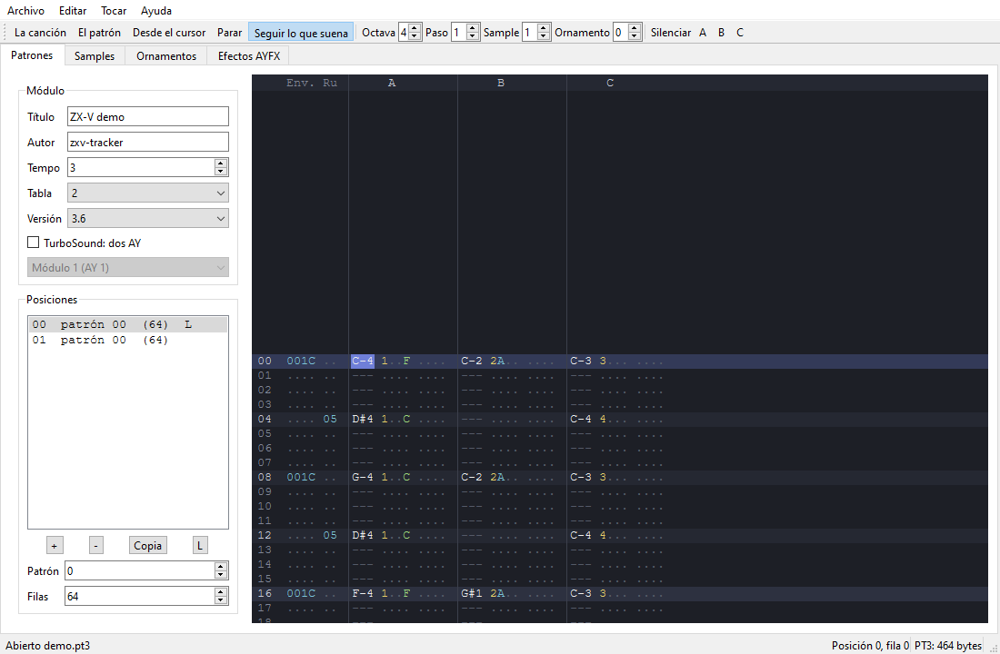

[English](../../en/sdk/README.md) · **Español**

# Programas nativos (SDK)

Un **programa nativo** (`.zxv`) es un programa escrito en C o en
ensamblador RISC-V y compilado para el procesador de la propia máquina.
Funciona a toda velocidad, tiene la máquina entera para él y puede hacer
todo lo que hace el BASIC y más: juegos con decenas de sprites, sonido
digitalizado, tus propios formatos de fichero.

Esta guía te lleva desde instalar las herramientas hasta distribuir un
programa terminado. La lista completa de funciones, constantes y formatos
está en la [referencia de la API](reference.md), y el motor gráfico tiene
su propia página: [Gráficos](graphics.md).

**Contenido**

- [¿Programa nativo o BASIC?](#programa-nativo-o-basic)
- [Instalar las herramientas](#instalar-las-herramientas)
- [Compilar y ejecutar los ejemplos](#compilar-y-ejecutar-los-ejemplos)
- [Tu primer programa](#tu-primer-programa)
- [Cómo funciona un programa](#cómo-funciona-un-programa)
- [La pantalla, los colores y el texto](#la-pantalla-los-colores-y-el-texto)
- [Gráficos: dibujo, sprites y mapas de tiles](#gráficos-dibujo-sprites-y-mapas-de-tiles)
- [Sonido](#sonido)
- [Teclado, mando y ratón](#teclado-mando-y-ratón)
- [Ficheros en la tarjeta SD](#ficheros-en-la-tarjeta-sd)
- [El tiempo y el bucle de frames](#el-tiempo-y-el-bucle-de-frames)
- [Programar en ensamblador](#programar-en-ensamblador)
- [Depurar](#depurar)
- [Distribuir tu programa](#distribuir-tu-programa)

## ¿Programa nativo o BASIC?

Usa el **BASIC** cuando quieras probar ideas deprisa, aprender o escribir
programas que sean sobre todo texto, menús o juegos sencillos. El BASIC de
ZX-V ya tiene sprites, mapas de tiles, sonido y ficheros, y cambias una
línea y lo vuelves a ejecutar en un segundo.

Usa un **programa nativo** cuando necesites:

- **Velocidad.** El C va muchas veces más rápido que el BASIC: la CPU hace
  unos 2,4 millones de instrucciones por frame (60 frames por segundo).
- **Control.** Tus propias estructuras de datos, aritmética de coma fija,
  tu propio motor de sonido, tus propios formatos de fichero.
- **Espacio.** Casi 248 KB para código y datos, con toda la memoria de la
  máquina a tu disposición mientras el programa funciona.

A cambio, escribes en C en tu ordenador, compilas y luego cargas el
resultado en la máquina o en el emulador. Mucha gente combina las dos
cosas: prueba una idea en BASIC y luego escribe el juego terminado en C.

Hay una tercera vía: **compilar BASIC** con [ZX Basic](../zxbasic.md), que
convierte un programa en BASIC en un `.zxv` unas 90 veces más rápido que en
el BASIC de la máquina.

**Si conoces el Spectrum:** un `.zxv` es como un programa en código
máquina cargado con `LOAD "" CODE` y arrancado con `RANDOMIZE USR`, pero en
C, con un procesador de 32 bits y una biblioteca de rutinas del sistema a
las que llamas como a funciones normales de C.

## Instalar las herramientas

Necesitas tres cosas:

1. **Un compilador cruzado GCC para RISC-V** (`riscv64-unknown-elf-gcc`).
   Aunque lleve «64» en el nombre, también genera el código de 32 bits que
   usa ZX-V.
2. **Python 3**, para las herramientas que convierten el programa
   compilado en un `.zxv` y las imágenes en gráficos.
3. **El SDK**: la carpeta `sdk` del
   [repositorio de ZX-V](../../../sdk). Clona o descarga el repositorio; las
   órdenes de esta guía se ejecutan desde su carpeta principal.

Opcionalmente:

- **picolibc**, la biblioteca estándar de C para máquinas pequeñas, si
  quieres `printf`, `fopen`, `malloc` y compañía (ver
  [Dos formas de escribir en C](#dos-formas-de-escribir-en-c)).
- **GDB** para RISC-V, para depurar con puntos de ruptura (ver
  [Depurar](#depurar)).
- **El emulador**, para ejecutar tus programas en tu ordenador (ver
  [El emulador](../emulator.md)). La versión sin ventana, `zxv-cli`, viene
  muy bien para pruebas rápidas y automáticas.

### Linux (Debian, Ubuntu)

```sh
sudo apt install gcc-riscv64-unknown-elf picolibc-riscv64-unknown-elf python3 make
# opcional, para depurar:
sudo apt install gdb-multiarch
```

Son los paquetes que usan las compilaciones automáticas del proyecto en
Ubuntu 24.04.

### Windows

Instala [MSYS2](https://www.msys2.org/) y, en su terminal **UCRT64**:

```sh
pacman -S mingw-w64-ucrt-x86_64-riscv64-unknown-elf-toolchain \
          mingw-w64-ucrt-x86_64-python make
# opcional, para depurar:
pacman -S mingw-w64-ucrt-x86_64-gdb-multiarch
```

Ejecuta las órdenes de esta guía en esa misma terminal. MSYS2 no tiene
paquete de picolibc, así que en Windows puedes compilar todos los ejemplos
menos `files` y escribir programas sin la biblioteca estándar de C (lo
normal: todos los demás ejemplos, incluido el juego Estela, son así).

### macOS

Todavía no hay una receta probada para macOS. El paquete `riscv64-elf-gcc`
de Homebrew debería servir si trae las bibliotecas de 32 bits `ilp32`; sus
órdenes empiezan por `riscv64-elf-` en vez de `riscv64-unknown-elf-`, así
que compila con `make -C sdk CROSS=riscv64-elf-`.

### Comprobar la instalación

```sh
riscv64-unknown-elf-gcc --version
python3 --version
```

## Compilar y ejecutar los ejemplos

Desde la carpeta principal del repositorio:

```sh
make -C sdk
```

Compila todos los ejemplos de `sdk/examples/` y deja los programas en
`sdk/build/`: `hello.zxv`, `graphics.zxv`, `estela.zxv`, etc. (y junto a cada
uno, el `.elf` con la información para depurar). Sin picolibc (MSYS2, en
Windows, no la tiene), `make` lo dice y compila los demás, sin `files`.

| Ejemplo | Qué enseña |
|---|---|
| [`hello`](../../../sdk/examples/hello/hello.c) | Los primeros pasos: texto con las rutinas del sistema, dibujo directo en la memoria de vídeo y una nota en el chip de sonido |
| [`graphics`](../../../sdk/examples/graphics/graphics.c) | El motor gráfico: un mapa de tiles que se desplaza, sprites que rebotan y chocan, un polígono que gira y un suelo en «modo 7» con sprites escalados, todo con doble buffer |
| [`scroll`](../../../sdk/examples/scroll/scroll.c) | Scroll por hardware sobre un campo de 1024 píxeles de ancho, dibujando solo la columna que entra, y parallax con la tabla por línea |
| [`digital`](../../../sdk/examples/digital/digital.c) | Sonido digitalizado: muestras a 8 kHz por el volumen de un canal del chip de sonido |
| [`files`](../../../sdk/examples/files/files.c) | La biblioteca estándar de C con la tarjeta SD: `fopen`, `fprintf`, `fgets`, `opendir`, `malloc`... (necesita picolibc) |
| [`boardtest`](../../../sdk/examples/boardtest/boardtest.c) | La prueba de la placa: `OUT_INFO` (la salida y el monitor), el reloj, un fichero escrito y leído, el teclado, los mandos y el ratón en vivo, y los canales del AY en estéreo |
| [`estela`](../../../sdk/examples/estela) | **Estela**, un matamarcianos completo: tres fases, jefes, música y efectos con los dos chips de sonido, teclado y mando, récord en la tarjeta; sus gráficos (`.gfx`) y sus músicas (`.pt3`) se cambian sin compilar ([su README](../../../sdk/examples/estela/README.es.md)) |
| [`route128`](../../../sdk/examples/route128) | **Route 128**, un juego de carreras: una carretera en pseudo-3D con curvas y cambios de rasante, pintada línea a línea, y el paisaje y el tráfico con sprites escalados; tres etapas contra el reloj; sus gráficos (`.gfx`) y sus músicas (`.pt3`) se cambian sin compilar ([su README](../../../sdk/examples/route128/README.es.md)) |
| [`mine`](../../../sdk/examples/mine) | **The Mine**, un juego de cavar: piedras y diamantes que caen y ruedan, bichos que siguen las paredes, musgo que crece y doce cuevas más grandes que la pantalla, con scroll suave; las reglas, aparte, se prueban también en el PC ([su README](../../../sdk/examples/mine/README.es.md)) |
| [`street`](../../../sdk/examples/street) | **Street Justice**, un juego de peleas por las calles: luchadores dibujados con el motor a partir de un esqueleto en poses, profundidad, agarres, matones que se turnan para atacar y un jefe en cada una de las tres fases ([su README](../../../sdk/examples/street/README.es.md)) |
| [`player`](../../../sdk/examples/player/player.c) | Música y efectos con la biblioteca `zxv_music.h`: un reproductor de módulos PT3, TurboSound, PT2, STC, ASC y PSG y de bancos de efectos AYFX, con los registros de los dos AY a la vista |
| [`gfxedit`](../../../sdk/examples/gfxedit) | **El editor de gráficos**: sprites, tiles, mapas y texturas en ficheros `.gfx`, con el ratón ([en la guía de gráficos](graphics.md#el-editor-de-gráficos-de-la-máquina-gfxedit)) |

Para ejecutar uno, el `.zxv` tiene que estar en la tarjeta SD de la
máquina:

- **En el emulador de escritorio (`zxv`)**, abre el fichero con Archivo >
  Abrir (Alt+O) o arrástralo a la ventana. El emulador ofrece copiarlo a la
  tarjeta y lo carga.
- **En cualquier emulador o en la máquina real**, copia el `.zxv` a la
  tarjeta SD (en el emulador de escritorio, la tarjeta es la carpeta `ZX-V`
  de tus Documentos) y escribe en el BASIC:

  ```
  LOAD "graphics"
  ```

  La extensión `.zxv` es opcional. En la versión web, sube antes el fichero
  con Archivo > La tarjeta SD.

Los ejemplos vienen también dentro de la máquina, en la unidad `ROM:`:
`LOAD "ROM:graphics"` funciona en una máquina recién encendida sin copiar
nada.

## Tu primer programa

Crea una carpeta para tu programa, junto al repositorio o donde quieras, y
guarda esto como `hello.c`:

```c
#include "zxv_api.h"

int main(void)
{
    zxv_cls(7);                                 /* borra la pantalla en blanco */
    zxv_print_str("Hola desde C!\n");
    zxv_print_str("Pulsa una tecla para volver al BASIC.");

    for (int x = 0; x < 256; x++)               /* una línea roja de lado a lado */
        zxv_plot(x, 100, 2);

    while (zxv_key_get() < 0)                   /* espera una tecla... */
        zxv_wait_vblank();                      /* ...frame a frame */
    return 0;
}
```

Compílalo (cambia `SDK` por donde esté la carpeta `sdk`):

```sh
SDK=../ZX-V/sdk
riscv64-unknown-elf-gcc -march=rv32imac_zicsr_zifencei_zba_zbb_zbs_zbkb_zcb -mabi=ilp32 \
    -Os -g -Wall -Wextra -std=gnu11 -ffreestanding -fno-builtin \
    -fno-tree-loop-distribute-patterns -I$SDK/include \
    -nostdlib -nostartfiles -static -T $SDK/zxv.ld -Wl,--gc-sections \
    -Wl,--no-warn-rwx-segments \
    $SDK/crt0.S $SDK/zxvlib.c hello.c -lgcc -o hello.elf
python3 $SDK/tools/elf2zxv.py hello.elf hello.zxv
```

La primera orden compila y enlaza tu programa para el procesador de ZX-V
en `hello.elf`. La segunda lo convierte en `hello.zxv`, el fichero que
carga la máquina. Copia `hello.zxv` a la tarjeta SD y escribe
`LOAD "hello"`:

- `zxv_cls(7)` borra la pantalla con el color 7 (blanco).
- `zxv_print_str` escribe texto en el cursor de texto, que empieza arriba a
  la izquierda; `\n` pasa a la línea siguiente.
- `zxv_plot(x, y, color)` pinta un píxel. La pantalla mide 256 × 192
  píxeles, con el (0, 0) arriba a la izquierda.
- `zxv_key_get()` devuelve la siguiente tecla pulsada, o −1 si no hay
  ninguna. `zxv_wait_vblank()` espera al siguiente frame (1/60 de segundo)
  para que el bucle no dé vueltas en vano.
- Cuando `main` devuelve 0, estás otra vez en el BASIC con el informe
  `0 OK`.

### Un Makefile para tu proyecto

Escribir esas órdenes cada vez cansa. Este `Makefile` lo hace por ti
(`make` compila, `make clean` borra lo compilado):

```make
# Dónde está el SDK de ZX-V (la carpeta sdk del repositorio).
SDK     ?= ../ZX-V/sdk
CROSS   ?= riscv64-unknown-elf-
PYTHON  ?= python3
NAME    := hello
SOURCES := hello.c

CFLAGS  := -march=rv32imac_zicsr_zifencei_zba_zbb_zbs_zbkb_zcb -mabi=ilp32 \
           -Os -g -Wall -Wextra -std=gnu11 -ffreestanding -fno-builtin \
           -fno-tree-loop-distribute-patterns -I$(SDK)/include
LDFLAGS := -nostdlib -nostartfiles -static -T $(SDK)/zxv.ld -Wl,--gc-sections \
           -Wl,--no-warn-rwx-segments

$(NAME).zxv: $(NAME).elf
	$(PYTHON) $(SDK)/tools/elf2zxv.py $< $@

$(NAME).elf: $(SOURCES) $(SDK)/crt0.S $(SDK)/zxvlib.c
	$(CROSS)gcc $(CFLAGS) $(LDFLAGS) $(SDK)/crt0.S $(SDK)/zxvlib.c $(SOURCES) -lgcc -o $@

clean:
	rm -f $(NAME).elf $(NAME).zxv
```

Añade tus otros ficheros `.c` a `SOURCES`. Las líneas de las órdenes
tienen que empezar con un tabulador, no con espacios.

## Cómo funciona un programa

### De `LOAD` a `main`

Cuando escribes `LOAD "hello"`, la máquina:

1. lee el `.zxv` y lo comprueba (una firma y una suma de control, así que
   nunca ejecuta un fichero dañado);
2. copia el programa al principio de la **RAM de usuario** (la dirección
   `0x2003_4000`) y pone a cero sus variables sin valor inicial;
3. pone el modo de vídeo que diga el fichero (el 0, salvo que elijas otro:
   ver [Distribuir](#distribuir-tu-programa)) y borra la pantalla;
4. salta a `crt0.S`, el trocito de código de arranque que añade el SDK, que
   llama a tu `main`.

Tu programa usa la pila que ya usaba el sistema, en lo alto de la RAM de
usuario, y crece hacia abajo desde ahí.

### Volver al BASIC

Hay dos formas de terminar:

- **Volver de `main`.**
- **Llamar a `zxv_exit_to_basic(código)`** desde cualquier sitio, por muy
  dentro que estés.

El número que devuelves (o que pasas como `código`) le dice al BASIC cómo ha
ido. **El 0 significa que todo ha ido bien**: el BASIC enseña `0 OK, 0:1`.
Cualquier otro número es un error, y el BASIC lo enseña en un informe `W`:
`W Error en el código nativo (3), 0:1`. Para explicar el error con palabras,
termina con **`zxv_report_error(código, mensaje)`**: el BASIC enseña tu
mensaje en vez del suyo, seguido del código si no es 0.

```c
if (zxv_file_load("nivel1.dat", nivel, sizeof(nivel)) < 0)
    zxv_report_error(1, "No puedo cargar nivel1.dat");   /* W No puedo cargar nivel1.dat (1), 0:1 */
```

En todos los casos la memoria del programa vuelve a ser del BASIC, así que
el programa BASIC que hubiera en memoria se pierde. El BASIC también deja
la pantalla como siempre (página 0, modo 0, sin scroll) y calla los chips
de sonido, pero es de buena educación dejarlo todo recogido tú mismo.

Si tu programa falla (por ejemplo, lee de una dirección prohibida), la
máquina también vuelve al BASIC, con el informe
`W Error en el código nativo, 0:1`. **Ctrl+Alt+Supr** para un programa que
se ha colgado, con `L BREAK en el programa, 0:1`.

Un programa nativo no puede lanzar otro: todos los programas se cargan en
la misma dirección, así que `zxv_exec` devuelve `ZXV_E_ACCESS` cuando la
llama un `.zxv`. Solo el BASIC lanza programas.

### La memoria

| Zona | Dirección | Tamaño | Uso |
|---|---|---|---|
| RAM de usuario | `0x2003_4000` – `0x2007_1FFF` | 248 KB | Tu código, tus datos y la pila |
| Página de vídeo 0 | `0x2000_4000` | 96 KB | La pantalla (ver [gráficos](graphics.md)) |
| Página de vídeo 1 | `0x2001_C000` | 96 KB | Una segunda pantalla, para el doble buffer |
| Área de sistema | `0x2000_0000` | 16 KB | Registros de pantalla, sonido y entrada; variables del sistema |
| ROM | `0x1004_0000` | 512 KB | El BASIC y las rutinas del sistema (solo lectura) |

- El programa y sus variables van abajo en la RAM de usuario, y la pila
  arriba. Deja sitio a la pila: el sistema solo comprueba que quedan 4 KB
  libres al cargar el programa. 32 KB, lo que deja picolibc, es una
  cantidad cómoda.
- En el modo 0 cada página de vídeo solo enseña sus primeros 24 KB; los
  otros 72 KB de cada página son RAM libre si te falta sitio (salvo que uses
  los campos de scroll grandes de [gráficos](graphics.md#scroll-por-hardware)).
- Los 64 KB que hay encima de la RAM de usuario son del sistema: tocarlos
  detiene tu programa.

### Las reglas de la máquina

El mismo programa tiene que funcionar en el emulador y en la máquina real.
Para eso:

1. Usa solo las rutinas del sistema (la API), los registros de ZX-V y la
   memoria. El chip con el que está hecho ZX-V tiene otros periféricos
   (temporizadores, DMA...); no forman parte de la máquina y tu programa no
   debe tocarlos.
2. Sincronízate con el frame (`zxv_wait_vblank`), nunca contando
   instrucciones: el procesador real y el emulador no van exactamente a la
   misma velocidad.
3. No escribas en la página de vídeo **visible** justo al empezar un frame,
   mientras el sistema todavía la está enviando a la pantalla (ver el
   [doble buffer](graphics.md#las-páginas-y-el-doble-buffer)).
4. Para volver al BASIC, `main` tiene que conservar los registros
   `s0`–`s11`, como cualquier función de C. En ensamblador, ocúpate tú.

Ejecuta tu programa en el emulador con `--strict` (u Opciones > Modo
estricto en `zxv`): avisa de casi todas las reglas incumplidas.

### Dos formas de escribir en C

**Sin la biblioteca estándar de C** (lo normal, y lo que hacen los
ejemplos): enlazas `zxvlib.c`, que solo trae `memcpy`, `memset`, `memmove`
y `memcmp` (el compilador puede llamarlas por su cuenta para copiar
estructuras). Tienes las cabeceras que vienen con el compilador
(`<stdint.h>`, `<stddef.h>`, `<stdbool.h>`, `<stdarg.h>`...) y las de ZX-V:

| Cabecera | Contenido |
|---|---|
| `zxv_api.h` | Las rutinas del sistema como funciones de C: pantalla, texto, teclas, mando, sonido, ficheros, reloj, ratón |
| `zxv_gfx.h` | El motor gráfico: bitmaps, sprites, mapas de tiles, modo 7 y figuras (incluye `zxv_api.h`) |
| `zxv.h` | Direcciones, registros y constantes (la incluyen las otras dos) |

No hay `printf` ni `malloc`: escribes con `zxv_print_str` y guardas tus
datos en vectores globales o estáticos. `float`, `double` y los enteros de
64 bits funcionan (el compilador añade las rutinas de `libgcc`), pero el
procesador no tiene unidad de coma flotante y son lentos; los juegos usan
enteros y coma fija.

**Con la biblioteca estándar de C** (picolibc): puedes usar `printf`,
`fopen`, `fgets`, `opendir`, `malloc`, `time` y casi toda la biblioteca de
C. `zxvc.c` la conecta con la máquina. Se compila con
`--specs=picolibc.specs` en vez de `-nostdlib`, y con `zxvc.c` en vez de
`zxvlib.c`:

```sh
riscv64-unknown-elf-gcc -march=rv32imac_zicsr_zifencei_zba_zbb_zbs_zbkb_zcb -mabi=ilp32 -Os \
    --specs=picolibc.specs -nostartfiles -static -T $SDK/zxv.ld -I$SDK/include \
    -Wl,--gc-sections -Wl,--no-warn-rwx-segments \
    $SDK/crt0.S $SDK/zxvc.c mi_programa.c -o mi_programa.elf
```

El programa crece (el ejemplo `files` ocupa 14 KB; 6,7 KB con
`-DPICOLIBC_INTEGER_PRINTF_SCANF`, un `printf` sin decimales). Los detalles,
en [la referencia](reference.md#la-biblioteca-estándar-de-c-picolibc).

## La pantalla, los colores y el texto

La pantalla tiene dos modos:

| Modo | Píxeles | Texto (caracteres de 8 × 8) |
|---|---|---|
| 0 | 256 × 192 | 32 columnas × 24 filas |
| 1 | 512 × 384 | 64 columnas × 48 filas |

Los programas empiezan en el modo 0, salvo que el `.zxv` diga otra cosa.
`zxv_set_mode(1)` cambia de modo y borra la pantalla.

Cada píxel es uno de **16 números de color**: ocho colores, y los mismos
ocho más brillantes (suma 8):

| Color | Normal | Brillante |
|---|---|---|
| Negro | 0 | 8 |
| Azul | 1 | 9 |
| Rojo | 2 | 10 |
| Magenta | 3 | 11 |
| Verde | 4 | 12 |
| Cian | 5 | 13 |
| Amarillo | 6 | 14 |
| Blanco | 7 | 15 |

El color 8 es el mismo negro que el 0, pero el motor gráfico lo usa como
**transparente** en los sprites y los tiles.

Este programa dibuja los 16 y cambia el color del **borde**, el marco que
rodea la imagen:

```c
#include "zxv_gfx.h"

#define REG8(a) (*(volatile uint8_t *)(uintptr_t)(a))

int main(void)
{
    zxv_cls(0);                                 /* pantalla negra */
    REG8(ZXV_V_BORDER) = 1;                     /* borde azul */
    for (int c = 0; c < 16; c++)                /* una barra por color */
        zxv_gfx_rect(c * 16, 32, 16, 128, c);
    zxv_print_str("Los 16 colores (el 8 tambien es negro)");

    while (zxv_key_get() < 0)
        zxv_wait_vblank();
    REG8(ZXV_V_BORDER) = 7;                     /* como le gusta al BASIC */
    return 0;
}
```

El borde es un **registro**: un byte del área de sistema que escribes como
cualquier variable. Los registros se aplican al empezar el frame
siguiente. La cabecera `zxv.h` les da nombre a todos (`ZXV_V_BORDER`,
`ZXV_V_SCROLL_X`...); ver la [referencia](reference.md#registros-de-vídeo).

### El texto

`zxv_print_str(s)` y `zxv_print_char(c)` escriben en el cursor de texto, en
celdas de 8 × 8 píxeles. Cuando el texto llega abajo, la pantalla sube.

- `zxv_text_at(col, fila)` mueve el cursor. Las columnas y las filas se
  cuentan desde 0 arriba a la izquierda: 32 × 24 en el modo 0 y 64 × 48 en
  el modo 1. `zxv_cls` y `zxv_set_mode` también lo devuelven arriba a la
  izquierda.
- `zxv_text_colors(tinta, papel)` elige los colores: cada carácter se
  dibuja con la `tinta` en una celda llena del `papel`. Son negro sobre
  blanco salvo que un programa los cambie, y siguen cambiados cuando acaba,
  así que elígelos antes de escribir.
- Las cadenas van en UTF-8, como tu código en C. Además de los ASCII, la
  fuente tiene `©` y las letras del español `á é í ó ú ü ñ`, sus
  mayúsculas, `¿` y `¡`; cualquier otro carácter sale como `?`. `\n` o
  `\r` empiezan una línea nueva y `\b` borra el carácter anterior.

```c
#include "zxv_api.h"

int main(void)
{
    zxv_cls(1);                                 /* pantalla azul */
    zxv_text_colors(14, 1);                     /* amarillo brillante sobre azul */
    zxv_text_at(8, 10);                         /* columna 8, fila 10 */
    zxv_print_str("¡Hola, señor Núñez!");       /* en UTF-8, con sus tildes */

    zxv_text_colors(0, 7);                      /* negro sobre blanco */
    zxv_text_at(0, 23);                         /* la última fila */
    zxv_print_str("Pulsa una tecla");
    while (zxv_key_get() < 0)
        zxv_wait_vblank();
    return 0;
}
```

Basta para mensajes y pruebas. Los juegos suelen dibujar su propio texto:
Estela tiene una fuente de 5 × 7, con tildes, en
[`draw.c`](../../../sdk/examples/estela/draw.c).

### Dibujar

`zxv_plot` pinta un píxel. Para todo lo demás está el motor gráfico
(`zxv_gfx.h`): líneas, rectángulos, círculos, triángulos, polígonos,
sprites y mapas de tiles, todo recortado contra la pantalla, así que
puedes dibujar en parte fuera de ella.

```c
#include "zxv_gfx.h"

int main(void)
{
    zxv_gfx_rect(0, 0, 256, 192, 1);                    /* fondo azul */
    zxv_gfx_rect(16, 16, 64, 40, 6);                    /* caja amarilla */
    zxv_gfx_line(0, 191, 255, 100, 15);                 /* línea blanca */
    zxv_gfx_circle(160, 48, 30, 10, 1);                 /* disco rojo brillante */
    zxv_gfx_circle(160, 48, 36, 14, 0);                 /* aro amarillo */

    static const int16_t tri[6] = { 40, 170, 90, 90, 140, 170 };
    zxv_gfx_tri(tri, 4);                                /* triángulo verde */

    static const int16_t star[10] = { 200, 100, 215, 160, 170, 122, 230, 122, 185, 160 };
    zxv_gfx_poly(star, 5, 13);                          /* estrella cian (regla par-impar) */

    zxv_gfx_clip(0, 0, 128, 192);                       /* solo la mitad izquierda... */
    zxv_gfx_circle(128, 96, 20, 3, 1);                  /* ...así que esto es medio disco */
    zxv_gfx_target(0);                                  /* quita el recorte */

    while (zxv_key_get() < 0)
        zxv_wait_vblank();
    return 0;
}
```

La memoria de vídeo es también un vector normal en el que puedes escribir:
4 bits por píxel, dos píxeles por byte, con el de la izquierda en la mitad
baja. Lo hace el ejemplo [`hello`](../../../sdk/examples/hello/hello.c), y
[Gráficos](graphics.md#la-memoria-de-vídeo) explica el formato.

## Gráficos: dibujo, sprites y mapas de tiles

El motor gráfico de la ROM hace el trabajo pesado de un juego:

- **Sprites** con transparencia, con espejo, recoloreados o escalados, y
  colisiones píxel a píxel.
- **Mapas de tiles** de 8 × 8 o 16 × 16, con prioridad, que se desplazan en
  cualquier dirección y se repiten si quieres.
- **Doble buffer** con las dos páginas de vídeo, para que nada parpadee.
- **Scroll por hardware** sobre campos de hasta cuatro pantallas de ancho o
  de alto, **efectos por línea** (parallax, pantallas partidas) y
  **remapeo de colores** (fundidos, ciclos de color).
- **Modo 7**: un suelo con textura en perspectiva, como en la SNES.

Todo eso, con ejemplos completos, está en [Gráficos](graphics.md),
incluido cómo convertir tus imágenes PNG con
[`png2gfx.py`](graphics.md#imágenes-desde-ficheros-png-png2gfxpy).

## Sonido

ZX-V tiene un **beeper** (de un bit, como el del Spectrum) y **dos chips
de sonido AY-3-8912**, el del Spectrum 128, cada uno con tres canales de
onda cuadrada (A, B y C), un generador de ruido y envolventes de volumen.
El sonido sale en estéreo: por defecto el canal A a la izquierda, el C a la
derecha y el B en el centro.

### El chip AY

Un AY se controla escribiendo en sus 16 registros con
`zxv_ay_write(reg, valor)`. Para el segundo chip, suma `ZXV_AY2` (16) al
número de registro. Los principales:

| Registro | Significado |
|---|---|
| 0–1, 2–3, 4–5 | Periodo del tono de los canales A, B y C (12 bits: byte bajo y 4 bits altos) |
| 6 | Periodo del ruido (0–31) |
| 7 | Mezclador: los bits 0–2 **apagan** el tono de A, B, C; los bits 3–5 apagan el ruido |
| 8, 9, 10 | Volumen de A, B, C (0–15), o 16 para seguir la envolvente |
| 11–12 | Periodo de la envolvente |
| 13 | Forma de la envolvente (escribirlo la reinicia) |

La frecuencia de la nota es 1.773.447,5 / (16 × periodo) Hz. Este programa
toca un La en el primer AY, un Mi en el segundo y un cuarto de segundo de
beeper:

```c
#include "zxv_api.h"

/* Periodo del tono para una frecuencia: el reloj del AY es de
 * 1.773.447,5 Hz, dividido entre 16 y entre el periodo. */
#define AY_PERIOD(hz) ((1773448 + 8 * (hz)) / (16 * (hz)))

static void wait_frames(int n)
{
    while (n--)
        zxv_wait_vblank();
}

/* Una nota en el canal A de un AY (0, o ZXV_AY2 para el segundo). */
static void note_a(int ay, int hz, int volume)
{
    int p = AY_PERIOD(hz);
    zxv_ay_write(ay + 0, p & 0xFF);             /* R0, R1: periodo del tono del canal A */
    zxv_ay_write(ay + 1, p >> 8);
    zxv_ay_write(ay + 7, 0x3E);                 /* R7, mezclador: tono A sí, lo demás no */
    zxv_ay_write(ay + 8, volume);               /* R8: volumen de A, 0-15 */
}

int main(void)
{
    zxv_cls(7);
    zxv_print_str("La de 440 Hz, Mi de 659 Hz en el\nsegundo AY y luego el beeper.");

    note_a(0, 440, 15);                         /* primer AY: La4 */
    wait_frames(ZXV_FRAME_HZ / 2);              /* medio segundo */
    zxv_ay_write(8, 0);                         /* silencio */

    note_a(ZXV_AY2, 659, 15);                   /* segundo AY: Mi5 */
    wait_frames(ZXV_FRAME_HZ / 2);              /* medio segundo */
    zxv_ay_write(ZXV_AY2 + 8, 0);

    /* El beeper, con la hora exacta: 1 kHz durante un cuarto de segundo.
     * Cada cambio suena 2 ms después de la hora que lleva. */
    uint32_t start = zxv_time_us();
    for (int i = 0; i < 500; i++) {
        while (zxv_time_us() - start < (uint32_t)i * 500)
            ;
        zxv_beeper_event(i & 1);
    }
    zxv_beeper_event(0);
    wait_frames(5);
    return 0;
}
```

- `zxv_ay_write` deja cada escritura en una cola que el sistema de sonido
  aplica unos milisegundos después, en orden. Nunca esperas al chip.
- El ejemplo [`hello`](../../../sdk/examples/hello/hello.c) usa una
  envolvente (registros 11–13) para una nota que se apaga sola.
- El [`sound.c`](../../../sdk/examples/estela/sound.c) de Estela es un motor
  completo de música y efectos: la música en el primer AY y los efectos en
  el segundo.

### El beeper

Hay dos formas de mover el altavoz:

- **Directa:** escribe 0 o 1 en el registro `ZXV_S_BEEPER`. Basta para
  chasquidos y efectos sencillos.
- **Con hora:** `zxv_beeper_event(nivel)` apunta el cambio con la hora
  actual, y el sistema lo reproduce exactamente 2 ms después
  (`ZXV_BEEP_LATENCY_US`). Así tu ritmo no depende de cuándo atienda el
  sistema de sonido, que es lo que necesita la música de beeper a varias
  voces.

### Sonido digitalizado

Con el tono y el ruido de un canal apagados, su registro de volumen *es*
la salida: escribir volúmenes lo bastante deprisa reproduce un sonido
muestreado. `zxv_ay_event(hora, reg, valor)` pone en cola una escritura en
un registro para que suene a una hora exacta (en el reloj de
`zxv_time_us`, más los mismos 2 ms), así que puedes preparar las muestras
por adelantado. El ejemplo [`digital`](../../../sdk/examples/digital/digital.c)
toca una onda senoidal a 8 kHz; Estela lo usa para sus explosiones. La
cola guarda 256 escrituras: 32 ms de sonido a 8 kHz.

### Volumen y estéreo

| Registro | Significado |
|---|---|
| `ZXV_S_VOLUME` | Volumen general, 0–255 (200 al arrancar) |
| `ZXV_S_AY_STEREO` | 0 mono, 1 ABC (A a la izquierda, C a la derecha; el de arranque), 2 ACB |
| `ZXV_S_AFLAGS` | Bit 0: silencio total |

Seis canales a todo volumen a la vez pueden saturar: baja `ZXV_S_VOLUME` o
el volumen de los canales.

### Música y efectos de los trackers

La biblioteca de música del SDK ([`zxv_music.h`](../../../sdk/include/zxv_music.h),
en `sdk/music`) toca los módulos de los trackers del Spectrum y los efectos
del AY Sound FX Editor:

| Formato | Qué es |
|---|---|
| **PT3** | Pro Tracker 3.x y Vortex Tracker II, el formato más usado de la música del AY |
| **TurboSound** | Dos PT3 en un fichero, uno por AY: seis voces |
| **PT2** | Pro Tracker 2 |
| **STC** | Sound Tracker 1.x (los módulos compilados) |
| **ASC** | ASC Sound Master 0.x y 1.x |
| **PSG** | Un volcado de los registros del AY, paso a paso (el que graban muchos emuladores) |
| **AYFX** (`.afb`, `.afx`) | Los efectos del [AY Sound FX Editor](https://shiru.untergrund.net/software.shtml) de Shiru: un banco o un efecto suelto |

Los módulos van a su tempo de 50 pasos por segundo, como en el Spectrum,
aunque la máquina vaya a 60 imágenes: cada paso sale al AY a su hora con la
cola con marca de tiempo, así que la música no se acelera ni da tirones.
Los registros que da son los mismos que los de
[ZXTune](https://zxtune.bitbucket.io/), paso a paso.

```c
#include "zxv_api.h"
#include "zxv_music.h"

static uint8_t song[0x10000], sfx[0x4000];

int main(void)
{
    int n = zxv_file_load("tema.pt3", song, sizeof song);
    zxv_music_play(song, n, ZXV_MUSIC_LOOP);
    n = zxv_file_load("efectos.afb", sfx, sizeof sfx);
    zxv_sfx_bank(sfx, n);
    for (int k = 0; k != 0x1B; k = zxv_key_get()) {     /* hasta Esc */
        if (k == ' ')
            zxv_sfx_play(0, ZXV_SFX_AUTO);      /* el efecto 0 del banco */
        zxv_music_update();
        zxv_wait_vblank();
    }
    zxv_music_stop();
    return 0;
}
```

- **`zxv_music_update()`** prepara los pasos de los próximos 35 ms
  (`ZXV_MUSIC_AHEAD_US`): llámala en cada imagen, o al menos con esa
  frecuencia. Desde el gancho de frame suena también mientras el programa
  está ocupado (cargando un fichero, por ejemplo).
- **Con otros `zxv_ay_event`** (sonido digitalizado, por ejemplo), todo va
  por la misma cola, que tiene que ir en orden de hora: un cambio con una
  hora anterior a lo que ya hay en la cola espera a que salga. Para
  mezclarlos, `zxv_music_update_until(t)` prepara solo los pasos de antes
  de `t`: llámala antes de cada uno de tus cambios, con su hora, y empieza
  los tuyos detrás de lo que ya tiene la música (a `ZXV_MUSIC_AHEAD_US` por
  delante). Mientras suenan los tuyos, la música no debe ir más allá del
  último: `zxv_music_update_until` en vez de `zxv_music_update`. Así lo
  hace [Estela](../../../sdk/examples/estela/sound.c) con sus explosiones.
- **Los AY:** un módulo de un AY suena en el primero (con
  `ZXV_MUSIC_AY2`, en el segundo); un TurboSound, en los dos. Los efectos
  van, por defecto, al AY que no usa la música: así no la interrumpen.
  `zxv_sfx_channels` elige otros canales, y un efecto en un canal de la
  música lo tapa mientras suena. La biblioteca solo escribe en los AY que
  usa: en el otro puedes tocar tú.
- **La memoria:** el módulo y el banco tienen que seguir donde están
  mientras suenan (no se copian); si el programa los mueve, se lo dice con
  `zxv_music_moved(módulo, banco)` y siguen sonando. Un PT3 cabe en 64 KB; un TurboSound, en
  128.
- `zxv_music_info` da el formato, el título y el autor de un módulo sin
  tocarlo; `zxv_music_pause`, `zxv_music_playing` y `zxv_music_steps`
  (los pasos de 1/50 s que lleva) completan la API.

Para usarla, compila tu programa con los ficheros de `sdk/music`: en el
Makefile de arriba, `SOURCES := hello.c $(wildcard $(SDK)/music/*.c)`. El
ejemplo [`player`](../../../sdk/examples/player/player.c) es un reproductor
completo: recorre la tarjeta, toca los módulos y los bancos de efectos y
enseña los registros de los dos AY.

#### El tracker para el PC: `zxv-tracker`

Para hacer la música, los paquetes del emulador traen **`zxv-tracker`**, un
tracker para Windows y Linux (en la AppImage,
`./ZX-V-x86_64.AppImage zxv-tracker`) que guarda módulos **PT3** y bancos de
efectos **AYFX**: los que toca esta biblioteca, y también Vortex Tracker y
los reproductores del Spectrum. Suena con el mismo código que la máquina
(esta biblioteca y el AY de la ULA), así que lo que se oye es lo que sonará.
Es software libre con la licencia MIT: su código está en
[`sdk/tools/tracker`](../../../sdk/tools/tracker), y se compila solo con
Qt 6 y SDL2 (`cmake -S sdk/tools/tracker -B build-tracker`). Habla español o
inglés, el del sistema (o el que se le pida: `zxv-tracker --lang en`).



- **Los patrones**, como en Vortex Tracker: por fila, el periodo de la
  envolvente, el ruido y, en cada canal, la nota, el sample, la forma de la
  envolvente, el ornamento, el volumen y un efecto (1 y 2 el tono baja y
  sube, 3 portamento, 4 y 5 la posición en el sample y en el ornamento,
  6 vibrato, 9 y A la envolvente, B el tempo). Las notas se escriben con el
  teclado como un piano (Z S X D C... y Q 2 W 3 E...) y suenan al escribirlas;
  lo demás, en hexadecimal. Se selecciona con las mayúsculas, se copia, se
  pega y se transpone; deshacer no tiene límite práctico.
- **La cabecera y las posiciones:** el título, el autor, el tempo, la tabla
  de notas y la versión de Pro Tracker; el orden de los patrones y la
  posición a la que vuelve. **TurboSound** pone un segundo módulo en el
  segundo AY: seis voces.
- **Los samples** (tono, ruido y envolvente de cada paso, sus
  desplazamientos y el volumen, que se pinta con el ratón) y **los
  ornamentos**, con un piano para oírlos.
- **Los efectos AYFX**, en su pestaña: un banco con sus nombres, los frames
  de cada efecto (tono, ruido, sus periodos y el volumen), importar y
  exportar `.afx`.
- **Tocar** la canción (F5), el patrón (F6) o desde el cursor (F7), con el
  cursor siguiendo lo que suena y los canales que se quieran en silencio; y
  **exportar** la canción a WAV.

Abre los PT3 de Vortex Tracker y de Pro Tracker 3: leídos y guardados otra
vez suenan igual. Si un módulo tiene órdenes que el editor no tiene (dos
efectos en la misma fila, por ejemplo), lo avisa al abrirlo. Los módulos y
los efectos los tocan los programas en C, con esta biblioteca, y el BASIC,
con [`MUSIC` y `SFX`](../basic/reference.md#music).

Las teclas del patrón (en el programa, Ayuda > Teclas):

| Teclas | Qué hacen |
|---|---|
| Z S X D C V G B H N J M · Q 2 W 3 E R 5 T 6 Y 7 U | Las notas, en la columna de la nota: dos octavas desde la elegida |
| 1 o A | El silencio (`R--`) |
| 0-9 y A-F | Lo demás, en hexadecimal (el sample, de 1 a 9 y de A a V) |
| \* y / del teclado numérico | Una octava más alta o más baja |
| Flechas, Re Pág, Av Pág, Inicio y Fin · Tab | Moverse · al canal siguiente |
| Mayúsculas y las flechas · Ctrl+C, Ctrl+X, Ctrl+V | Seleccionar · copiar, cortar y pegar |
| Ctrl+↑ y Ctrl+↓ (con Mayúsculas, una octava) | Transponer lo seleccionado, o el canal |
| Supr · Insert · Retroceso | Borrar · meter una fila · quitarla |
| F5 · F6 · F7 · F8 o Esc | Tocar la canción · el patrón · desde el cursor · parar |
| Bloq Despl | Seguir lo que suena |
| Ctrl+Z · Ctrl+Y | Deshacer · rehacer |

En los samples, los ornamentos y los efectos, el espacio o un clic cambia
los interruptores (T, N, E), Insert y Supr meten y quitan líneas, y el
volumen se pinta arrastrando el ratón por su barra; Intro toca el efecto.

## Teclado, mando y ratón

### Las teclas pulsadas

`zxv_key_get()` saca la siguiente tecla de la **cola de teclas**, o
devuelve −1 si está vacía. Es lo que quieres para escribir texto o
manejar menús: no se pierde ninguna tecla, y una tecla mantenida se repite.

- Un carácter es su código **Unicode**: `'a'` es 0x61 y `ñ`, 0xF1.
- Intro es 13 (0x0D), Retroceso 8, Tab 9 y Esc 27 (0x1B).
- Las demás teclas (F1–F12, los cursores, Inicio...) son
  `ZXV_KEY_SPECIAL | código HID` (0xF000 más el código de la tecla, ver la
  tabla de abajo).

```c
#include "zxv_api.h"

static void print_hex(unsigned v)
{
    for (int i = 12; i >= 0; i -= 4)
        zxv_print_char("0123456789ABCDEF"[(v >> i) & 15]);
}

int main(void)
{
    zxv_cls(7);
    zxv_print_str("Teclea algo (Esc termina)\n");
    for (;;) {
        int k = zxv_key_get();
        if (k < 0) {                            /* nada: espera un frame */
            zxv_wait_vblank();
            continue;
        }
        if (k == 0x1B)                          /* Esc */
            break;
        print_hex((unsigned)k);
        if (k >= 0x20 && k < 0x7F) {            /* un carácter ASCII imprimible */
            zxv_print_str(" '");
            zxv_print_char(k);
            zxv_print_char('\'');
        } else if ((k & 0xF000) == ZXV_KEY_SPECIAL) {
            zxv_print_str(" especial, HID ");
            print_hex((unsigned)k & 0xFFF);
        }
        zxv_print_char('\n');
    }
    return 0;
}
```

### Las teclas mantenidas

En un juego quieres saber qué teclas están **pulsadas ahora mismo**, varias
a la vez. El registro `ZXV_I_KEYMAP` es un mapa de 256 bits, uno por
tecla, numeradas con los códigos estándar de USB (HID); un bit vale 1
mientras su tecla está pulsada:

```c
static int held(unsigned hid)                   /* ¿está pulsada ahora? */
{
    const volatile uint8_t *map = (const volatile uint8_t *)(uintptr_t)ZXV_I_KEYMAP;
    return (map[hid >> 3] >> (hid & 7)) & 1;
}
```

| Teclas | Códigos HID |
|---|---|
| A a Z | 0x04 a 0x1D |
| 1 a 9, 0 | 0x1E a 0x26, 0x27 |
| Intro, Esc, Retroceso, Tab, Espacio | 0x28, 0x29, 0x2A, 0x2B, 0x2C |
| F1 a F12 | 0x3A a 0x45 |
| Derecha, izquierda, abajo, arriba | 0x4F, 0x50, 0x51, 0x52 |
| Ctrl, Mayús y Alt izquierdas | 0xE0, 0xE1, 0xE2 |
| Ctrl, Mayús y Alt derechas | 0xE4, 0xE5, 0xE6 |

Los códigos son los de la **posición** de la tecla en un teclado de EE. UU.,
sea cual sea la distribución del teclado (la Ñ de un teclado español es
0x33). Si lees el mapa, vacía también la cola de teclas en cada frame
(`while (zxv_key_get() >= 0);`): si no, lo que se tecleó durante la
partida sigue ahí cuando vuelve el BASIC.

**Si conoces el Spectrum:** `ZXV_I_KEYROWS` tiene la matriz del teclado de
siempre, ocho semifilas con 0 para pulsada, para los programas que la leen
como el puerto `0xFE` del Spectrum.

### Los mandos

`zxv_joy_read(0)` y `zxv_joy_read(1)` devuelven el estado del primer y del
segundo mando (el primero que se conecta es el 0). Cada bit es un botón:

| Bit | `ZXV_JOY_...` |
|---|---|
| 0, 1, 2, 3 | `RIGHT`, `LEFT`, `DOWN`, `UP` (la cruceta o el stick izquierdo) |
| 4, 5, 6 | `FIRE1`, `FIRE2`, `FIRE3` |
| 7, 8 | `START`, `SELECT` |
| 15 | `CONNECTED`: hay un mando |

Los cinco bits bajos son los de un joystick Kempston.

Este programa mueve un sprite con los cursores o la cruceta y termina con
Esc. Enseña además el bucle de frames de cualquier juego, explicado en
[Gráficos](graphics.md#las-páginas-y-el-doble-buffer):

```c
#include <stddef.h>
#include "zxv_gfx.h"

/* Códigos HID de algunas teclas (página "Keyboard/Keypad" de USB HID). */
#define KEY_RIGHT 0x4F
#define KEY_LEFT  0x50
#define KEY_DOWN  0x51
#define KEY_UP    0x52
#define KEY_ESC   0x29

static int held(unsigned hid)                   /* ¿está pulsada ahora? */
{
    const volatile uint8_t *map = (const volatile uint8_t *)(uintptr_t)ZXV_I_KEYMAP;
    return (map[hid >> 3] >> (hid & 7)) & 1;
}

static uint32_t ship_pix[16 * 16 / 8];          /* un bitmap de 16x16: 8 bytes por línea */
static uint32_t ship[(8 + 16 * 2 * 8) / 4];     /* el sprite preparado */

static void make_ship(void)
{
    zxv_bitmap b = { (uint8_t *)ship_pix, 8, 16, 16, 0 };
    zxv_gfx_target(&b);                         /* dibuja en el bitmap */
    zxv_gfx_rect(0, 0, 16, 16, ZXV_TRANSPARENT);
    static const int16_t body[6] = { 0, 15, 8, 0, 16, 15 };
    zxv_gfx_tri(body, 14);
    zxv_gfx_rect(6, 8, 4, 4, 2);
    zxv_gfx_target(0);                          /* vuelve a la pantalla */
    zxv_spr_prepare(&b, 0, 0, 16, 16, ship);
}

int main(void)
{
    make_ship();
    int x = 120, y = 88, visible = 0;
    for (;;) {
        uint32_t joy = zxv_joy_read(0);
        if (held(KEY_ESC))
            break;
        if (held(KEY_LEFT) || (joy & ZXV_JOY_LEFT))   x -= 2;
        if (held(KEY_RIGHT) || (joy & ZXV_JOY_RIGHT)) x += 2;
        if (held(KEY_UP) || (joy & ZXV_JOY_UP))       y -= 2;
        if (held(KEY_DOWN) || (joy & ZXV_JOY_DOWN))   y += 2;
        while (zxv_key_get() >= 0)              /* vacía la cola de teclas */
            ;

        int hidden = 1 - visible;
        zxv_gfx_draw_page(hidden);              /* dibuja el frame siguiente sin que se vea */
        zxv_gfx_rect(0, 0, 256, 192, 0);
        zxv_spr_draw(ship, x, y, 0, NULL);
        zxv_set_page(hidden);                   /* se verá desde el próximo VBLANK... */
        zxv_wait_vblank();                      /* ...que se espera aquí */
        visible = hidden;
    }
    zxv_set_page(0);                            /* deja la página 0 visible y de dibujo */
    zxv_gfx_draw_page(0);
    return 0;
}
```

### El ratón

La máquina solo sabe cuánto se ha movido el ratón. `zxv_mouse_t` lo
convierte en un puntero: `zxv_mouse_init` lo coloca, y `zxv_mouse_update`,
llamada una vez por frame, lo mueve y lo mantiene dentro de la zona que le
digas. Este pequeño programa de dibujo pinta con el botón izquierdo y
borra con el derecho:

```c
#include "zxv_gfx.h"

int main(void)
{
    zxv_mouse_t m;
    zxv_mouse_init(&m, 128, 96);                /* el puntero empieza en el centro */
    zxv_gfx_rect(0, 0, 256, 192, 7);
    while (zxv_key_get() < 0) {
        zxv_wait_vblank();
        zxv_mouse_update(&m, 256, 192);         /* sigue al ratón, dentro de 256x192 */
        if (m.buttons & 1)                      /* botón izquierdo: pinta */
            zxv_gfx_circle(m.x, m.y, 3, 2, 1);
        else if (m.buttons & 2)                 /* botón derecho: borra */
            zxv_gfx_circle(m.x, m.y, 6, 7, 1);
    }
    return 0;
}
```

`m.wheel` acumula la rueda (positiva hacia arriba), y `m.buttons` tiene los
botones izquierdo, derecho y central en los bits 0, 1 y 2.

### Esc y Ctrl+Alt+Supr

Esc (BREAK) no interrumpe tu programa: es una tecla más, así que dale al
jugador una forma de salir. **Ctrl+Alt+Supr** vuelve siempre al BASIC,
aunque el programa se haya colgado, y nunca llega a tu programa.

## Ficheros en la tarjeta SD

La máquina tiene dos unidades: `SD:`, la **tarjeta SD**, donde se lee y se
escribe, y `ROM:`, la unidad de solo lectura con los ejemplos de serie. Una
ruta sin unidad es de la carpeta actual, que es aquella desde la que se
cargó tu programa (el `CD` del BASIC la cambia).

- El separador es `/`; `.` y `..` funcionan. Mayúsculas y minúsculas dan
  igual (`RECORD.TXT` es `record.txt`).
- Nombres de hasta 63 caracteres ASCII, sin `\ : * ? " < > |`; rutas de
  hasta 255.
- Hasta 8 ficheros y 4 carpetas abiertos a la vez.
- Las funciones devuelven 0 o más si van bien y un código de error
  negativo si fallan: `ZXV_E_NOENT` (−1, no existe), `ZXV_E_NOCARD` (−12,
  no hay tarjeta), etc. (ver [la referencia](reference.md#códigos-de-error)).

```c
#include "zxv_api.h"

static void print_num(int v)
{
    char buf[12];
    int n = 0;
    if (v < 0) {
        zxv_print_char('-');
        v = -v;
    }
    do
        buf[n++] = (char)('0' + v % 10);
    while (v /= 10);
    while (n)
        zxv_print_char(buf[--n]);
}

int main(void)
{
    zxv_cls(7);

    /* Escribe un fichero pequeño (se crea si no existe y se vacía si existe). */
    static const char msg[] = "Grabado por un programa nativo\n";
    int f = zxv_file_open("SD:notes.txt", ZXV_O_WRITE | ZXV_O_CREATE | ZXV_O_TRUNC);
    if (f < 0) {
        zxv_print_str("No se puede escribir: error ");
        print_num(f);                           /* -12 = no hay tarjeta, etc. */
    } else {
        zxv_file_write(f, msg, sizeof(msg) - 1);
        zxv_file_close(f);
    }

    /* Lo vuelve a leer. */
    char buf[64];
    f = zxv_file_open("SD:notes.txt", ZXV_O_READ);
    if (f >= 0) {
        int n = zxv_file_read(f, buf, sizeof(buf) - 1);
        zxv_file_close(f);
        buf[n > 0 ? n : 0] = 0;
        zxv_print_str(buf);
    }

    /* La carpeta raíz de la tarjeta: nombre y tamaño. */
    zxv_dirent_t e;
    int d = zxv_dir_open("SD:/");
    while (d >= 0 && zxv_dir_read(d, &e) == 1) {
        zxv_print_str(e.name);
        if (e.attr & ZXV_ATTR_DIR) {
            zxv_print_str(" <carpeta>");
        } else {
            zxv_print_char(' ');
            print_num((int)e.size);
        }
        zxv_print_char('\n');
    }
    if (d >= 0)
        zxv_dir_close(d);

    zxv_print_str("Fichero que no existe: ");
    print_num(zxv_file_open("nothere.txt", ZXV_O_READ));   /* -1, ZXV_E_NOENT */

    while (zxv_key_get() < 0)
        zxv_wait_vblank();
    return 0;
}
```

- **Guardar:** escribe en `SD:` expresamente, como arriba. Tu programa
  puede haberse cargado desde `ROM:`, y escribir allí falla con
  `ZXV_E_ACCESS`. Por eso Estela guarda su récord en `SD:estela.txt`.
- **Cargar un fichero entero:** `zxv_file_load(nombre, dirección, máx)` lo
  lee de una vez en memoria y devuelve su tamaño. `máx` es el tamaño de tu
  buffer: si el fichero es más grande, no se carga nada y te da
  `ZXV_E_RANGE` (lo usa el
  [ejemplo de gráficos](graphics.md#imágenes-desde-ficheros-png-png2gfxpy)).
- El listado de una carpeta sale en orden alfabético.

### Con la biblioteca estándar de C

Con picolibc (ver [Dos formas de escribir en C](#dos-formas-de-escribir-en-c))
usas las funciones de siempre; los errores llegan en `errno`. Esto es un
trozo del ejemplo [`files`](../../../sdk/examples/files/files.c):

```c
    /* Unas líneas con fprintf, leídas con fgets. */
    FILE *f = fopen("puntos.txt", "w");
    for (int i = 1; i <= 3; i++)
        fprintf(f, "jugador%d %d\n", i, i * 100);
    fclose(f);
    f = fopen("puntos.txt", "r");
    char line[32];
    long total = 0;
    while (fgets(line, sizeof(line), f)) {
        char *sp = strchr(line, ' ');
        total += sp ? atol(sp + 1) : 0;
    }
    fclose(f);
```

`printf` escribe en la pantalla y `getchar` lee del teclado, con eco. La
lista de lo que funciona está en
[la referencia](reference.md#la-biblioteca-estándar-de-c-picolibc).

## El tiempo y el bucle de frames

ZX-V dibuja **60 frames por segundo**. El momento entre dos frames es el
**VBLANK**, y todo en un juego gira a su alrededor:

```c
for (;;) {
    read_input();
    move_everything();
    draw_the_frame();           /* en la página oculta */
    show_it();                  /* zxv_set_page */
    zxv_wait_vblank();          /* espera al siguiente frame */
}
```

A la velocidad de referencia el procesador hace unos **2,4 millones de
instrucciones por frame**. Si una vuelta de tu bucle tarda más de un
frame, `zxv_wait_vblank` espera al siguiente y el juego va a 30 frames por
segundo en vez de a 60. `ZXV_FRAME_HZ` (60) es el número de frames por
segundo: escribe los tiempos como `2 * ZXV_FRAME_HZ` y no como un número de
frames.

Hay tres relojes:

| Reloj | Qué es | Para qué |
|---|---|---|
| `ZXV_SV_FRAMES` | Un contador de frames de 32 bits, +1 en cada VBLANK | El ritmo del juego; detectar frames perdidos |
| `zxv_time_us()` | Microsegundos, 32 bits (da la vuelta cada 71 minutos) | Medir tiempos; el sonido a su hora |
| `zxv_clock_get()` | La fecha y la hora | Enseñar la hora; fechas |

Compara tiempos restándolos como números sin signo
(`zxv_time_us() - inicio`): el resultado es correcto aunque el contador dé
la vuelta.

### El gancho de frame

`zxv_set_frame_hook(función)` hace que el sistema llame a tu función en
cada VBLANK, haga lo que haga tu programa: útil para una música que no
debe pararse mientras el juego carga un nivel. El gancho tiene que ser
breve, no puede llamar a `zxv_wait_vblank`, y las variables que comparta
con el resto del programa deben ser `volatile`:

```c
#include "zxv_api.h"

static volatile uint32_t ticks;                 /* la cambia el gancho: volatile */

static void on_frame(void)                      /* en cada VBLANK, 60 veces por segundo */
{
    ticks++;
}

static void print_num(uint32_t v)
{
    char buf[12];
    int n = 0;
    do
        buf[n++] = (char)('0' + v % 10);
    while (v /= 10);
    while (n)
        zxv_print_char(buf[--n]);
}

int main(void)
{
    volatile uint32_t *frames = (volatile uint32_t *)(uintptr_t)ZXV_SV_FRAMES;
    zxv_cls(7);
    zxv_set_frame_hook(on_frame);

    uint32_t f0 = *frames, t0 = zxv_time_us();
    while (ticks < 2 * ZXV_FRAME_HZ)            /* dos segundos, sin wait_vblank */
        ;
    uint32_t us = zxv_time_us() - t0;           /* sin signo: bien aunque dé la vuelta */
    zxv_set_frame_hook(0);                      /* quita el gancho antes de salir */

    zxv_print_str("frames: ");
    print_num(*frames - f0);
    zxv_print_str("\nmicrosegundos: ");
    print_num(us);
    while (zxv_key_get() < 0)
        zxv_wait_vblank();
    return 0;
}
```

Escribe 120 frames y unos 2.000.000 de microsegundos. Quita el gancho antes
de que termine tu programa.

### Las interrupciones

El VBLANK es una interrupción. Puedes desactivar las interrupciones
(`csrci mstatus, 8`) y activarlas (`csrsi mstatus, 8`) el tiempo que
quieras: la pantalla, el sonido y la entrada siguen funcionando, porque los
atiende otro núcleo del procesador. Mientras están desactivadas,
`ZXV_SV_FRAMES` no avanza y el gancho no se llama. Para medir cuánto tarda
un trozo de código puedes leer el contador `mcycle`; no lo uses para llevar
el tiempo.

## Programar en ensamblador

Las rutinas del sistema se alcanzan a través de una **tabla de
direcciones** en `0x2000_0000`: la entrada *n* (de 4 bytes cada una) es la
dirección de la función *n*, que sigue la convención de llamada estándar de
RISC-V (argumentos en `a0`–`a7`, resultado en `a0`). Los números son las
constantes `ZXV_API_...` de `zxv.h`, una cabecera que puedes incluir en los
ficheros `.S`:

```asm
#include "zxv.h"

/* Llama a la función n de la API: su dirección está en la tabla de 0x2000_0000. */
#define API(n)  lui t0, %hi(ZXV_API_TABLE); lw t0, 4*(n)(t0); jalr t0

    .section .rodata
msg:
    .asciz "Hola desde ensamblador!\nPulsa una tecla."

    .text
    .globl main
main:
    addi sp, sp, -16
    sw ra, 12(sp)                   # llamamos a otras funciónes: guarda ra

    li a0, 7
    API(ZXV_API_CLS)                # cls(7)
    la a0, msg
    API(ZXV_API_PRINT_STR)          # print_str(msg)

wait:
    API(ZXV_API_WAIT_VBLANK)
    API(ZXV_API_KEY_GET)            # a0 = tecla, o -1
    bltz a0, wait

    li a0, 0                        # main devuelve 0
    lw ra, 12(sp)
    addi sp, sp, 16
    ret
```

Guárdalo como `hello.S` (con la S mayúscula, para que pase por el
preprocesador de C) y compílalo con las mismas órdenes que un fichero de C,
poniendo `hello.S` en lugar de `hello.c`. Como en C, conserva `s0`–`s11` y
la pila alineada a 16 bytes si quieres volver al BASIC. Por supuesto,
puedes mezclar ficheros de C y de ensamblador en un mismo programa.

Como la tabla está en la RAM, un programa puede cambiar una entrada por una
función suya para interceptar una rutina del sistema, como se hacía con los
ganchos del Spectrum.

## Depurar

### El modo estricto

Ejecuta con `--strict` (u Opciones > Modo estricto en `zxv`). El emulador
avisa, con la dirección de la instrucción, cuando tu programa toca memoria
que no debe, lee datos desalineados, usa instrucciones que el procesador
real no tiene o escribe en la página de vídeo que se está enviando a la
pantalla:

```
[estricto] escritura en la zona reservada del sistema (20072000, PC=20034010)
```

(Los mensajes del emulador salen en el idioma de `--lang`.) Para saber a
qué línea de tu código corresponde esa dirección:

```sh
riscv64-unknown-elf-addr2line -e hello.elf 20034010
```

### Ver lo que devuelve `main`

El BASIC enseña el valor que devuelve `main` cuando no es 0, en el informe
`W Error en el código nativo (N), 0:1`. La orden `MONITOR` del BASIC abre
la consola de pruebas del sistema, que lo enseña siempre: escribir allí
`LOAD hello` ejecuta el programa y después enseña `Programa terminado: 0`.
Es práctico para pruebas rápidas.

### El depurador del emulador

El emulador de escritorio `zxv` tiene un depurador completo (Alt+D):
desensamblado, puntos de ruptura, registros, memoria, las páginas de vídeo
y los chips de sonido. Al abrir un `.zxv`, carga también los símbolos del
`.elf` que haya a su lado, así que ves tus funciones por su nombre. Ver
[El emulador](../emulator.md).

Sin ventana, `zxv-cli --debug` empieza parado en un depurador de consola:
`b DIRECCIÓN` pone un punto de ruptura, `c` sigue, `s` ejecuta una
instrucción, `r` enseña los registros, `d` desensambla y `x` vuelca la
memoria. Todos los programas empiezan en `20034000`, así que `b 20034000` y
`c` paran en su primera instrucción cuando lo cargas con `LOAD`.

### GDB

El emulador puede hacer de servidor GDB. Arráncalo con `--gdb 1234` (o
desde el menú Depurar de `zxv`); la máquina espera parada a que GDB se
conecte:

```sh
zxv-cli --sd mi_tarjeta --gdb 1234 --type 'LOAD "hello"\n'
```

En otra terminal, abre GDB con el `.elf` de tu programa:

```sh
riscv64-unknown-elf-gdb hello.elf -ex "target remote :1234"     # o gdb-multiarch
(gdb) break main
(gdb) continue
(gdb) next
(gdb) print x
```

- Los puntos de ruptura se pueden poner antes de cargar el programa.
- Para ver tus variables paso a paso, compila con `-Og` en vez de `-Os`:
  con `-Os` muchas salen como «optimized out».
- `next` sobre una llamada a una rutina del sistema entra en la ROM, que no
  tiene símbolos; usa `finish` para volver, o pon un punto de ruptura en la
  línea siguiente.- Una instrucción `ebreak` en tu código (`__asm__("ebreak")`) para en el
  depurador. Sin depurador, para el programa como un fallo.

### Dónde se va el tiempo

`--profile perfil.txt` apunta dónde pasa el tiempo el procesador. Recuerda que el emulador cuenta una
instrucción por ciclo, y que en la máquina real hay código que va más
lento: el motor gráfico, por ejemplo, tarda entre lo mismo y 1,8 veces más.
Deja algo de tiempo libre en cada frame.

## Distribuir tu programa

Un programa es su fichero `.zxv`, más los ficheros de datos que cargue.
Para dárselo a alguien:

- **Ponlo en la tarjeta SD** (en cualquier carpeta) y cárgalo con
  `LOAD "nombre"`. Si el programa carga más ficheros sin unidad en el
  nombre, déjalos en la misma carpeta y entra antes en ella con `CD`, o
  abre el programa en `zxv`, que lo hace por ti.
- Si en la misma carpeta hay un `nombre.tap`, `LOAD "nombre"` carga ese:
  escribe `LOAD "nombre.zxv"` para ir sobre seguro.
- En la versión web, sube los ficheros a su tarjeta (Archivo > La tarjeta
  SD).

`elf2zxv.py` tiene opciones para la cabecera del `.zxv`:

| Opción | Efecto |
|---|---|
| `--name NOMBRE` | El nombre del programa, hasta 27 caracteres (por defecto, el del fichero) |
| `--mode 1` | Empezar en el modo 1 (512 × 384) en vez del 0 |
| `--stack DIRECCIÓN` | Usar una pila propia que empieza en esa dirección (alineada a 16, por encima del programa) |

Algunos consejos:

- Prueba en el emulador con `--strict`: si no da avisos, el programa
  debería funcionar igual en la máquina real.
- Elige los textos según el idioma de la máquina: `zxv_lang_get()`
  devuelve `ZXV_LANG_EN`, `ZXV_LANG_ES` u otro código de dos letras. Así lo
  hace Estela.
- Guarda el `.elf`: es lo que te permite depurar más tarde un fallo. No hace
  falta para ejecutar el programa.

**La licencia es tuya.** El SDK tiene la licencia MIT
([sdk/LICENSE](../../../sdk/LICENSE)): lo que va dentro de tu programa
(el arranque, la biblioteca de C y las cabeceras) no le impone nada, y lo
puedes distribuir con la licencia que quieras, también cerrada. Basta con
que el aviso de la licencia MIT del SDK vaya con él, por ejemplo en su
documentación.
